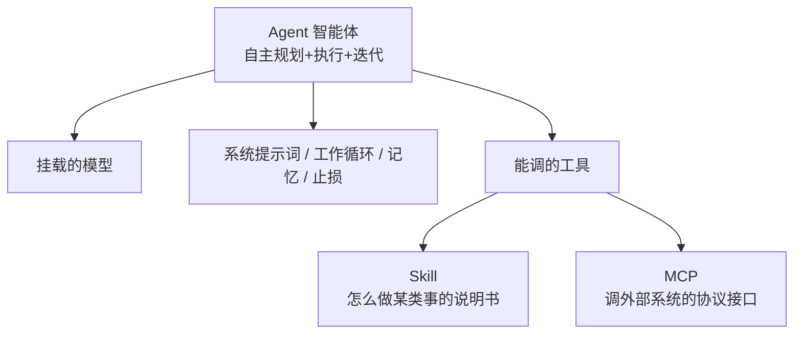
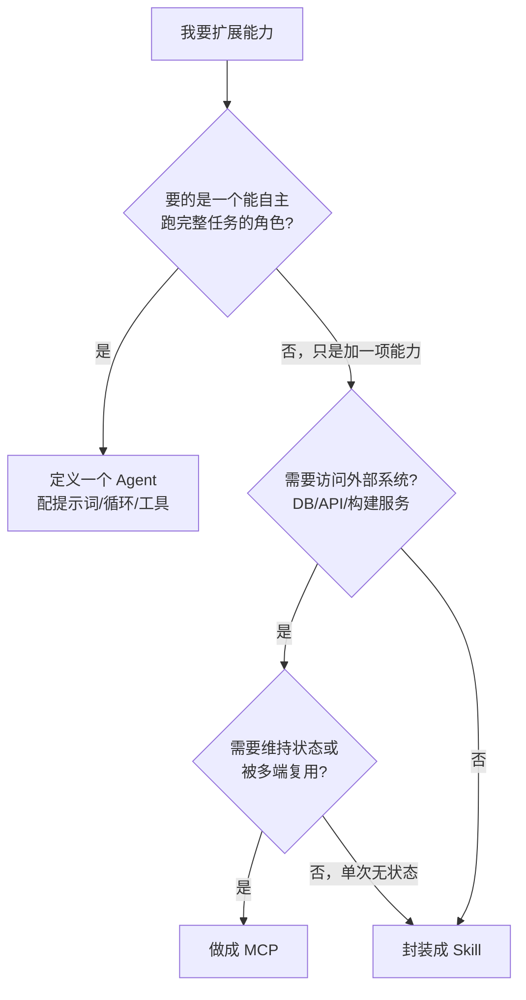
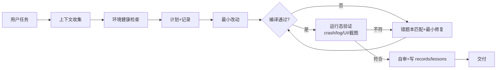

<callout emoji="💡">
**一句话区分：Agent** 是下场干完整件事的人；**Skill** 是教他某类活怎么干的招式说明书；**MCP** 是接去外部系统的工具箱协议。三者是包含关系，不在同一层级竞争。
</callout>

# 先把三个常见误解拆掉

| 常见误解 | 实际情况 |
|-|-|
| Skill 就是写份接口文档 | 入口虽然是 `SKILL.md`，但它包含完整操作流、脚本和规范，是给模型看的工作手册 |
| MCP 就是普通 RPC 接口 | 定位接近为大模型设计的 gRPC，底层走 JSON-RPC 2.0 协议，提供 Tools、Resources、Prompts 三种能力 |
| 三者平级，选一个用就行 | 上下包含关系：最外层是 Agent，里面按需要挂载多个 Skill 和多个 MCP |

---

# 三者在系统里的层次位置

Agent 在最外层充当执行宿主，Skill 和 MCP 分别提供标准工作法和外部连接能力：

---

# 一表分清三者差异

| 维度 | Agent | Skill | MCP |
|-|-|-|-|
| **角色定位** | 会自主跑任务的容器（比如人） | 写给模型读的工作流说明（招式） | 对接外部系统的标准协议（工具箱） |
| **所处层级** | 最外层，包着后两者 | 挂在 Agent 下面 | 挂在 Agent 下面 |
| **谁在执行** | 自己做规划并驱动循环 | 模型读完说明书按步做 | 独立的常驻 Server 进程 |
| **状态管理** | 有，维护记忆、断点和进度 | 无，按需临时加载 | 有，维护外部连接和缓存 |
| **具体载体** | 提示词 + 工具集 + 循环配置 | `SKILL.md` 与辅助脚本文件夹 | 常驻服务进程（基于 JSON-RPC 2.0） |
| **解决什么问题** | 由谁扛下完整任务 | 某类常见活该怎么步步做 | 怎么安全打通外部工具和数据 |

---

# 怎么选：三条判断路径

<callout emoji="✅">
**选型口诀：**要完整跑任务的角色配 Agent；要补充可复用步骤加 Skill；要连外部系统和常驻服务接 MCP。
</callout>

---

# 拿「iOS 自闭环开发流水线」拆着看

看一个实际落地的多层工程方案，三样东西正好各自落在对应位置上。

## 整体是个 Agent

整条流水线的骨架就是一个自主循环的 Agent：拿到目标后，自己按顺序做上下文收集、健康检查、出计划、改代码、编译测试、运行态取证、自检沉淀并交付；中间失败还会做错误分类、查错题本、设重试上限止损。加上 `logs`、`records`、`lessons` 持久记忆和看板，这是典型的 Agent 容器能力。

## 适合抽成 Skill 的部分

方案第 7.2 节的独立技能模块模式，专门把跨项目通用的标准动作拆出来：

| 抽成 Skill 的能力 | 解决的问题 |
|-|-|
| `config_wizard` | 自动定位工程、列出 scheme 与可用设备、提取 bundle id |
| `doctor` | 开跑前一次查出本地环境缺什么工具或配置 |
| `runtime_smoke` | 通用的启动、crash 检查、UI 树采集与截图流程 |
| `dashboard` | 跨项目汇总当前执行状态 |

这几类都是无状态的标准操作流，按需唤醒即可，写成 `SKILL.md` 加配套脚本最轻便。

## 适合做成 MCP 的部分

方案里的 **build helper / XcodeBuildMCP** 最适合落成 MCP：

<grid>
<column width-ratio="0.500000">
<callout emoji="📝">
**为什么走 MCP**  
iOS 编译要接 Xcode 与复杂构建服务，需要维持环境状态并跨项目复用，这些正是外部常驻服务接口擅长的事。
</callout>
</column>
<column width-ratio="0.500000">
<callout emoji="📝">
**为什么不写成 Skill**  
编译不是教模型怎么写命令，让模型直接裸跑 `xcodebuild` 既容易卡死又难收运行态日志，必须交给专门的守护服务兜底。
</callout>
</column>
</grid>

<callout emoji="📌">
**串起来一句话：**整条流水线是 **Agent**（闭环控制人），挂上若干 **Skill**（`config_wizard`、`doctor`、`runtime_smoke` 等标准招式），再通过 **MCP**（`XcodeBuildMCP`）去驱动外部编译和运行服务。日常在 TRAE 里配智能体时，按这个分层去拆最清楚。
</callout>
