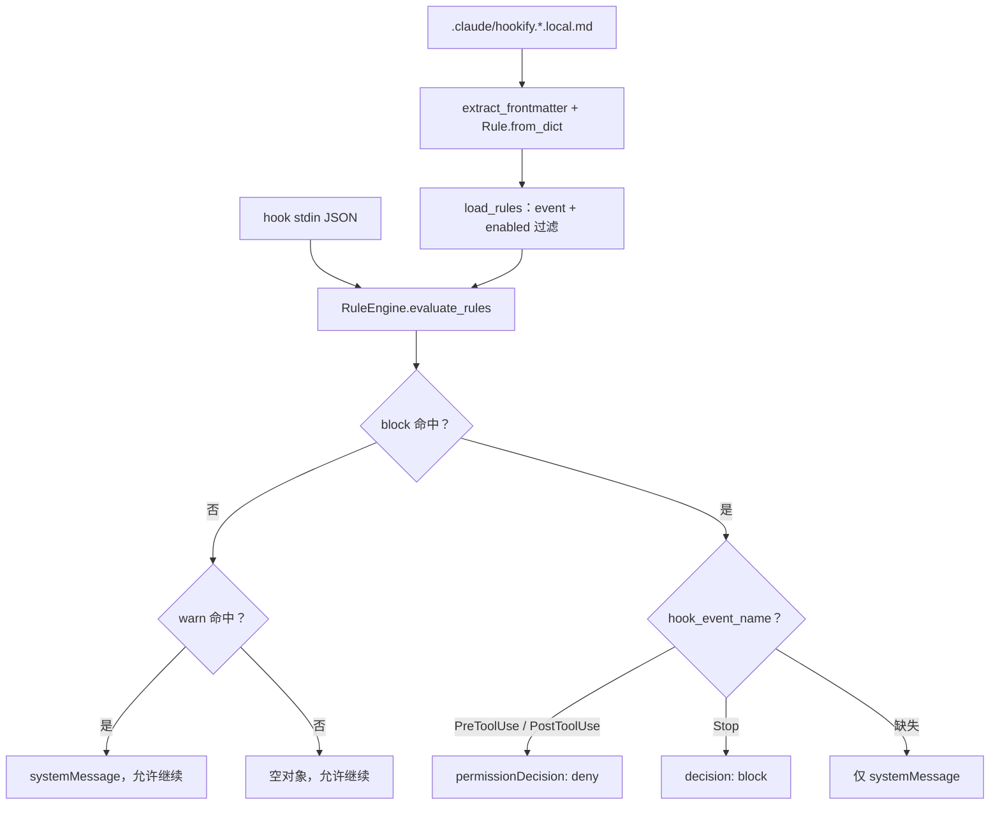
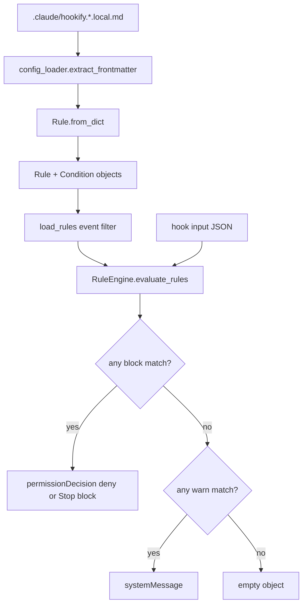
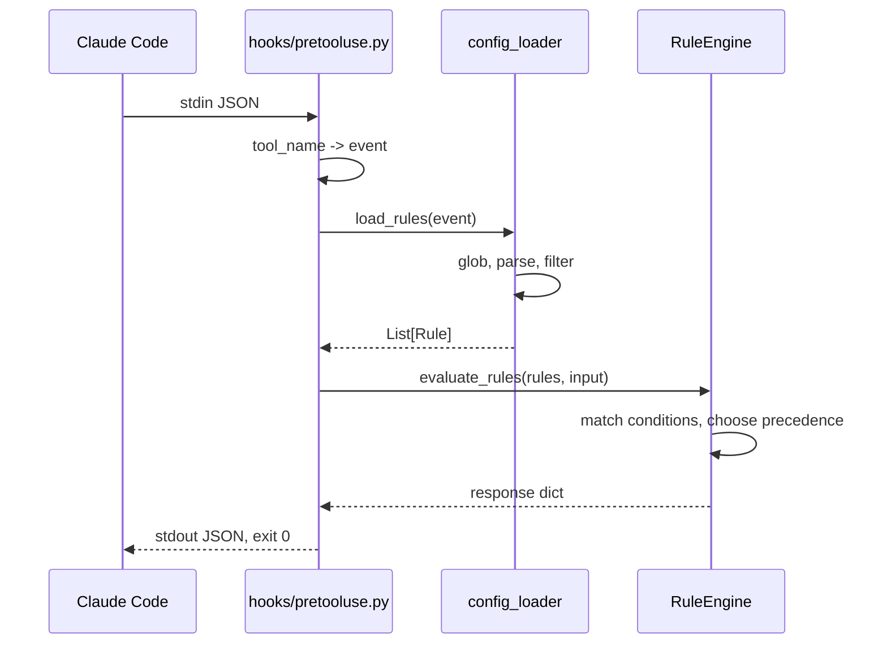

<callout emoji="✅">
**结论：**只装一个选 **code-tour**；系统学习选 **codebase-study-guide**；带新人或逼自己主动思考选 **mentoring-juniors**。这几个 Skill 的主要价值是改变阅读路径和学习闭环，不是替代模型对代码本身的理解。
</callout>

# 研究问题

这篇调研回答两个问题：这些代码阅读 Skill 现在各自是什么定位；把同一个代码库交给它们之后，给人类读者的输出到底差在哪里。

读者对象是正在挑选代码阅读工具、准备做团队 onboarding 或想沉淀代码导读材料的工程师，重点是看清什么任务该配哪种产物，不给 Skill 排绝对名次。

# 对比对象

| Skill | 主要产物 | 最适合的任务 | 当前生态信号 |
|-|-|-|-|
| [code-tour](https://skills.sh/affaan-m/ecc/code-tour) | CodeTour .tour JSON | 模块导读、onboarding、PR 导读、架构走读 | 约 6K 安装，来源仓库 303.9K stars，安全审计通过 |
| [codebase-study-guide](https://skills.sh/petekp/agent-skills/codebase-study-guide) | Markdown 学习手册 | 系统学习陌生代码库、团队培训材料 | 约 229 安装，来源仓库 10 stars，安全审计通过 |
| [mentoring-juniors](https://skills.sh/github/awesome-copilot/mentoring-juniors) | 苏格拉底式对话 | 新人带教、学习模式、强制主动推理 | 约 7K 安装，来源仓库 41.2K stars，安全审计通过 |
| [understand](https://skills.sh/egonex-ai/understand-anything/understand) | 知识图谱和交互式 dashboard | 大型代码库的架构与关系探索 | 约 6K 安装，来源仓库 92.7K stars，有一项安全审计 warning |

smart-explore 这类高安装量 Skill 没有放进主对比。它主要用 AST 帮 Agent 做结构化搜索、节省 token，服务对象是 Agent，不是人类读者的阅读体验。

# 一张图看差异

下面三张图分别回答三个问题：同一段代码会变成什么产物；代码在 Hookify 里实际怎样流动；不同 Skill 在阅读路径和学习留存上的位置。

## 四类 Skill 的产物分流


## Hookify 的实际调用链



## 阅读路径强度与学习留存

横轴看“第一次打开时有多容易知道下一步看哪里”，纵轴看“过几天还能不能复述和迁移”。位置越靠右上，越适合既快速定位又长期学习。


# 实验设计

实验对象选的是真实代码：claude-code 仓库里的 hookify 子系统。它不大，但包含规则文件解析、事件路由、条件匹配、block 和 warn 响应、错误隔离，足够区分“只会复述文件”和“真的读懂了调用链”。

固定任务：帮一位有经验但第一次接触 Hookify 的后端工程师读懂这个子系统，重点说明它解决什么问题、入口和调用链、规则如何从 Markdown 变成匹配条件、block 和 warn 如何生效，以及最容易误解的边界。输出给人类阅读，不修改源码。

本次跑了四组输出：无 Skill 基线、code-tour、codebase-study-guide、mentoring-juniors。四组使用同一份代码副本、同一个模型和同一个任务。输出是按各 Skill 公开的 SKILL.md 指令执行的结果，没有把 Skill 全局安装后再交给独立 Agent 自动运行，这样能比较产物形态，同时避免安装副作用。

codebase-study-guide 原本会先问读者类型和深度。本次实验预先固定为“有经验、第一次接触该子系统、只读该子系统”，所以没有把交互提问算进输出成本。understand 因为需要知识图谱、dashboard 和额外运行依赖，本轮没有做同一形态的文本对比。

为了让“讲得对不对”有共同尺子，我先用可执行脚本验证了 Hookify 的关键行为。测试覆盖 block、warn、条件 AND、Edit 和 Write 字段差异、缺少 hook_event_name 等场景，6 个行为刻画测试全部通过。

# 同一份代码的实测结果

## 无 Skill 基线：最快，但阅读过程要自己组织

基线输出是一篇 43 行的直接说明，覆盖了“规则文件 → 配置加载 → 规则引擎 → 响应”的主链路，也指出了 Write 字段缺口和 hook_event_name 依赖。它适合快速问答，缺点是阅读顺序靠读者自己整理，没有可点击锚点，也没有预测、练习和自测。

## code-tour：最像人类代码导览

code-tour 产出 11 步的 .tour 文件，从 README 的产品承诺开始，依次经过 hooks.json 的事件注册、pretooluse.py 的事件路由、config_loader.py 的 Rule 数据模型、frontmatter 解析、规则加载、rule_engine.py 的匹配与响应，最后落到 dangerous-rm 样例。每一步都有真实文件和行号，11 个锚点全部通过存在性校验。

它的优势是“下一步看哪里”非常明确。你不需要先读完整棵树，也不会在 config_loader 和 rule_engine 之间来回跳。它还把两个关键边界单独做成步骤：block 是响应协议，不是异常；旧式 file pattern 在 Write 上存在字段缺口。

它的限制也明确：需要 VS Code 和 CodeTour 扩展，本质上是“带路”，不是“教学”。如果你要的是读完能自己复述、能做题、能迁移，它不如学习手册。

## codebase-study-guide：最像一门小课

学习手册先讲 Hookify 要解决的真实问题，再给出三个关键概念：规则是数据、事件路由和规则匹配是两层、block 是响应协议。之后用系统图和时序图建立结构，再逐模块导读，最后用 dangerous-rm 走完整条链路。

它最强的地方是学习闭环。读者要先预测、再运行、再调查、最后修改；每个阶段都有具体文件和行为目标。它还把“README 说 file 覆盖 Write，但旧式 pattern 在 Write 上不命中”做成一个独立边界，并提醒补 Write 回归测试。

代价是 138 行、约 4.7K 字符，明显比基线长。它适合 onboarding 或专门的学习时段，不适合“我现在只想快速知道这个模块怎么走”。

## mentoring-juniors：最像有人在旁边带你想

它的第一轮输出没有给完整答案，而是把读者带到入口：先看 pretooluse.py 的 main()，回答输入从哪里来、事件怎样选择；再看 Rule.from_dict()，预测旧式 pattern 会变成什么条件；最后看 evaluate_rules()，判断 block 与 warn 的优先级，以及缺少 hook_event_name 时会发生什么。

它的优势是主动学习最强。读者要自己在代码里找证据，不能只接收一张地图。缺点是它不会在一轮里交付完整文档，如果你只想拿一份材料转发给同事，它反而会增加沟通轮次。

# 关键行为核查

| 场景 | 实际结果 | 对阅读的启示 |
|-|-|-|
| block 规则命中 PreToolUse | 返回 permissionDecision: deny 和 systemMessage | 规则命中后还要经过响应协议 |
| warn 规则命中 Edit | 只返回 systemMessage | warn 不会阻止操作 |
| 旧式 file pattern 命中 Edit | 正常命中 | new_text 能从 new_string 取到值 |
| 旧式 file pattern 命中 Write | 返回空对象 | Write 提供的是 content，存在字段契约缺口 |
| 多条件规则只满足路径 | 返回空对象 | 条件之间是 AND，不是 OR |
| block 规则缺少 hook_event_name | 只有 systemMessage | block 协议依赖事件字段，不能只看 action |

这些结果说明，一个真正好的代码阅读输出不能只写“Hookify 会拦截危险命令”。它还要讲清什么条件下拦截才会真正生效，以及文档承诺和实现字段之间哪里可能对不上。

# 评分

| 输出 | 首次定位 | 代码锚点 | 机制解释 | 学习留存 | 主动学习 | 一次性交付 |
|-|-|-|-|-|-|-|
| 无 Skill 基线 | 3 | 2 | 4 | 2 | 1 | 5 |
| code-tour | 5 | 5 | 4 | 3 | 2 | 5 |
| codebase-study-guide | 4 | 4 | 5 | 5 | 5 | 5 |
| mentoring-juniors | 3 | 3 | 3 | 4 | 5 | 1 |

这组分数不是统计结论，只是同一任务下的定性对照。总分不适合跨产物类型直接排名，尤其不能因为 mentoring-juniors 没有一次性交付完整文档，就判断它效果差；它的目标本来就是带教过程。

# 选型建议

| 你的目标 | 建议 |
|-|-|
| 10 分钟内读懂一个模块或 PR | code-tour |
| 花一小时系统学习一个子系统 | codebase-study-guide |
| 带新人，或者逼自己主动思考 | mentoring-juniors |
| 看大型代码库的整体架构和关系 | understand，但要接受 dashboard 依赖和安全审计 warning |
| 只是临时问一段代码怎么工作 | 直接用基线式问答，不必上 Skill |

一个实用的组合是：先用 code-tour 建立阅读路线，再用 codebase-study-guide 补概念、边界和练习。前者解决“从哪里开始”，后者解决“为什么这样设计、以后怎么迁移”。

# 局限与复现

这次实验是单模型、单代码库、单轮输出的结构化对照，不是多人盲测，也没有统计显著性。Skill 的公开说明页、安装量和安全审计只能说明生态信号，不能替代真实团队里的长期使用效果。

understand 没有完成同形态端到端实测，原因是它的产物是知识图谱和 dashboard，运行条件与前三者不同。原始实验还包含 baseline.md、hookify.tour、codebase-study-guide.md、mentoring-juniors.md、行为测试脚本和评分口径，本次飞书文档保留核心结论、关键证据和对比表。

# 参考链接

- [code-tour](https://skills.sh/affaan-m/ecc/code-tour)
- [codebase-study-guide](https://skills.sh/petekp/agent-skills/codebase-study-guide)
- [mentoring-juniors](https://skills.sh/github/awesome-copilot/mentoring-juniors)
- [understand](https://skills.sh/egonex-ai/understand-anything/understand)

# 原始输出对照

四份完整输出已单独成文：[代码阅读 Skill 原始输出对照](#完整原始输出)。

该文档原文保留同一段 Hookify 代码在四组任务下的最终产物：无 Skill 基线、CodeTour 导览、代码库学习手册、苏格拉底带教首轮。没有只放评分或摘要。

# 完整原始输出

<callout emoji="📄">
同一段代码、同一个任务下四份最终产物的原文。为了保留真实效果，正文未改写，统一放进代码块；CodeTour 输出是可直接使用的 .tour JSON，其余三份是 Markdown。
</callout>

输入代码：claude-code 仓库中的 hookify 子系统，包含 hooks、config_loader、rule_engine、examples 四个部分。

# 输出一：无 Skill 基线

```markdown
# Hookify 子系统导读

## 它解决什么问题

Hookify 让用户用 Markdown 文件定义 hook 规则，而不必直接修改 `hooks.json`。规则文件放在项目的 `.claude/hookify.*.local.md`，文件头部的 YAML frontmatter 描述事件、匹配条件和动作，正文是命中后显示给用户的提示。

## 主要组成

- `hooks/hooks.json`：向 Claude Code 注册 `PreToolUse`、`PostToolUse`、`Stop`、`UserPromptSubmit` 四个事件。
- `hooks/*.py`：四个事件适配器，负责读取 stdin、选择事件类型、调用规则加载器和规则引擎、输出 JSON。
- `core/config_loader.py`：把 Markdown 规则解析成 `Rule` 和 `Condition` 对象。
- `core/rule_engine.py`：遍历规则，判断是否匹配，并组合成 warn 或 block 响应。
- `examples/*.local.md`：可直接参考的规则样例。

## 调用链

以一次 Bash 工具调用为例：

1. Claude Code 触发 `PreToolUse`，执行 `hooks/pretooluse.py`。
2. 脚本从 stdin 读取 JSON，根据 `tool_name` 把事件映射成 `bash`、`file`，无法识别的工具则保持 `None`。
3. `load_rules(event=...)` 扫描当前目录的 `.claude/hookify.*.local.md`。
4. `load_rule_file()` 调用 `extract_frontmatter()`，再用 `Rule.from_dict()` 构造规则对象。
5. `RuleEngine.evaluate_rules()` 逐条检查规则。规则先看可选的 `tool_matcher`，再要求所有 `conditions` 都匹配。
6. 命中的 block 规则优先于 warn 规则。block 响应根据 `hook_event_name` 生成 `permissionDecision: deny` 或 Stop 的 `decision: block`；warn 只返回 `systemMessage`。
7. 没有规则命中时返回 `{}`。脚本无论成功还是异常都退出 0，避免 hook 本身阻断操作。

## 规则匹配要点

- 条件之间是 AND 关系，所有条件都匹配才算命中。
- `regex_match` 使用 Python 正则，编译结果有 128 条 LRU 缓存，并且不区分大小写。
- 旧式 `pattern` 会按 `event` 推导字段：`bash` 用 `command`，`file` 用 `new_text`，其他事件用 `content`。
- 文件字段的提取按工具类型区分：Edit 使用 `new_string`，Write 使用 `content`，MultiEdit 会拼接多个 `new_string`。
- `enabled: false` 的规则不会被加载。

## 容易踩的边界

`file` 事件的旧式 `pattern` 规则被转换成 `new_text` 条件。Edit 工具提供 `new_string`，可以命中；Write 工具提供 `content`，不会提供 `new_string`，所以这类规则在 Write 上不会命中。这是 README 声称 `file` 覆盖 Edit、Write、MultiEdit 时容易忽略的实现差异。

另一个边界是 block 响应依赖输入里的 `hook_event_name`。如果调用方没有传这个字段，规则仍然会匹配，但只会返回 `systemMessage`，不会生成 `permissionDecision: deny`。

## 建议阅读顺序

先读 `README.md` 的规则格式和事件类型，再读 `hooks/pretooluse.py` 看入口，随后读 `core/config_loader.py` 的 `Rule`、`extract_frontmatter()`、`load_rules()`，最后读 `core/rule_engine.py` 的 `evaluate_rules()` 和 `_check_condition()`。读完后用一个 `rm -rf` 样例和一个 `console.log` 样例分别走一遍 block 与 warn 分支。

```

# 输出二：code-tour

```json
{
  "$schema": "https://raw.githubusercontent.com/microsoft/codetour/main/schema/tour.schema.json",
  "title": "Hookify: from Markdown rule to hook decision",
  "description": "A guided read for an experienced engineer who is new to the Hookify subsystem. Follow the path from the user-facing rule format to the event adapter, configuration loader, matcher, and final JSON response.",
  "ref": "main",
  "steps": [
    {
      "file": "plugins/hookify/README.md",
      "line": 7,
      "title": "Start with the promise",
      "description": "Hookify's product promise is simple: a user edits a Markdown rule instead of editing hooks.json. Keep this promise in mind, because every layer below exists to turn that Markdown into a decision at tool-call time."
    },
    {
      "file": "plugins/hookify/hooks/hooks.json",
      "line": 4,
      "title": "Four event entry points",
      "description": "The plugin registers PreToolUse, PostToolUse, Stop, and UserPromptSubmit. The next question is how each entry point selects the right rules for the current event."
    },
    {
      "file": "plugins/hookify/hooks/pretooluse.py",
      "line": 35,
      "title": "The adapter reads stdin and chooses an event",
      "description": "For PreToolUse, the adapter reads the hook payload, maps Bash to bash and Edit/Write/MultiEdit to file, then calls load_rules(event=...). This is the routing layer, not the matching layer."
    },
    {
      "file": "plugins/hookify/core/config_loader.py",
      "line": 32,
      "title": "A rule is data before it is behavior",
      "description": "Rule is the central data model: name, enabled, event, conditions, action, optional tool_matcher, and message. Condition is deliberately small: field, operator, pattern. Once you see this shape, the parser and engine become much easier to read."
    },
    {
      "file": "plugins/hookify/core/config_loader.py",
      "line": 87,
      "title": "Frontmatter becomes a Rule",
      "description": "extract_frontmatter() is a small, purpose-built YAML parser rather than a general YAML dependency. It preserves indented list items so a conditions list can become a list of dictionaries. Then Rule.from_dict() normalizes both the new conditions syntax and the legacy pattern syntax."
    },
    {
      "file": "plugins/hookify/core/config_loader.py",
      "line": 198,
      "title": "Loading is filtering plus error isolation",
      "description": "load_rules() globs .claude/hookify.*.local.md, filters by event, and only keeps enabled rules. Each file is parsed in its own try/except, so one malformed rule does not take down the whole hook."
    },
    {
      "file": "plugins/hookify/core/rule_engine.py",
      "line": 35,
      "title": "Evaluation separates matching from response building",
      "description": "evaluate_rules() first partitions matches into blocking and warning lists, then builds the response. This is why a matching block rule wins even if warning rules also match. The method is a small decision pipeline: collect matches, choose precedence, serialize the protocol."
    },
    {
      "file": "plugins/hookify/core/rule_engine.py",
      "line": 120,
      "title": "Conditions are an AND gate",
      "description": "Every condition must pass. A missing field returns None, which makes the condition false. That choice is important for rules such as sensitive-file checks: a path match alone is not enough if the content condition cannot be evaluated."
    },
    {
      "file": "plugins/hookify/core/rule_engine.py",
      "line": 61,
      "title": "Block is a response protocol, not an exception",
      "description": "A block rule does not throw. It returns either a Stop decision or a PreToolUse/PostToolUse permissionDecision of deny, depending on hook_event_name. If that field is absent, the same match falls back to a systemMessage. This is the most important boundary to verify when changing the hook contract."
    },
    {
      "file": "plugins/hookify/core/config_loader.py",
      "line": 56,
      "title": "Watch the legacy file-pattern gap",
      "description": "The legacy pattern path infers new_text for file events. Edit supplies new_string, but Write supplies content. As a result, a legacy file rule can match Edit and still miss Write even though the README lists both. Treat this as a concrete reading checkpoint, not a cosmetic detail."
    },
    {
      "file": "plugins/hookify/examples/dangerous-rm.local.md",
      "line": 1,
      "title": "Close the loop with a real rule",
      "description": "Now read the dangerous-rm example as an end-to-end contract: frontmatter names the event and action, the body supplies the user-facing message, and the engine turns a matching Bash command into a deny response. You can now trace any rule from Markdown to decision."
    }
  ]
}

```

# 输出三：codebase-study-guide

````markdown
# Hookify 代码库学习手册

## 读者与范围

这份手册面向已经熟悉 Python 和 CLI 工具、但第一次接触 Hookify 的工程师。范围限定在 `plugins/hookify`，目标是让你读完后能够独立回答三个问题：一条 Markdown 规则怎样变成可执行的判断，判断结果怎样变成 Claude Code 能理解的响应，以及哪些边界最容易在修改时被忽略。

## 先建立问题感

如果没有 Hookify，用户想让 Claude Code 在运行危险命令前停下来，通常要直接改 `hooks.json`，还要写一个能读取 stdin、解析 JSON、输出协议字段的脚本。这个门槛很高，而且每加一条规则都要碰底层配置。

Hookify 把这件事拆成两层：用户只写一条 Markdown 规则，插件负责把规则加载成数据，再在每次工具调用时做匹配和响应。理解这个分层，比记住某个函数名更重要。

## 三个关键概念

### 规则是数据，不是代码

`Rule` 和 `Condition` 是这条系统的中心。一个规则文件被解析后，先变成一个 `Rule` 对象；规则里的每个匹配条件变成一个 `Condition`。后面的引擎只面对这些对象，不需要知道 Markdown 长什么样。这就是典型的“数据驱动规则”模式。

### 事件路由和规则匹配是两层

`hooks/pretooluse.py` 先根据 `tool_name` 选择 `bash` 或 `file` 事件，然后调用 `load_rules(event=...)`。规则引擎本身不负责判断“这是 Bash 还是 Edit”，它只负责拿已经加载的规则去匹配输入。把这两层混在一起，就会在排查“为什么规则没生效”时找错地方。

### block 是一种响应协议

`action: block` 不是抛异常，也不是直接终止进程。它根据 `hook_event_name` 返回不同的 JSON：Stop 事件返回 `decision: block`，PreToolUse/PostToolUse 返回 `permissionDecision: deny`。如果输入里没有这个字段，匹配仍然会发生，但只会返回 `systemMessage`，不会真正阻止操作。

## 系统地图



图中最值得记住的是两条输入：一条来自磁盘上的规则文件，一条来自运行时 stdin。它们在 `RuleEngine.evaluate_rules()` 汇合，之后才产生响应。

## 一次调用怎么走



注意最后一步：适配器无论成功还是异常都退出 0。这不是“错误被吞掉”，而是 Hookify 的故障隔离选择：hook 自己出错时，优先让原操作继续，避免因为规则引擎坏了导致整个工具链不可用。

## 模块导读

### 事件适配器

先读 `hooks/pretooluse.py` 的 `main()`。它做四件事：读 stdin、判断事件、加载规则、调用引擎。`posttooluse.py` 几乎相同，`stop.py` 和 `userpromptsubmit.py` 直接固定事件类型。四个文件看起来重复，但这是有意的适配层：每个入口只关心自己的事件契约，核心逻辑留在两个 core 模块里。

### 配置加载器

`core/config_loader.py` 负责把文本变成对象。阅读顺序建议是：

1. `Condition` 和 `Rule` 两个 dataclass，先看数据形状。
2. `Rule.from_dict()`，看新式 `conditions` 和旧式 `pattern` 怎样统一成条件列表。
3. `extract_frontmatter()`，看项目为什么不引入通用 YAML 库，以及它支持到什么程度。
4. `load_rules()` 和 `load_rule_file()`，看事件过滤、启用开关和单文件错误隔离。

这个模块的一个设计取舍是“自己写一个很小的 YAML 子集解析器”。好处是没有第三方依赖，坏处是它只覆盖当前规则格式，遇到复杂 YAML 结构时不能假设行为与标准 YAML 一致。

### 规则引擎

`core/rule_engine.py` 的核心是 `evaluate_rules()`。它先遍历规则，把命中项分成 blocking 和 warning 两组，然后按优先级生成响应。`_rule_matches()` 先看可选的 `tool_matcher`，再要求所有条件通过。`_extract_field()` 负责把不同工具的字段名统一成规则能理解的值，例如 Edit 的 `new_string`、Write 的 `content`、MultiEdit 的 `edits`。

## 用一个例子走完

以 `examples/dangerous-rm.local.md` 为例：

```yaml
name: block-dangerous-rm
enabled: true
event: bash
pattern: rm\s+-rf
action: block
```

解析后，`Rule.from_dict()` 会把旧式 `pattern` 转成一个 `Condition(field="command", operator="regex_match", pattern=r"rm\s+-rf")`。当输入是 `Bash` 且命令为 `rm -rf /tmp/test` 时，`_extract_field()` 返回命令字符串，`_regex_match()` 命中，规则进入 blocking 列表。若 `hook_event_name` 是 `PreToolUse`，最终响应包含 `permissionDecision: deny`。

如果同一个输入只命中一条 `action: warn` 规则，响应只有 `systemMessage`，操作继续执行。这个差异是理解 Hookify 的关键：规则匹配和动作执行是两个阶段。

## 一个容易被文档掩盖的边界

README 说 `file` 事件覆盖 Edit、Write、MultiEdit。但旧式 `pattern` 规则在 `Rule.from_dict()` 里会被推导成 `new_text` 条件，而 `_extract_field()` 对 Write 的 `new_text` 只读取 `new_string`，Write 实际提供的是 `content`。因此同一个 `event: file` 的旧式规则可以命中 Edit，却不会命中 Write。

这不是语法问题，而是字段契约问题。读代码时要特别区分“事件名称覆盖了哪些工具”和“条件字段实际能从哪些工具提取到值”。如果你要修改文件规则，优先检查这个边界，并补一条 Write 场景的回归测试。

## 主动练习

### 预测

在运行代码前先回答：如果一条规则没有 `conditions`，只有 `pattern` 和 `event: bash`，它会被转成什么条件？如果一条规则同时命中 block 和 warn，最终响应会是什么？

### 运行

用 `PYTHONPATH=plugins` 导入 `hookify.core.rule_engine`，构造一个 `Bash` 输入和一个 `Edit` 输入，分别打印 `evaluate_rules()` 的结果。观察 block 与 warn 返回结构的差异。

### 调查

打开 `core/config_loader.py` 的 `extract_frontmatter()`，找出它支持哪些 YAML 结构、哪些结构没有处理。再打开 `core/rule_engine.py` 的 `_extract_field()`，列出每种工具实际提供哪些字段。

### 修改

尝试写一条只对 `Write` 生效的 `console.log` 规则。先用新式 `conditions` 写，再用旧式 `pattern` 写，比较两者行为。这个练习会直接暴露“规则写法”和“工具字段”之间的耦合。

## 自测问题

- 为什么 `load_rules(event=...)` 要在解析规则之后再做事件过滤？
- 为什么一个规则文件解析失败不会阻止其他规则加载？
- 为什么 hook 脚本在异常时仍然退出 0？
- 什么情况下 block 规则只会返回提示，而不会真正阻止操作？
- 旧式 `pattern` 在 Write 上为什么可能失效？

## 读完以后

你现在应该能从一条 `.local.md` 规则出发，沿着 `hooks -> config_loader -> rule_engine` 走到最终 JSON。下一步可以选一个真实规则，分别构造命中、未命中和字段缺失三种输入，验证自己对边界条件的理解。这个子系统目前没有独立测试目录，只有两个模块底部的 `__main__` 示例，因此补测试本身就是很好的下一步练习。

````

# 输出四：mentoring-juniors

```markdown
# 先用问题把 Hookify 的地图搭起来

我们先不急着看完整实现。你可以把 Hookify 想成一个邮局：规则文件是投递说明，工具调用是当天到达的包裹，hook 脚本负责决定这个包裹该走普通通道、警告通道，还是直接被拦下。现在先判断三件事，你就能知道该从哪里开始读。

## 第一轮：先找入口

打开 `plugins/hookify/hooks/pretooluse.py`，只看 `main()`。先回答我：

1. 这个脚本从哪里拿到本次工具调用的信息？
2. 它怎样判断当前是 `bash` 还是 `file` 事件？
3. 如果 `tool_name` 既不是 `Bash`，也不是 `Edit/Write/MultiEdit`，`event` 会是什么？你觉得后面的规则加载会因此发生什么变化？

先不要看 `RuleEngine`。你只要把“输入从哪里来、事件在哪里被选择”说清楚，就已经找到入口了。

## 第二轮：猜规则怎样变成条件

打开 `plugins/hookify/core/config_loader.py`，找到 `Rule.from_dict()`。在继续往下读之前，先写下你的预测：

一条规则只有 `event: bash` 和 `pattern: rm\s+-rf`，没有 `conditions`。你认为它最后会变成哪个字段上的条件？为什么？

然后再看 `_extract_field()`。这里有一个值得你停下来的地方：Edit 和 Write 都算 `file` 事件，但它们提供的新文本字段名并不一样。你能从代码里找出这个差异吗？如果一条旧式 `pattern` 规则在 Edit 上能命中，在 Write 上却不一定能命中，你觉得问题更可能出在规则解析，还是字段提取？

## 第三轮：追踪一次 block

现在回到 `core/rule_engine.py`，找到 `evaluate_rules()`。先只看它怎样把命中规则分成 blocking 和 warning 两组，不要急着看所有条件判断。回答我：

1. 如果一条 block 规则和一条 warn 规则同时命中，哪一个优先？
2. `action: block` 是通过抛异常实现的吗？
3. 如果输入里没有 `hook_event_name`，一条 block 规则还会真正阻止操作吗？你依据哪一行代码判断？

这三个问题会把你带到 Hookify 最关键的分界：**规则命中不等于动作生效**。你可以先猜，再去代码里找证据。

## 第一轮作业

这一轮只做两件事：

- 用 `pretooluse.py` 的 `main()` 画出“stdin -> event -> load_rules -> evaluate_rules -> stdout”的五步流程。
- 用 `Rule.from_dict()` 和 `_extract_field()` 解释：为什么同一个 `event: file` 的旧式规则，在 Edit 和 Write 上可能有不同结果。

写完把你的判断发给我。我们先对照代码验证你的推理，再决定下一轮是读 `extract_frontmatter()` 的解析边界，还是读 `load_rules()` 的错误隔离。这样你会自己搭出地图，而不是背一份别人给你的摘要。

```
