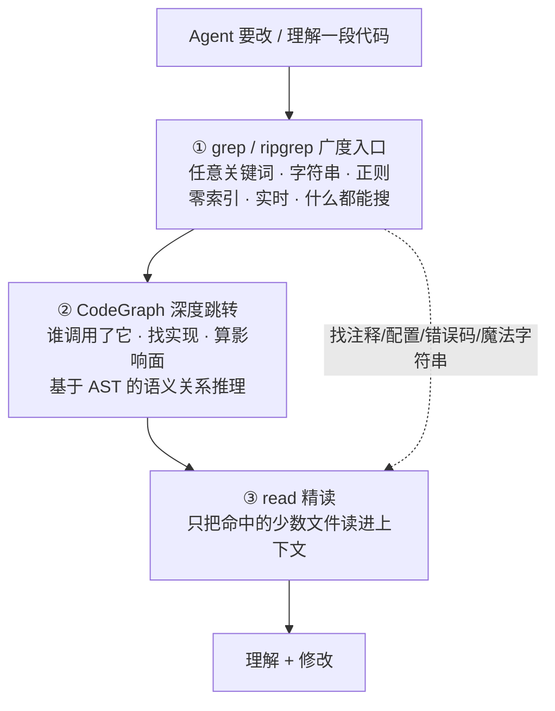

<callout emoji="💡">
**一句话看懂：**CodeGraph 先用 tree-sitter 加 SQLite FTS5 给代码库建好结构图谱，再通过 MCP Server 喂给编码 Agent。重点是把它放在 `grep` 后面做关系跳转，用更少的探索步数定位改动面。
</callout>

# 项目基本情况

开源作者为 **colbymchenry**，仓库地址：[github.com/colbymchenry/codegraph](https://github.com/colbymchenry/codegraph)。

| 项目属性 | 说明 |
|-|-|
| 核心技术栈 | tree-sitter 语法解析 + SQLite FTS5 全文搜索 + MCP Server |
| 协议与语言 | MIT 协议，TypeScript / JavaScript 实现（Node.js 环境） |
| 适配客户端 | Claude Code、Cursor、Windsurf、Cline 等支持 MCP 的工具 |

普通 Agent 进大仓库干活，往往反复执行 `grep`、`find` 和整文件读取，既费 token 又拖慢速度。CodeGraph 的补位思路分三步：

1. **预索引：**先用 tree-sitter 扫一遍代码库，抽出函数、类、方法和模块的定义及引用
2. **建关系图：**把符号之间的调用、依赖和继承关系落进 SQLite
3. **MCP 暴露：**通过 MCP 接口让 Agent 直接按结构查，减少大范围盲搜

---

# CodeGraph 和 grep 是分层配合，谁也替不了谁

CodeGraph 靠语法解析建了索引，适合按结构关系跳转；但有覆盖盲区，也要求提前建好索引。`grep` 虽然笨，胜在零依赖、永远实时、全仓什么文本都搜得到。

实际用起来是一个「广度入口 → 深度跳转 → 精读源码」的三步漏斗：



拿实际改函数来说：AI 想动 `parseConfig`，先用 `grep` 扫出定义位置和相关配置字段，再用 CodeGraph 查谁调了它、改完会影响哪些测试，最后只精读那几个关联文件。`grep` 负责找位置，CodeGraph 负责理关系。

## 两者的能力边界

| 检索场景 | CodeGraph | grep |
|-|-|-|
| 精确符号的调用关系 | 强项 | 分不清重名 |
| 子类与协议实现定位 | 强项 | 弱 |
| 改动影响面分析 | 强项 | 弱 |
| 注释、TODO 与字符串常量 | 通常不入图 | 直接命中 |
| 配置、YAML、SQL 与日志错误码 | 无解析器就漏 | 全仓可搜 |
| 带语法报错的半成品代码 | 解析失败不建图 | 照常能搜 |
| 刚改完尚未重刷索引的代码 | 可能滞后 | 始终实时 |

<callout emoji="📌">
Sourcegraph 和 GitHub 的代码导航也是「结构图谱负责跳转 + 全文搜索兜底」双轨并行。加上 CodeGraph 后，`grep` 和 `find` 的调用会明显变少，但依然没法拿掉。
</callout>

---

# 公开基准数字参考

以下为原仓库 README 引用的 SWE-bench Verified 子集对比数据（建议实际选型前在自家项目再做一次对照）：

| 指标 | 变化幅度 | 口径说明 |
|-|-|-|
| API 调用费用 | 约降 35% | 对比无 CodeGraph 基线 |
| Token 总消耗 | 约降 59% | 输入加输出总量 |
| 任务完成耗时 | 约提速 49% | 端到端响应时间 |
| 工具调用次数 | 约降 70% | 减少反复探索步骤 |

<callout emoji="✅">
**Swift 与 iOS 参考：**原项目支持 Swift 语法解析，记录中在 Alamofire 仓库实测成本下降 38%、工具调用减少 77%（上述数字均摘自开源介绍材料，落地前建议按自身仓库实测确认）。
</callout>

---

# 支持语言与安装接法

<grid>
<column width-ratio="0.500000">
**内置专用 tree-sitter 解析器：**
- Swift
- TypeScript / JavaScript
- Python
- Rust
- Go
- Java / Kotlin
- C / C++
- Ruby
- PHP
</column>
<column width-ratio="0.500000">
**社区支持与实验性语言：**
- C#
- Dart
- Elixir
- Scala
- Zig
- Lua
- Haskell
</column>
</grid>

## 安装与索引命令

注：原笔记此处曾写为 `npm install -g @anthropic/codegraph`，但该项目由个人作者 colbymchenry 维护，包名归属存在明显出入，实际安装与 CLI 子命令请以 GitHub 仓库最新 README 为准。

```bash
# 进入项目根目录生成 .codegraph/ 索引
cd ~/Projects/MyiOSApp
codegraph index .

# 查看当前索引到的文件数、符号数与引用数
codegraph status
```

```json
{
  "codegraph": {
    "command": "codegraph",
    "args": ["serve", "--project", "/path/to/your/project"]
  }
}
```

## 暴露给 Agent 的 MCP 工具

| MCP 工具 | 用途 |
|-|-|
| `search_symbol` | 按名称模糊找函数、类和方法定义 |
| `find_references` | 定位某个符号的全部引用位置 |
| `get_definition` | 直接读回符号完整定义源码 |
| `get_dependencies` | 查看上下游依赖链 |
| `get_file_symbols` | 列出单文件里的全部符号 |
| `get_call_graph` | 追踪函数调用链（谁调用了谁） |

---

# 几种进阶用法

## 按依赖图缩减 CI 测试范围

大型 iOS 工程跑全量单测往往要半小时以上。结合变更影响分析命令，可以只重跑受改动的测试 target：

```bash
# 排查最近一次提交的影响面
codegraph affected --since HEAD~1

# 串进 iOS CI 过滤测试目标
codegraph affected --since $CI_MERGE_REQUEST_DIFF_BASE_SHA | xargs xcodebuild test -only-testing
```

## 针对 iOS 工程的过滤配置与增量更新

建议把三方依赖目录排除掉，并加入 git post-commit hook 做增量索引，同时把产物目录 `.codegraph/` 放进 `.gitignore`：

```json
{
  "include": ["**/*.swift", "**/*.m", "**/*.h"],
  "exclude": ["Pods/**", "Carthage/**", "DerivedData/**"],
  "maxFileSize": "1MB",
  "symbolTypes": ["function", "class", "protocol", "struct", "enum"]
}
```

```bash
# 联合索引主工程与子模块
codegraph index . --include-deps ./Modules/NetworkKit ./Modules/UIComponents

# .git/hooks/post-commit 增量更新
codegraph index . --incremental
```

也可以在根目录的 `CLAUDE.md` 里写明优先用 `search_symbol` 和 `find_references`，重构前先调 `get_call_graph` 看清调用链。

---

# 适用场景与已知局限

<callout emoji="❗">
**使用前要留意几点：**
- 文件超过 500 个的中大型模块化仓库收益才明显，小仓库直接 `grep` 更快。
- 大型工程首次全量建索引要等几分钟，`.codegraph/` 别误提交进 Git。
- Objective-C 依赖大量 runtime 动态派发，符号跳转准确度天然低于静态类型的 Swift。
- 语言新语法跟进依赖 tree-sitter grammar 更新节奏，项目本身也在频繁迭代，命令和参数以仓库文档为准。
</callout>

<callout emoji="📌">
**试用建议：**如果在千文件级的 iOS 模块仓里，Agent 经常满屏 `grep` 还找漏引用，值得拿 CodeGraph 核对最新安装命令后配进 MCP 试两周，把省下来的 token 和耗时和原基线比一比。
</callout>
