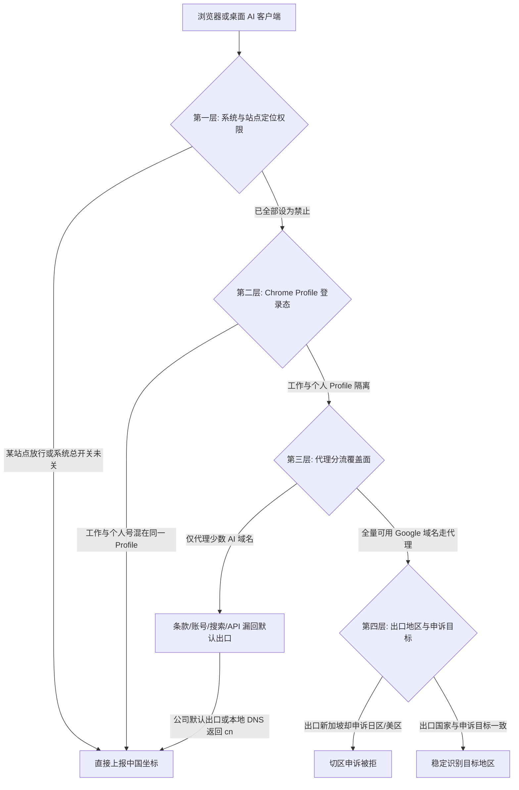

<callout emoji="💡"><p><b>核心结论</b>：Google 账号切区屡次被拒、或 Antigravity（<code>agy</code>）刚配好出口又报地区拦截与认证失效，往往是<b>定位权限、Profile 混用、窄分流漏网、出口地区错配、双代理叠加冲突</b>以及<b>凭证会话运维</b>几条线同时出了岔子。</p><p>本文整理了一套可跨电脑、跨公司复用的合规打法：包含四层防送中治理、三场景网络切换速查表、三类地区区分与家庭组共享路线、400/401 排障、七合一自动体检与配置脚本，以及给 AI Agent 的标准执行协议。<b>边界说明</b>：本文仅讨论合规网络分流、定位治理、官方改区与多窗口运维，不涉及修改客户端二进制或绕过资格校验。</p></callout>

# 一、为什么总被判回中国：四层泄漏面

很多人明明挂上了海外代理，或者在 Chrome 里顺手关了某个网站的定位，打开 [Google 服务条款](https://policies.google.com/terms) 页面还是显示「中国」，提交切区申诉照样被拒。问题出在定位信号有四条路会绕开你的代理直接连出去：



把这四层拆开来看，每一层都有非常具体的陷阱：

| 泄漏层级 | 常见现象 | 为什么会直接拖累切区 | 正确做法 |
|-|-|-|-|
| **定位权限层** | 平时在日常窗口给 `google.com` 或部分站点点过「允许获取位置」 | 浏览器直接调用 macOS 定位服务上报经纬度，代理 IP 再干净也没用 | 全本机 Chrome Profile 默认策略改为**禁止**，清空允许白名单，并在系统设置关掉浏览器和 AI 客户端定位 |
| **Profile 容器层** | 主窗口登录工作号，又顺手「添加其他账号」把个人 Gmail 挂在同一个 Chrome Profile | 同一 Profile 共享 Cookie、设备标识和站点权限；在公司环境浏览会顺带给同窗个人号打上国内特征 | **工作 Profile 只登工作号**；个人号放到独立个人 Profile，各自维护权限与扩展 |
| **分流漏网层** | 代理插件只填了 `gemini.google.com` 等少数 AI 域名 | 访问 `policies.google.com`（条款与申诉表）、`accounts.google.com`、`www.google.com`、`*.googleapis.com` 全部直连默认出口，Chrome 变体配置接口直接返回 `x-country: cn` | 只覆盖 `*.google.com`、`*.googleapis.com`、`*.gstatic.com`、`*.antigravity.google`、`*.recaptcha.net` 5 条防漂移核心域，刻意放行流媒体与无 Cookie 下载 CDN |
| **出口与目标错配** | 连的中转代理实际出口在新加坡，切区表单却填日本或美国 | Google 后台核验近一段时间的真实出口特征，IP 所在国与申诉目标国对不上就会直接拒绝 | 先用脚本实测代理的真实国家判定，**申诉目标国家必须与稳定使用的出口国家保持一致** |

# 二、网络方案二选一：精细分流与个人代理

桌面端 `agy` / Gemini 客户端与网页端浏览器分处不同进程，按自己所处的网络环境选一套主方案即可，**切勿两套代理或企业 VPN 同时叠加接管**。

## 2.1 日常办公网推荐：桌面按进程（Antify）+ 浏览器按域名（FoxyProxy）

如果工作环境不方便常开全局海外 VPN（会拖慢内网访问），最稳的方式是不改 macOS 全局代理和系统 DNS，把客户端和浏览器拆开各自接管：

- **桌面端与 CLI（按进程透明代理）：** 用应用级透明代理工具（例如 Antify）只接管桌面 AI 客户端和 `agy` CLI 路径，开启远程 DNS 解析，同时**关闭「派生子进程继承」**。这样 AI 客户端自己的流量走代理，它拉起的 `git`、`ssh` 等子进程依然直连内网。
- **浏览器（按域名精细分流）：** 在 Chrome 或 Firefox 里给需要访问 Google 的 Profile 安装 FoxyProxy，切到「按规则代理」并开启远程 DNS（`proxyDNS: true`），只把真正承载账号登录与地区判定的 **5 条防漂移核心域名**（`*.google.com`、`*.googleapis.com`、`*.gstatic.com`、`*.antigravity.google`、`*.recaptcha.net`）送进代理，办公系统与国内网站全部保持直连。

这里有三个硬禁忌：第一，**不要为了省事把整个 Chrome 进程塞进应用级代理**，如果开发代理只放行白名单域名或对非白名单流量回落国内，整进程代理会让普通网页卡顿甚至超时；第二，**不要把流媒体、无 Cookie 下载 CDN 与第三方托管域塞进多出口轮换/白名单代理**——实测在出口 IP 逐连接轮换或带严格白名单的中转代理上，把 `youtube.com` / `googlevideo.com` 送入代理会破坏视频流 IP 绑定导致无法播放，把 `googleusercontent.com` / `gvt1.com`（如 Chrome 扩展安装包与组件更新 CDN）及 `withgoogle.com` 送入代理会触发 `504 Gateway Timeout` 让 Chrome 应用商店一直转圈下不下来，而 `appspot.com` / `firebaseapp.com` / `chromium.org` 也不承担账号地区信号，全部刻意放行；第三，换到新代理后要**现场并发探测一遍核心域名连通性**，不要生搬硬套未经实测的庞大清单。

## 2.2 独立个人 Mac 方案：OpenSurge / Mihomo 规则模式 TUN 分流

在独立个人环境里，如果使用 [OpenSurge for Mac](https://github.com/YTwsy/OpenSurge-for-Mac) 或 Clash/Mihomo 走规则模式 TUN 接管，分流规则要守住三条底线：

- **专用策略组绝不带 `DIRECT` 回退：** 把 `agy` 进程、`language_server` 与 Google 域名规则全部指向专用策略组（例如 `Google-agy`），组内**只放具体海外节点与 `REJECT`**，不要混入 `DIRECT` 或带直连兜底的分组，避免节点短暂波动时请求静默掉回本地直连。
- **DNS 防循环与 DoH：** Google 相关域名走基于代理组的 DoH，代理节点域名与普通国内域名走明确上游 DNS，关闭会干扰内网的下游 DHCP 或多余局域网接管项。
- **切换节点后必清旧连接、再用真实模型验收：** 很多混合分流或「极速模式」下，网页测速能返回 HTTP `204`，真实调用高阶模型却直接报地区 `400`；并且切换节点后，正在运行的旧 CLI 进程可能还握着旧长连接。**每次切换代理或模式，都要在可中断点退出旧进程并重开恢复，再用目标模型真实发一条请求验证。**

## 2.3 三场景网络切换速查表

很多人换到家里、咖啡厅或出差环境后，忘了关掉办公网分流规则就打开个人 TUN，两套代理同时接管同一条连接，结果终端和浏览器一起卡死。按当下所处网络只保留一套主方案即可：

| 所在网络场景 | 唯一启用的主方案 | 必须同步关闭的冲突项 | 切换后必验动作 |
|-|-|-|-|
| **场景 1：公司办公网**<br>（内网系统须直连） | **Antify + Chrome FoxyProxy** | 退出或停用 OpenSurge / Mihomo TUN 与系统全局代理 | `status` 无冲突 -> `verify` 4 项 `PASS` -> 重开 CLI |
| **场景 2：外部个人网络**<br>（家 / 咖啡厅 / 手机热点） | **OpenSurge / Mihomo 规则模式 TUN**<br>（Google 组不设 `DIRECT` 回退） | 关闭 Antify 总开关，Chrome FoxyProxy 切为「禁用」 | `status` 无冲突 -> 重开 CLI 并用目标模型发 1 条请求 |
| **场景 3：海外干净直连**<br>（`discover` 判 `DIRECT` 为 `CLEAN`） | **无分流直接访问** | 关闭 Antify、FoxyProxy 与 TUN 全局/规则代理 | `status` 正常 -> `discover` 确认 `DIRECT CLEAN` -> 重开 CLI |

每次跨场景切换后，先跑一遍 `google-clean-kit.sh status` 检查有没有双代理冲突或残留的不可达代理地址，然后在可中断点退出旧 CLI 进程再重开恢复，避免旧进程继续复用失效的长连接。

# 三、账号与地区：分清三类地区与两条合规路线

同样叫「账号地区」，Google 生态里其实有三张互相独立的表，很多人搞混了才一直白忙：

| 概念 | 查看入口 | 决定什么 | 常见误解 |
|-|-|-|-|
| **服务条款关联国家** | [Google 服务条款](https://policies.google.com/terms) | 决定 Google 账号本身在服务与 API 资格上的归属地 | 改了付款币种或 Google Play 地区，不等于这里跟着变 |
| **付款资料国家** | [Google Payments](https://pay.google.com/) | 决定结算币种（如美元）、订阅扣费与家庭组同区校验 | 美区钱包和在用订阅并不要求每次 API 请求都挂美国 IP；**千万别误关正在扣费的海外钱包** |
| **App Store 地区** | 苹果设备商店账号 | 决定 iOS 客户端下载与苹果内购方式 | 与 Google 账号归属地无关，不必强求同区 |

如果原账号目前仍被归为中国区，有两条合规路径可以走：

- **路线 1：清净环境养号后，提交官方国家关联申诉。** 先按后文把本机、云端与手机端定位全部关干净，用单一稳定的支持区出口（比如新加坡或美国）在独立个人 Profile 里正常使用 1～2 周，再到 [Google 国家/地区关联申请页](https://policies.google.com/country-association-form) 提交审核。填写时如实说明情况，**申诉的目标国家必须与长期使用的出口国家完全一致**，不要用 VPN 出口冒充真实居住经历。
- **路线 2：注册支持区新号，或用 Google One 家庭组共享主号订阅额度。** 如果老号已有高阶订阅（例如 Google AI Ultra），不想丢掉权益又想让支持区账号免折腾直接用，可以利用 Google One 家庭组机制把额度分享给最多 5 位年满 18 岁的家庭成员（成员各自独立账号、对话历史与云盘完全隔离）。使用家庭组必须注意三个硬规则：
  1. **方向不能反：** 加入家庭组不会改变成员原有的条款关联国家；必须由**已订阅主号当家庭管理员，去邀请处于支持区的小号**（[Google 家庭组管理](https://myaccount.google.com/family/details)）。
  2. **付款资料国家必须对齐：** 家庭组强制校验管理员与成员的 **Google Payments 付款资料国家**（而不是条款国家）。如果主号按美元计费且付款资料在美国，受邀的支持区小号必须先把自己的付款资料国家对齐为美国（没有历史资料时按美区新建，有多余他国资料先关闭），否则接受邀请会提示不在同一国家或地区；开启分享后记得在 [Google One](https://one.google.com/) 确认「与家人共享」已打开。
  3. **遵守 12 个月冷却期：** Google Play 改区与切换家庭组均有 12 个月冷却限制，同组内如果有成员触发严重封禁也可能波及整组，务必先规划好再建组，不要反复建删试错。

# 四、常见故障排障与多窗口运维：400、401 与会话恢复

日常跑通网络和账号后，命令行里最常遇到两类报错，排查方向完全不同，千万不要拿同一套办法瞎试：

| 报错类型 | 典型特征 | 排查与恢复动作 |
|-|-|-|
| **服务端地区 `400`** | 返回 `FAILED_PRECONDITION` 或 `User location is not supported` | 1. 对照 [Antigravity 官方支持列表](https://antigravity.google/docs/faq) 核对当前出口国家；<br>2. 确认没有多出口混流（极速模式常见网页通而 API 拒）；<br>3. 退出沿用旧长连接的进程，切换单一干净出口后用报错模型重开复测 |
| **认证 `401`（情况 A：小时级续期竞态）** | 正在跑的长任务在整点前后突然报 `UNAUTHENTICATED (code 401)` | 参考 [Google 开发者论坛公开讨论](https://discuss.ai.google.dev/t/bug-antigravity-cli-1-3-6-a-running-turn-fails-with-401-unauthenticated-right-after-the-hourly-token-refresh/190499) 与 [Gemini API 错误定义](https://ai.google.dev/gemini-api/docs/api-errors)：后台刷新 Token 时正在飞的请求偶尔沿用了旧凭据。只要日志里没有撤销授权记录，直接在原会话发一次「继续」通常即可恢复；若一次仍失败，只退出该故障进程并用准确会话 ID 重开，不必关掉其他正常窗口 |
| **认证 `401`（情况 B：凭证已被吊销）** | 在 Google「您的设备」页误退了挂着 `Google Antigravity` 的会话 | 本机 OAuth Token 已当场失效，发「继续」无效。确认海外代理已接稳后，直接重跑 `agy` 通过内置入口重新完成 OAuth 登录授权即可 |

多窗口长期使用和跨设备迁移时，还有几条稳定运维习惯能省掉很多麻烦：

- **精确恢复会话，多窗口不用 `-c`：** 已知会话 ID 直接运行 `agy --conversation <完整会话ID>`；不记得 ID 时先启动 `agy`，在输入框输入 `/resume` 按标题检索打开。多窗口并行时避免用 `agy -c`，很容易误拉错别的任务窗口。
- **终端还原文字不等于进程活着：** 终端重启窗口后显示的 `Session Contents Restored` 只是历史屏幕回放，不会自动把模型请求接回来；同时避免用两个终端进程打开同一份会话 ID，防止状态互相覆盖。
- **用统一包装脚本锁好环境变量：** 如果通过桌面应用、脚本或编辑器调用 CLI，不要指望它们自动加载 `~/.zshrc` 里的环境变量。把固定入口放在 `~/.local/bin/agy`，在入口里显式导出所需环境配置后再 `exec` 内层程序，更新覆盖排查也会简单得多。

# 五、一键复用脚本：`google-clean-kit.sh`

为了避免每次重装系统、换电脑或换新公司时重新踩一遍坑，下面把**状态体检与防冲突、出口主动嗅探、Chrome 定位清零、动态探测生成 FoxyProxy / Antify 双配置与四项验收**收拢成一个只依赖 macOS 自带 `bash`、`python3`、`curl` 和 `osascript` 的七合一脚本 `google-clean-kit.sh`。

把它保存到本地目录（例如 `~/antify-network-setup/google-clean-kit.sh`）并加上可执行权限：

```bash
chmod +x ~/antify-network-setup/google-clean-kit.sh
```

它提供七个子命令：

- **`status [--json]`：** 只读体检当前机器状态：检查 Antify、OpenSurge / Mihomo TUN、macOS 系统代理（`scutil --proxy`）、全部 Chrome Profile 的定位与 FoxyProxy 启用状态、`agy` 路径覆盖度与本地 DNS，直接判定当前所处网络模式并报出「双代理冲突」或「旧代理不可达」告警。
- **`discover [--json] [--candidate <proxy_url>]...`：** 主动嗅探本机合法出口候选（默认直连路由、环境变量代理、macOS `scutil --proxy` 与 PAC 脚本、git/curl 用户代理、本机回环常见代理端口以及已有分流配置文件），只对 Google / Gemini / Antigravity 官方公开端点发只读探测（**安全边界：绝不扫描公司内网网段或探测未公开服务**），同时核查本机 DNS 是否把后台域名解析到国内节点，最后按干净度打分排序给出推荐命令。
- **`auto [--candidate <proxy_url>]... [--output <json_path>] [--antify-output <json_path>]`：** 自动跑完 `discover` 选出最优干净出口；若直连已干净直接提醒清定位，若命中可用代理则串联完成兼容域名探测、FoxyProxy 配置生成与 4 项出口验收；追加 `--antify-output` 时顺便按本机客户端路径生成 Antify 备份。
- **`clean-chrome`：** 自动备份全部 Chrome Profile 的 `Preferences` 到 `~/.google-clean-kit-backups/`，优雅退出 Chrome，把所有 Profile 的默认定位改为禁止（`2`）并删光允许白名单，恢复启动 Chrome 复核无回弹后，自动为你打开 macOS「定位服务」设置页。
- **`build-foxyproxy <host> <port> [type] [output] [title]`：** 通过指定代理并发探测 5 个防漂移核心 Google 域名（5 秒超时）并生成 FoxyProxy v8/v9 配置文件；刻意排除不承载账号地区且易在轮换/白名单代理上失效的流媒体、无 Cookie 下载 CDN 与第三方托管域。
- **`build-antify <host> <port> [type] [output] [proxy_name]`：** 动态扫描本机实际安装的 `Antigravity.app`、`Antigravity IDE.app`、`Gemini.app`、嵌套 Helper、内置命令行工具及 `agy` 多版本真实路径，自动生成可直接导入 Antify 的完整备份 JSON（预设远程 DNS、屏蔽失败连接并关闭派生子进程继承），不用手动挨条配置路径。
- **`verify <proxy_url> [country_keyword] [country_code]`：** 实测 `policies.google.com/terms`、`www.google.com`、`clientservices.googleapis.com` 和 `www.youtube.com` 四项指标，确认 Google 后台已经把当前出口稳定识别为目标国家。

完整脚本源码如下（不依赖任何三方包，可跨机器直接复用）：

```bash
#!/usr/bin/env bash
set -euo pipefail

usage() {
  cat <<'EOF'
Google 账号定位清零、出口主动嗅探、状态体检与精细分流复用工具 (macOS)

用法:
  google-clean-kit.sh status [--json]
      只读环境体检：核查 Antify、OpenSurge / Mihomo TUN、系统代理、全 Chrome Profile 定位与 FoxyProxy、
      agy 路径覆盖度与本地 DNS，识别当前工作模式并拦截双代理冲突或断线残留。

  google-clean-kit.sh discover [--json] [--candidate <proxy_url>]...
      主动嗅探本机所有合法出口候选（直连、环境变量、系统代理/PAC、git/curl 配置、常见本地代理端口及已有分流配置），
      并发探测各出口在 Google / Gemini / Antigravity 官方端点的真实国家判定与连通性，给出推荐排序与命令。

  google-clean-kit.sh auto [--candidate <proxy_url>]... [--output <json_path>] [--antify-output <json_path>]
      一键串行跑通：自动执行 discover 选出最优干净出口 -> 探测并生成 FoxyProxy 全量配置 -> 跑 4 项硬指标验收。
      传入 --antify-output 时同步生成桌面端 Antify 备份配置。
      - output 默认: ./foxyproxy-google-full.json

  google-clean-kit.sh clean-chrome
      备份全部 Chrome Profile 的 Preferences，优雅退出 Chrome，将所有 Profile 的默认定位设为禁止并清空允许列表，
      重启 Chrome 复核持久化生效后，自动打开 macOS 定位服务设置页。

  google-clean-kit.sh build-foxyproxy <proxy_host> <proxy_port> [proxy_type] [output_json] [title]
      并发探测 5 个防漂移核心 Google 域名在指定代理下的连通性，写入 FoxyProxy v8/v9 配置文件；
      刻意排除流媒体与无 Cookie 下载 CDN，避免轮换代理池导致 YouTube 播放失败或 Chrome 应用商店下载 504 超时。
      - proxy_type  默认: http（可选: http / https / socks5 / socks4）
      - output_json 默认: ./foxyproxy-google-full.json
      - title       默认: Google 核心 · 分流代理

  google-clean-kit.sh build-antify <proxy_host> <proxy_port> [proxy_type] [output_json] [proxy_name]
      动态扫描本机实际安装的 Antigravity / Antigravity IDE / Gemini 及其 Helper、内置可执行文件与 agy CLI 路径，
      生成可直接导入 Antify 的完整分流备份 JSON（远程 DNS、屏蔽失败连接、关闭派生子进程继承）。
      - proxy_type  默认: http（可选: http / https / socks5 / socks5h）
      - output_json 默认: ./antify-backup-generated.json
      - proxy_name  默认: Google AI · 分流代理

  google-clean-kit.sh verify <proxy_url> [expected_country_keyword] [expected_country_code]
      通过 4 项硬指标检验出口被 Google 识别的真实国家/地区（例如 Singapore / sg，或 Japan / jp）。
      - expected_country_keyword 默认: Singapore
      - expected_country_code    默认: sg

示例:
  bash google-clean-kit.sh status
  bash google-clean-kit.sh discover --candidate http://proxy.example.com:8118
  bash google-clean-kit.sh auto --output ~/antify-network-setup/foxyproxy-google-full.json --antify-output ~/antify-network-setup/antify-backup.json
  bash google-clean-kit.sh build-antify proxy.example.com 8118 http ~/antify-network-setup/antify-backup.json
  bash google-clean-kit.sh clean-chrome
  bash google-clean-kit.sh verify http://proxy.example.com:8118 Singapore sg
EOF
}

cmd_status() {
  python3 - "$@" <<'PY'
import base64
import glob
import json
import os
import re
import shutil
import socket
import subprocess
import sys
import urllib.parse

json_mode = "--json" in sys.argv[1:]
home = os.path.expanduser("~")

def run_cmd(cmd, timeout=3):
    try:
        return subprocess.run(cmd, capture_output=True, text=True, timeout=timeout)
    except Exception:
        return None

def tcp_reachable(host, port, timeout=1.5):
    try:
        with socket.create_connection((host, int(port)), timeout=timeout):
            return True
    except Exception:
        return False

# 1. Process inspection (generic proxy / Antify / TUN cores only)
ps_res = run_cmd(["ps", "-eo", "pid,comm"], timeout=3)
proc_lines = ps_res.stdout.splitlines()[1:] if ps_res and ps_res.returncode == 0 else []

antify_gui_pids = []
antify_core_pids = []
standby_control_procs = []
active_tun_cores = []

standby_basenames = {"opensurge-control", "com.opensurge.helper"}
core_exact_basenames = {"mihomo", "clash", "clash-meta", "clash-verge", "sing-box", "surge", "surge-cli", "v2ray", "xray", "stash"}

for line in proc_lines:
    parts = line.strip().split(None, 1)
    if len(parts) < 2:
        continue
    pid, comm = parts[0], parts[1].strip()
    base = os.path.basename(comm).lower()
    comm_lower = comm.lower()
    if comm_lower.endswith("/antify.app/contents/macos/antify") or base == "antify":
        antify_gui_pids.append(f"{pid}:{comm}")
    elif "antifycore" in base or "com.lester.antify.antifycore" in comm_lower:
        antify_core_pids.append(f"{pid}:{comm}")
    elif base in standby_basenames or base.startswith("opensurge"):
        standby_control_procs.append(base)
    elif (base in core_exact_basenames or base.startswith(("mihomo", "clash", "sing-box"))) and not base.startswith(("opensurge", "com.opensurge")):
        active_tun_cores.append(f"{pid}:{base}")

# Antify live config inspection
antify_config_candidates = []
snap_path = os.path.join(home, "Library/Group Containers/group.app.com.lester.Antify/Library/Application Support/config-snapshot.json")
if os.path.isfile(snap_path):
    antify_config_candidates.append(("config-snapshot", snap_path))
bak_files = sorted(glob.glob(os.path.join(home, "Library/Application Support/com.lester.Antify/Backups/*.json")))
if bak_files:
    antify_config_candidates.append(("latest-backup", bak_files[-1]))
alt_files = sorted(glob.glob(os.path.join(home, "Library/Application Support/Antify/*.json")))
if alt_files:
    antify_config_candidates.append(("antify-support", alt_files[-1]))

antify_config_source = None
antify_proxies = []
antify_rules = []
for label, cfg_path in antify_config_candidates:
    try:
        jd = json.load(open(cfg_path, encoding="utf-8"))
        cfg = jd.get("configuration") if isinstance(jd.get("configuration"), dict) else jd
        if isinstance(cfg, dict) and ("proxies" in cfg or "rules" in cfg):
            antify_config_source = f"{label}:{cfg_path}"
            antify_proxies = cfg.get("proxies") or []
            antify_rules = cfg.get("rules") or []
            break
    except Exception:
        continue

antify_enabled_rules = [r for r in antify_rules if isinstance(r, dict) and r.get("isEnabled", True)]
antify_rule_paths = [r.get("appPath") for r in antify_enabled_rules if isinstance(r, dict) and r.get("appPath")]
missing_rule_paths = [p for p in antify_rule_paths if not os.path.exists(p)]

antify_proxy_checks = []
for px in antify_proxies:
    if not isinstance(px, dict):
        continue
    if not px.get("isEnabled", True):
        continue
    host = px.get("host")
    port = px.get("port")
    ptype = str(px.get("type", "HTTP"))
    name = px.get("name") or f"{host}:{port}"
    if host and port:
        ok = tcp_reachable(host, port)
        antify_proxy_checks.append({
            "name": name,
            "type": ptype,
            "host": host,
            "port": port,
            "reachable": ok,
        })

antify_active = bool(antify_gui_pids or antify_core_pids)

# 2. TUN / OpenSurge / System Proxy / Env Proxy state
sources_path = os.path.join(home, "Library/Application Support/OpenSurge/sources.json")
opensurge_sources_applied = False
opensurge_sources_names = []
if os.path.isfile(sources_path):
    try:
        sd = json.load(open(sources_path, encoding="utf-8"))
        items = sd if isinstance(sd, list) else (sd.get("sources") if isinstance(sd, dict) and isinstance(sd.get("sources"), list) else ([sd] if isinstance(sd, dict) else []))
        for item in items:
            if isinstance(item, dict):
                if item.get("name"):
                    opensurge_sources_names.append(str(item.get("name")))
                if item.get("applied") is True or item.get("isApplied") is True:
                    opensurge_sources_applied = True
    except Exception:
        pass

utun_with_ipv4 = []
ifc_res = run_cmd(["ifconfig", "-l"], timeout=2)
if ifc_res and ifc_res.returncode == 0:
    for iface in ifc_res.stdout.split():
        if iface.startswith("utun"):
            det = run_cmd(["ifconfig", iface], timeout=2)
            if det and det.returncode == 0:
                for l in det.stdout.splitlines():
                    if re.search(r"^\s*inet\s+\d+\.", l):
                        utun_with_ipv4.append(f"{iface} ({l.strip().split()[1]})")
                        break

route_iface = ""
route_gateway = ""
rt_res = run_cmd(["route", "-n", "get", "8.8.8.8"], timeout=2)
if rt_res and rt_res.returncode == 0:
    for l in rt_res.stdout.splitlines():
        ls = l.strip()
        if ls.startswith("interface:"):
            route_iface = ls.split(":", 1)[1].strip()
        elif ls.startswith("gateway:"):
            route_gateway = ls.split(":", 1)[1].strip()

route_via_utun = route_iface.startswith("utun")
tun_active = bool(active_tun_cores or opensurge_sources_applied or route_via_utun)

scutil_proxies = {}
sc_res = run_cmd(["scutil", "--proxy"], timeout=2)
if sc_res and sc_res.returncode == 0:
    kv = {}
    for l in sc_res.stdout.splitlines():
        if ":" in l:
            k, v = l.split(":", 1)
            kv[k.strip()] = v.strip()
    if kv.get("HTTPEnable") == "1":
        scutil_proxies["HTTP"] = f"{kv.get('HTTPProxy', '')}:{kv.get('HTTPPort', '')}"
    if kv.get("HTTPSEnable") == "1":
        scutil_proxies["HTTPS"] = f"{kv.get('HTTPSProxy', '')}:{kv.get('HTTPSPort', '')}"
    if kv.get("SOCKSEnable") == "1":
        scutil_proxies["SOCKS"] = f"{kv.get('SOCKSProxy', '')}:{kv.get('SOCKSPort', '')}"
    if kv.get("ProxyAutoConfigEnable") == "1":
        scutil_proxies["PAC"] = kv.get("ProxyAutoConfigURLString", "")

sys_proxy_active = bool(scutil_proxies)
env_proxies = {k: os.environ[k] for k in ["http_proxy", "https_proxy", "HTTP_PROXY", "HTTPS_PROXY", "all_proxy", "ALL_PROXY"] if os.environ.get(k)}

# 3. Chrome all-profile geolocation & FoxyProxy status
FOXYPROXY_EXT_ID = "gcknhkkoolaabfmlnjonogaaifnjlfnp"
chrome_base = os.path.join(home, "Library/Application Support/Google/Chrome")
chrome_profiles = []
chrome_geo_leaks = []
foxyproxy_active_profiles = []
unreachable_targets = []

for px in antify_proxy_checks:
    if antify_active and not px["reachable"]:
        unreachable_targets.append(f"Antify -> {px['host']}:{px['port']} ({px['name']})")

def inspect_pac_text(pac_txt):
    proxies = sorted(set(re.findall(r"\b(PROXY|HTTPS|SOCKS5|SOCKS)\s+([A-Za-z0-9._-]+:\d+)", pac_txt)))
    has_google = bool(re.search(r"google\\*\.com", pac_txt))
    has_googleapis = bool(re.search(r"googleapis\\*\.com", pac_txt))
    return proxies, has_google, has_googleapis

if os.path.isdir(chrome_base):
    for pref_path in sorted(glob.glob(os.path.join(chrome_base, "*", "Preferences"))):
        prof = os.path.basename(os.path.dirname(pref_path))
        try:
            d = json.load(open(pref_path, encoding="utf-8"))
        except Exception:
            continue
        p = d.get("profile", {})
        def_geo = p.get("default_content_setting_values", {}).get("geolocation")
        geo_ex = p.get("content_settings", {}).get("exceptions", {}).get("geolocation", {})
        allowed_sites = [k for k, v in geo_ex.items() if isinstance(v, dict) and v.get("setting") == 1]

        geo_clean = (def_geo == 2 and len(allowed_sites) == 0)
        if not geo_clean:
            chrome_geo_leaks.append(f"{prof} (default={def_geo}, allowed={len(allowed_sites)})")

        sp_path = os.path.join(os.path.dirname(pref_path), "Secure Preferences")
        fp_installed = False
        fp_enabled = False
        proxy_mode = None
        pac_proxies = []
        pac_has_core_domains = False
        if os.path.isfile(sp_path):
            try:
                sd = json.load(open(sp_path, encoding="utf-8"))
                exts = sd.get("extensions", {}).get("settings", {})
                fp_ext = exts.get(FOXYPROXY_EXT_ID)
                if isinstance(fp_ext, dict):
                    fp_installed = True
                    dis = fp_ext.get("disable_reasons")
                    state = fp_ext.get("state", 1)
                    fp_enabled = (not dis) and (state != 0)
                    pref_proxy = (fp_ext.get("preferences") or {}).get("proxy") or {}
                    proxy_mode = pref_proxy.get("mode")
                    pac_url = pref_proxy.get("pac_url") or ""
                    if proxy_mode == "pac_script" and pac_url.startswith("data:") and "," in pac_url:
                        header, body = pac_url.split(",", 1)
                        try:
                            if ";base64" in header:
                                pac_txt = base64.b64decode(body).decode("utf-8", errors="ignore")
                            else:
                                pac_txt = urllib.parse.unquote(body)
                            raw_px, has_g, has_ga = inspect_pac_text(pac_txt)
                            pac_has_core_domains = has_g and has_ga
                            for kind, hostport in raw_px:
                                h, prt = hostport.rsplit(":", 1)
                                ok = tcp_reachable(h, prt)
                                pac_proxies.append({
                                    "kind": kind,
                                    "host": h,
                                    "port": int(prt),
                                    "reachable": ok,
                                })
                                if fp_enabled and not ok:
                                    unreachable_targets.append(f"FoxyProxy [{prof}] -> {hostport}")
                        except Exception:
                            pass
                    elif proxy_mode == "fixed_servers":
                        rules = pref_proxy.get("rules") or {}
                        for _, rv in rules.items():
                            if isinstance(rv, dict) and rv.get("host") and rv.get("port"):
                                ok = tcp_reachable(rv["host"], rv["port"])
                                pac_proxies.append({
                                    "kind": rv.get("scheme", "HTTP").upper(),
                                    "host": rv["host"],
                                    "port": int(rv["port"]),
                                    "reachable": ok,
                                })
                                if fp_enabled and not ok:
                                    unreachable_targets.append(f"FoxyProxy [{prof}] -> {rv['host']}:{rv['port']}")
            except Exception:
                pass

        fp_active = bool(fp_installed and fp_enabled and proxy_mode in ("pac_script", "fixed_servers"))
        if fp_active:
            foxyproxy_active_profiles.append(prof)

        chrome_profiles.append({
            "profile": prof,
            "geo_default": def_geo,
            "geo_allowed_count": len(allowed_sites),
            "geo_clean": geo_clean,
            "foxyproxy_installed": fp_installed,
            "foxyproxy_enabled": fp_enabled,
            "foxyproxy_mode": proxy_mode,
            "foxyproxy_active": fp_active,
            "foxyproxy_has_core_domains": pac_has_core_domains,
            "foxyproxy_proxies": pac_proxies,
        })

# 4. agy paths & Antify rule coverage + local DNS check
agy_candidates = []
which_agy = shutil.which("agy")
for p in [
    which_agy,
    os.path.join(home, ".local/bin/agy"),
    os.path.realpath(which_agy) if which_agy else None,
    *sorted(glob.glob(os.path.join(home, ".gemini/antigravity-cli/bin/managed-*/agy"))),
    os.path.join(home, ".gemini/antigravity-cli/bin/agy"),
]:
    if p and os.path.isfile(p) and os.access(p, os.X_OK):
        ap = os.path.abspath(p)
        if ap not in agy_candidates:
            agy_candidates.append(ap)

uncovered_agy_paths = []
if antify_active and antify_rule_paths:
    covered_set = set(os.path.abspath(p) for p in antify_rule_paths)
    for ap in agy_candidates:
        if ap not in covered_set:
            uncovered_agy_paths.append(ap)

dns_info = {}
dns_warnings = []
for host in ["clientservices.googleapis.com", "update.googleapis.com"]:
    try:
        infos = socket.getaddrinfo(host, 443, proto=socket.IPPROTO_TCP)
        ips = sorted(set(x[4][0] for x in infos))
        dns_info[host] = ips[:3]
        if any(ip.startswith(("203.208.", "120.253.")) for ip in ips):
            dns_warnings.append(f"{host} 解析到本地国内节点 {ips[:2]}（直连会判为 CN；使用 Antify/FoxyProxy 时必须开启远程 DNS）")
    except Exception as e:
        dns_info[host] = [f"ERR:{e}"]

# 5. Dual-proxy conflict & current mode classification
foxyproxy_active = bool(foxyproxy_active_profiles)
dual_proxy_conflict = bool((antify_active or foxyproxy_active) and (tun_active or sys_proxy_active))

warnings = []
if dual_proxy_conflict:
    left = []
    if antify_active:
        left.append("Antify")
    if foxyproxy_active:
        left.append(f"FoxyProxy({', '.join(foxyproxy_active_profiles)})")
    right = []
    if tun_active:
        right.append("TUN/规则代理")
    if sys_proxy_active:
        right.append("macOS系统代理")
    warnings.append(("冲突告警", f"检测到双代理叠加风险：{' + '.join(left)} 与 {' + '.join(right)} 同时处于开启状态，极易导致死循环或假死。"))

for tgt in sorted(set(unreachable_targets)):
    warnings.append(("切换提醒", f"{tgt} 当前 TCP 不可达（可能已离开公司内网或代理已关闭）；请切换代理模式或在 FoxyProxy/Antify 中停用该代理。"))

if chrome_geo_leaks:
    warnings.append(("定位告警", f"以下 Chrome Profile 存在定位权限残留：{'; '.join(chrome_geo_leaks)}。建议运行 clean-chrome 清零。"))

for dw in dns_warnings:
    warnings.append(("DNS 告警", dw))

if uncovered_agy_paths:
    warnings.append(("版本提示", f"Antify 活跃但以下本机 agy 路径未被最新备份规则覆盖：{', '.join(uncovered_agy_paths)}。建议用 build-antify 重新生成并导入。"))

if antify_active and missing_rule_paths:
    warnings.append(("版本提示", f"Antify 最新配置中存在 {len(missing_rule_paths)} 条已失效路径（例如 {missing_rule_paths[0]}），建议用 build-antify 刷新规则。"))

if dual_proxy_conflict or unreachable_targets:
    current_mode = "异常或冲突状态（需处理）"
elif tun_active or sys_proxy_active:
    current_mode = "模式 2（独立个人 TUN/全局代理）"
elif antify_active or foxyproxy_active:
    current_mode = "模式 1（办公网精细分流）"
else:
    current_mode = "模式 3（干净直连 / 未启用分流）"

payload = {
    "current_mode": current_mode,
    "dual_proxy_conflict": dual_proxy_conflict,
    "antify": {
        "active": antify_active,
        "gui_pids": antify_gui_pids,
        "core_pids": antify_core_pids,
        "config_source": antify_config_source,
        "enabled_rules_count": len(antify_enabled_rules),
        "missing_rule_paths": missing_rule_paths,
        "proxies": antify_proxy_checks,
    },
    "tun_and_system_proxy": {
        "tun_active": tun_active,
        "standby_controls": sorted(set(standby_control_procs)),
        "active_tun_cores": active_tun_cores,
        "opensurge_sources_applied": opensurge_sources_applied,
        "opensurge_sources_names": opensurge_sources_names,
        "route_8888_interface": route_iface,
        "route_8888_gateway": route_gateway,
        "route_via_utun": route_via_utun,
        "utun_with_ipv4": utun_with_ipv4,
        "system_proxy_active": sys_proxy_active,
        "scutil_proxies": scutil_proxies,
        "env_proxies": env_proxies,
    },
    "chrome_profiles": chrome_profiles,
    "agy_paths": agy_candidates,
    "uncovered_agy_paths": uncovered_agy_paths,
    "dns_info": dns_info,
    "warnings": [{"level": lvl, "message": msg} for lvl, msg in warnings],
}

if json_mode:
    print(json.dumps(payload, ensure_ascii=False, indent=2))
    sys.exit(1 if (dual_proxy_conflict or unreachable_targets) else 0)

print(f"=== 本机网络与防送中体检结论: {current_mode} ===")

print("\n[1] 桌面应用级分流 (Antify)")
print(f"  进程状态: GUI={'运行中' if antify_gui_pids else '未运行'} | 系统扩展(AntifyCore)={'运行中' if antify_core_pids else '未运行'}")
if antify_config_source:
    print(f"  配置来源: {antify_config_source}（启用规则 {len(antify_enabled_rules)} 条，失效路径 {len(missing_rule_paths)} 条）")
    for px in antify_proxy_checks:
        st = "TCP 可达" if px["reachable"] else "TCP 不可达"
        print(f"  代理出口: {px['name']} ({px['type']}://{px['host']}:{px['port']}) -> {st}")
else:
    print("  配置来源: 未发现本地 Antify 备份/快照文件")

print("\n[2] TUN / 规则代理 / 系统代理 (OpenSurge / Mihomo / scutil)")
if tun_active:
    print(f"  TUN/内核: 活跃接管中 | cores={active_tun_cores or 'none'} | sources_applied={opensurge_sources_applied} | route_8.8.8.8={route_iface}")
elif standby_control_procs:
    print(f"  OpenSurge 状态: 待机（未接管流量，控制进程={', '.join(sorted(set(standby_control_procs)))}，sources_applied={opensurge_sources_applied}）")
else:
    print("  TUN/内核: 未运行")
print(f"  8.8.8.8 路由出口: {route_iface or '未知'} (网关: {route_gateway or '-'}) | 含 IPv4 的 utun: {utun_with_ipv4 or '无'}")
print(f"  macOS 系统代理 (scutil --proxy): {scutil_proxies if scutil_proxies else '未开启'}")
if env_proxies:
    print(f"  当前 Shell 代理变量: {env_proxies}")

print("\n[3] Chrome 全 Profile 定位与 FoxyProxy 状态")
if not chrome_profiles:
    print("  未发现 Chrome Profile。")
for cp in chrome_profiles:
    geo_s = f"default={cp['geo_default']}, allowed={cp['geo_allowed_count']} ({'干净' if cp['geo_clean'] else '有残留'})"
    if not cp["foxyproxy_installed"]:
        fp_s = "FoxyProxy 未安装"
    elif not cp["foxyproxy_enabled"]:
        fp_s = "FoxyProxy 已安装但被禁用"
    else:
        px_desc = ", ".join(
            f"{px['kind']} {px['host']}:{px['port']}({'可达' if px['reachable'] else '不可达'})"
            for px in cp["foxyproxy_proxies"]
        ) or "无代理地址"
        core_desc = "含核心域名" if cp["foxyproxy_has_core_domains"] else "未确认核心域名"
        fp_s = f"FoxyProxy 已启用 (mode={cp['foxyproxy_mode']}, {core_desc}, {px_desc})"
    print(f"  [{cp['profile']}] 定位: {geo_s} | {fp_s}")

print("\n[4] agy CLI 路径与 Google 后台 DNS")
print(f"  本机 agy 路径 ({len(agy_candidates)}): {agy_candidates if agy_candidates else '未检测到'}")
if antify_active and agy_candidates:
    print(f"  Antify 覆盖状态: {'全部已覆盖' if not uncovered_agy_paths else f'缺少 {len(uncovered_agy_paths)} 项: {uncovered_agy_paths}'}")
for h, ips in dns_info.items():
    print(f"  本地 DNS {h}: {ips}")

print("\n[5] 告警与处置建议")
if not warnings:
    print("  未发现冲突或残留告警。如需检查出口国家识别，可运行 verify；切换网络后请重开正在进行的 CLI 会话并用目标模型发 1 条真实请求验收。")
else:
    for lvl, msg in warnings:
        print(f"  [{lvl}] {msg}")

if dual_proxy_conflict or unreachable_targets:
    sys.exit(1)
PY
}

run_discover_py() {
  python3 - "$@" <<'PY'
import concurrent.futures
import glob
import json
import os
import re
import socket
import subprocess
import sys
import urllib.parse

args = sys.argv[1:]
json_mode = False
extra_candidates = []
i = 0
while i < len(args):
    a = args[i]
    if a == "--json":
        json_mode = True
    elif a == "--candidate" and i + 1 < len(args):
        extra_candidates.append(args[i + 1])
        i += 1
    elif a.startswith("--candidate="):
        extra_candidates.append(a.split("=", 1)[1])
    i += 1

home = os.path.expanduser("~")
raw_candidates = [("DIRECT", "默认直连路由")]

def add_candidate(url, source):
    if not url:
        return
    u = url.strip()
    if not u:
        return
    if "://" not in u:
        u = "http://" + u
    p = urllib.parse.urlparse(u)
    if not p.hostname or not p.port:
        return
    scheme = p.scheme.lower()
    if scheme == "socks5":
        scheme = "socks5h"
    norm = f"{scheme}://{p.hostname}:{p.port}"
    raw_candidates.append((norm, source))

# 1. Environment variables
for env_k in ["http_proxy", "https_proxy", "HTTP_PROXY", "HTTPS_PROXY", "all_proxy", "ALL_PROXY"]:
    val = os.environ.get(env_k)
    if val:
        add_candidate(val, f"env:{env_k}")

# 2. macOS scutil --proxy + PAC
try:
    sp = subprocess.run(["scutil", "--proxy"], capture_output=True, text=True, timeout=3)
    kv = {}
    for line in sp.stdout.splitlines():
        if ":" in line:
            k, v = line.split(":", 1)
            kv[k.strip()] = v.strip()
    if kv.get("HTTPEnable") == "1" and kv.get("HTTPProxy") and kv.get("HTTPPort"):
        add_candidate(f"http://{kv['HTTPProxy']}:{kv['HTTPPort']}", "scutil:HTTP")
    if kv.get("HTTPSEnable") == "1" and kv.get("HTTPSProxy") and kv.get("HTTPSPort"):
        add_candidate(f"http://{kv['HTTPSProxy']}:{kv['HTTPSPort']}", "scutil:HTTPS")
    if kv.get("SOCKSEnable") == "1" and kv.get("SOCKSProxy") and kv.get("SOCKSPort"):
        add_candidate(f"socks5h://{kv['SOCKSProxy']}:{kv['SOCKSPort']}", "scutil:SOCKS")
    if kv.get("ProxyAutoConfigEnable") == "1" and kv.get("ProxyAutoConfigURLString"):
        pac_url = kv["ProxyAutoConfigURLString"]
        pac_txt = ""
        if pac_url.startswith("file://"):
            pac_path = urllib.parse.unquote(urllib.parse.urlparse(pac_url).path)
            if os.path.isfile(pac_path):
                pac_txt = open(pac_path, encoding="utf-8", errors="ignore").read(65536)
        elif pac_url.startswith(("http://", "https://")):
            pr = subprocess.run(["curl", "-sS", "--max-time", "3", pac_url], capture_output=True, text=True)
            if pr.returncode == 0:
                pac_txt = pr.stdout[:65536]
        for kind, addr in re.findall(r"\b(PROXY|HTTPS|SOCKS5|SOCKS)\s+([A-Za-z0-9._-]+:\d+)", pac_txt):
            scheme = "socks5h" if kind.startswith("SOCKS") else "http"
            add_candidate(f"{scheme}://{addr}", "scutil:PAC")
except Exception:
    pass

# 3. git global proxy & ~/.curlrc
for gk in ["http.proxy", "https.proxy"]:
    try:
        gr = subprocess.run(["git", "config", "--global", "--get", gk], capture_output=True, text=True, timeout=2)
        if gr.returncode == 0 and gr.stdout.strip():
            add_candidate(gr.stdout.strip(), f"git:{gk}")
    except Exception:
        pass

curlrc = os.path.join(home, ".curlrc")
if os.path.isfile(curlrc):
    try:
        for line in open(curlrc, encoding="utf-8", errors="ignore"):
            m = re.search(r'(?:^|\s)(?:--proxy|proxy)\s*=?\s*"?([^\s"]+)"?', line.strip())
            if m:
                add_candidate(m.group(1), "curlrc")
    except Exception:
        pass

# 4. Local loopback proxy ports (127.0.0.1 only; never scans remote networks)
loopback_ports = [
    (7890, "http"),
    (7897, "http"),
    (6152, "http"),
    (6153, "socks5h"),
    (1080, "socks5h"),
    (1087, "http"),
    (2080, "socks5h"),
    (2081, "http"),
    (8118, "http"),
]
for port, scheme in loopback_ports:
    try:
        with socket.create_connection(("127.0.0.1", port), timeout=0.25):
            add_candidate(f"{scheme}://127.0.0.1:{port}", f"local-port:{port}")
    except Exception:
        pass

# 5. Existing local FoxyProxy / Antify config files (generic paths only)
def extract_from_json_file(path, label):
    try:
        d = json.load(open(path, encoding="utf-8"))
    except Exception:
        return
    if isinstance(d, dict) and isinstance(d.get("data"), list):
        for item in d["data"]:
            if isinstance(item, dict) and item.get("hostname") and item.get("port"):
                t = str(item.get("type", "http")).lower()
                add_candidate(f"{t}://{item['hostname']}:{item['port']}", label)
    proxies = []
    if isinstance(d, dict):
        if isinstance(d.get("proxies"), list):
            proxies.extend(d["proxies"])
        cfg = d.get("configuration")
        if isinstance(cfg, dict) and isinstance(cfg.get("proxies"), list):
            proxies.extend(cfg["proxies"])
    for item in proxies:
        if isinstance(item, dict) and item.get("host") and item.get("port"):
            t = str(item.get("type", "http")).lower()
            add_candidate(f"{t}://{item['host']}:{item['port']}", label)

for p in sorted(glob.glob(os.path.join(home, "antify-network-setup/*.json"))):
    extract_from_json_file(p, f"file:{os.path.basename(p)}")
snap_file = os.path.join(home, "Library/Group Containers/group.app.com.lester.Antify/Library/Application Support/config-snapshot.json")
if os.path.isfile(snap_file):
    extract_from_json_file(snap_file, "antify:snapshot")
for p in sorted(glob.glob(os.path.join(home, "Library/Application Support/Antify/*.json"))):
    extract_from_json_file(p, "antify:config")
bak_files = sorted(glob.glob(os.path.join(home, "Library/Application Support/com.lester.Antify/Backups/*.json")))
if bak_files:
    extract_from_json_file(bak_files[-1], "antify:latest-backup")

# 6. CLI --candidate arguments
for c in extra_candidates:
    add_candidate(c, "cli:--candidate")

dedup = {}
for target, src in raw_candidates:
    dedup.setdefault(target, []).append(src)

dns_info = {}
dns_warnings = []
for host in ["clientservices.googleapis.com", "update.googleapis.com"]:
    try:
        infos = socket.getaddrinfo(host, 443, proto=socket.IPPROTO_TCP)
        ips = sorted(set(x[4][0] for x in infos))
        dns_info[host] = ips[:3]
        if any(ip.startswith(("203.208.", "120.253.")) for ip in ips):
            dns_warnings.append(f"{host} 解析到本地国内节点 {ips[:2]}（直连会被判为 CN，必须启用远程 DNS）")
    except Exception as e:
        dns_info[host] = [f"ERR:{e}"]

def probe_target(item):
    target, sources = item
    pargs = [] if target == "DIRECT" else ["-x", target]

    def run_curl(cmd_tail):
        return subprocess.run(
            ["curl", "-sS", "--max-time", "6"] + pargs + cmd_tail,
            capture_output=True,
            text=True,
        )

    def probe_terms():
        r = run_curl(["-L", "-H", "Accept-Language: en-US,en;q=0.9", "https://policies.google.com/terms"])
        if r.returncode != 0:
            return None, f"err:{r.returncode}"
        idx = r.stdout.find("Country version")
        if idx == -1:
            return None, "missing"
        snippet = re.sub(r"<[^>]+>", " ", r.stdout[idx:idx + 220])
        snippet = re.sub(r"\s+", " ", snippet).strip()
        m = re.search(r"Country version:\s*(.+?)\s*(?:What[’']s|What|\n|$)", snippet)
        country = m.group(1).strip(" .:;-") if m else snippet[:30]
        return country, snippet[:80]

    def probe_google():
        r = run_curl(["-D", "-", "-o", "/dev/null", "https://www.google.com/"])
        if r.returncode != 0:
            return False, f"err:{r.returncode}"
        lines = [l.strip() for l in r.stdout.splitlines() if l.strip()]
        http_l = [l for l in lines if l.startswith("HTTP/")]
        st = http_l[-1] if http_l else ""
        loc = next((l for l in lines if l.lower().startswith("location:")), "")
        ok_200 = (" 200" in st) and ("google.com.hk" not in loc.lower()) and ("hkredirect" not in loc.lower())
        desc = "200" if ok_200 else ("302->.hk" if "google.com.hk" in loc.lower() else (st or "?"))
        return ok_200, desc

    def probe_variations():
        r = run_curl(["-D", "-", "-o", "/dev/null", "https://clientservices.googleapis.com/chrome-variations/seed?osname=mac"])
        if r.returncode != 0:
            return None
        for l in r.stdout.splitlines():
            if l.lower().startswith("x-country:"):
                return l.split(":", 1)[1].strip().lower()
        return None

    def probe_youtube():
        r = run_curl(["-L", "-H", "Accept-Language: en-US,en;q=0.9", "https://www.youtube.com/"])
        if r.returncode != 0:
            return None
        m = re.search(r'"(?:INNERTUBE_CONTEXT_GL|GL)":"([A-Z]{2})"', r.stdout)
        return m.group(1) if m else None

    def probe_reach(url):
        r = run_curl(["-D", "-", "-o", "/dev/null", url])
        if r.returncode != 0:
            return False
        http_l = [l.strip() for l in r.stdout.splitlines() if l.strip().startswith("HTTP/")]
        if not http_l:
            return False
        parts = http_l[-1].split()
        code = int(parts[1]) if len(parts) >= 2 and parts[1].isdigit() else 0
        return 0 < code < 500

    with concurrent.futures.ThreadPoolExecutor(max_workers=6) as inner_pool:
        f_terms = inner_pool.submit(probe_terms)
        f_google = inner_pool.submit(probe_google)
        f_var = inner_pool.submit(probe_variations)
        f_yt = inner_pool.submit(probe_youtube)
        f_gem = inner_pool.submit(probe_reach, "https://gemini.google.com/")
        f_agy = inner_pool.submit(probe_reach, "https://antigravity.google/")

        terms_country, terms_detail = f_terms.result()
        google_ok, google_desc = f_google.result()
        x_country = f_var.result()
        yt_gl = f_yt.result()
        gemini_ok = f_gem.result()
        antigravity_ok = f_agy.result()

    score = 0
    if terms_country and "china" not in terms_country.lower():
        score += 35
    if google_ok:
        score += 20
    if x_country and x_country != "cn":
        score += 20
    if yt_gl and yt_gl != "CN":
        score += 10
    if gemini_ok:
        score += 8
    if antigravity_ok:
        score += 7

    clean = bool(
        terms_country
        and "china" not in terms_country.lower()
        and google_ok
        and x_country
        and x_country != "cn"
        and gemini_ok
        and antigravity_ok
    )

    country_code = x_country or (yt_gl.lower() if yt_gl else None) or ""
    return {
        "target": target,
        "sources": sources,
        "score": score,
        "clean": clean,
        "terms_country": terms_country,
        "terms_detail": terms_detail,
        "google_ok": google_ok,
        "google_desc": google_desc,
        "x_country": x_country,
        "yt_gl": yt_gl,
        "gemini_ok": gemini_ok,
        "antigravity_ok": antigravity_ok,
        "country_code": country_code,
    }

results = []
with concurrent.futures.ThreadPoolExecutor(max_workers=4) as pool:
    for r in pool.map(probe_target, dedup.items()):
        results.append(r)

results.sort(key=lambda x: (x["clean"], x["score"], x["target"] != "DIRECT"), reverse=True)
best = results[0] if results and results[0]["clean"] else None

payload = {
    "dns_info": dns_info,
    "dns_warnings": dns_warnings,
    "candidates": results,
    "best": best,
}

if json_mode:
    print(json.dumps(payload, ensure_ascii=False, indent=2))
    sys.exit(0)

print("=== 1. 本机 Google 后台 DNS 核查 ===")
for h, ips in dns_info.items():
    print(f"  {h}: {ips}")
for w in dns_warnings:
    print(f"  [告警] {w}")
if not dns_warnings:
    print("  未发现本地 DNS 将 Google 后台指回国内节点。")

print(f"\n=== 2. 本机合法网络出口并发嗅探结果（共 {len(results)} 个候选） ===")
for r in results:
    status = "CLEAN" if r["clean"] else "DIRTY/UNREACHABLE"
    srcs = ", ".join(sorted(set(r["sources"])))
    print(
        f"  [{status:17s} | {r['score']:3d}分] {r['target']}\n"
        f"     来源: {srcs}\n"
        f"     条款地区: {r['terms_country'] or '未知'} | google.com: {r['google_desc']} | "
        f"x-country: {r['x_country'] or '-'} | YouTube GL: {r['yt_gl'] or '-'} | "
        f"Gemini: {'OK' if r['gemini_ok'] else 'FAIL'} | Antigravity: {'OK' if r['antigravity_ok'] else 'FAIL'}"
    )

print("\n=== 3. 推荐决策 ===")
if best is None:
    print("未探测到满足全部条件的干净出口。")
    print("建议检查 VPN/代理客户端是否已启动，或显式指定代理重试：")
    print("  bash google-clean-kit.sh discover --candidate http://<host>:<port>")
    sys.exit(2)

if best["target"] == "DIRECT":
    print(f"当前网络直连已经干净（条款地区: {best['terms_country']}，x-country: {best['x_country']}），无需配置额外浏览器代理。")
    print("建议执行清定位脚本：")
    print("  bash google-clean-kit.sh clean-chrome")
else:
    p = urllib.parse.urlparse(best["target"])
    ptype = "socks5" if p.scheme == "socks5h" else p.scheme
    kw = best["terms_country"] or "Singapore"
    cc = best["country_code"] or "sg"
    print(f"最佳干净出口: {best['target']}（来源: {', '.join(sorted(set(best['sources'])))} | 识别地区: {kw} / {cc}）")
    print("可一键生成 FoxyProxy + Antify 双配置并完成 4 项验收：")
    print(f"  bash google-clean-kit.sh auto --candidate {best['target']} --output ./foxyproxy-google-full.json --antify-output ./antify-backup-generated.json")
    print("或分步执行：")
    print(f"  bash google-clean-kit.sh build-foxyproxy {p.hostname} {p.port} {ptype} ./foxyproxy-google-full.json")
    print(f"  bash google-clean-kit.sh build-antify {p.hostname} {p.port} {ptype} ./antify-backup-generated.json")
    print(f"  bash google-clean-kit.sh verify {best['target']} \"{kw}\" {cc}")
PY
}

cmd_discover() {
  run_discover_py "$@"
}

cmd_auto() {
  local output_json="./foxyproxy-google-full.json"
  local antify_output_json=""
  local candidates=()
  while [ "$#" -gt 0 ]; do
    case "$1" in
      --output)
        shift
        output_json="${1:-}"
        [ -n "$output_json" ] || { echo "--output 需要文件路径参数" >&2; exit 1; }
        ;;
      --output=*)
        output_json="${1#*=}"
        ;;
      --antify-output)
        shift
        antify_output_json="${1:-}"
        [ -n "$antify_output_json" ] || { echo "--antify-output 需要文件路径参数" >&2; exit 1; }
        ;;
      --antify-output=*)
        antify_output_json="${1#*=}"
        ;;
      --candidate)
        shift
        [ -n "${1:-}" ] || { echo "--candidate 需要代理地址参数" >&2; exit 1; }
        candidates+=("--candidate" "$1")
        ;;
      --candidate=*)
        candidates+=("$1")
        ;;
      *)
        echo "未知参数: $1" >&2
        exit 1
        ;;
    esac
    shift || true
  done

  local discover_json
  discover_json="$(run_discover_py --json ${candidates[@]+"${candidates[@]}"})"

  local decision
  decision="$(python3 - "$discover_json" <<'PY'
import json, sys, urllib.parse
data = json.loads(sys.argv[1])
best = data.get("best")
if not best:
    print("NONE")
    sys.exit(0)
t = best["target"]
if t == "DIRECT":
    print(f"DIRECT\t{best.get('terms_country') or ''}\t{best.get('country_code') or ''}")
    sys.exit(0)
p = urllib.parse.urlparse(t)
ptype = "socks5" if p.scheme == "socks5h" else p.scheme
kw = best.get("terms_country") or "Singapore"
cc = best.get("country_code") or "sg"
print(f"PROXY\t{t}\t{p.hostname}\t{p.port}\t{ptype}\t{kw}\t{cc}")
PY
)"

  local kind
  kind="$(printf '%s' "$decision" | cut -f1)"
  if [ "$kind" = "NONE" ]; then
    echo "=== auto 自动执行中止：未探测到干净出口 ==="
    run_discover_py ${candidates[@]+"${candidates[@]}"} || true
    exit 2
  fi

  if [ "$kind" = "DIRECT" ]; then
    local kw cc
    kw="$(printf '%s' "$decision" | cut -f2)"
    cc="$(printf '%s' "$decision" | cut -f3)"
    echo "=== auto 判断结果：当前网络直连已干净（${kw} / ${cc}） ==="
    echo "无需生成浏览器与桌面分流代理；如需清理本机 Chrome 定位，请运行："
    echo "  bash $0 clean-chrome"
    exit 0
  fi

  local proxy_url host port ptype kw cc
  proxy_url="$(printf '%s' "$decision" | cut -f2)"
  host="$(printf '%s' "$decision" | cut -f3)"
  port="$(printf '%s' "$decision" | cut -f4)"
  ptype="$(printf '%s' "$decision" | cut -f5)"
  kw="$(printf '%s' "$decision" | cut -f6)"
  cc="$(printf '%s' "$decision" | cut -f7)"

  echo "=== auto 步骤 1/2：命中干净出口 ${proxy_url}（识别地区: ${kw} / ${cc}），开始探测并生成 FoxyProxy 配置 ==="
  cmd_build_foxyproxy "$host" "$port" "$ptype" "$output_json" "Google 核心 · ${kw} 分流代理"
  if [ -n "$antify_output_json" ]; then
    echo ""
    echo "=== auto 附加步骤：动态扫描本机客户端路径并生成 Antify 备份配置 ==="
    cmd_build_antify "$host" "$port" "$ptype" "$antify_output_json" "Google AI · ${kw} 分流代理"
  fi
  echo ""
  echo "=== auto 步骤 2/2：执行 4 项出口硬指标验收 ==="
  cmd_verify "$proxy_url" "$kw" "$cc"
  echo ""
  echo "=== auto 就绪摘要 ==="
  echo "  FoxyProxy 配置文件: $(python3 -c 'import os,sys; print(os.path.abspath(sys.argv[1]))' "$output_json")"
  if [ -n "$antify_output_json" ]; then
    echo "  Antify 备份文件   : $(python3 -c 'import os,sys; print(os.path.abspath(sys.argv[1]))' "$antify_output_json")"
  else
    echo "  生成桌面端 Antify 配置: bash $0 build-antify ${host} ${port} ${ptype} ./antify-backup-generated.json"
  fi
  echo "  目标区校验: ${kw} (${cc}) 全部通过"
  echo "  下一步: 在 Chrome FoxyProxy「选项 → 导入」选择上述 JSON，切到「代理」点保存，确认模式为「按规则代理」；桌面端在 Antify「从备份恢复」导入配置后重启客户端与 CLI 会话。"
}

cmd_clean_chrome() {
  python3 - <<'PY'
import datetime
import glob
import json
import os
import shutil
import subprocess
import sys
import time

home = os.path.expanduser("~")
chrome_base = os.path.join(home, "Library/Application Support/Google/Chrome")
if not os.path.isdir(chrome_base):
    print(f"未找到 Chrome 配置目录: {chrome_base}")
    sys.exit(1)

pref_files = sorted(glob.glob(os.path.join(chrome_base, "*", "Preferences")))
if not pref_files:
    print("未发现任何 Chrome Profile Preferences 文件。")
    sys.exit(1)

ts = datetime.datetime.now().strftime("%Y%m%d-%H%M%S")
backup_dir = os.path.join(home, ".google-clean-kit-backups", ts)
os.makedirs(backup_dir, exist_ok=True)

print(f"=== 1. 备份 Chrome 配置到 {backup_dir} ===")
for src in pref_files:
    prof = os.path.basename(os.path.dirname(src))
    dst = os.path.join(backup_dir, prof.replace(" ", "_") + "_Preferences.bak")
    shutil.copy2(src, dst)
    print(f"  [备份] {prof}")

def is_chrome_running():
    proc = subprocess.run(["pgrep", "-x", "Google Chrome"], capture_output=True, text=True)
    return proc.returncode == 0 and bool(proc.stdout.strip())

was_running = is_chrome_running()
if was_running:
    print("\n=== 2. 优雅退出 Chrome ===")
    subprocess.run(["osascript", "-e", 'tell application "Google Chrome" to quit'], capture_output=True, text=True)
    exited = False
    for i in range(15):
        time.sleep(1)
        if not is_chrome_running():
            exited = True
            print(f"  Chrome 已在 {i + 1}s 后安全退出。")
            break
    if not exited:
        print("ERROR: Chrome 在 15 秒内未退出（可能被网页未保存弹窗阻塞）。请手动关闭 Chrome 后重试。")
        sys.exit(2)
else:
    print("\n=== 2. Chrome 当前未运行，可直接修改配置 ===")

print("\n=== 3. 全局禁止定位并清空允许白名单 ===")
for src in pref_files:
    prof = os.path.basename(os.path.dirname(src))
    with open(src, "r", encoding="utf-8") as f:
        data = json.load(f)

    profile = data.setdefault("profile", {})
    defaults = profile.setdefault("default_content_setting_values", {})
    cs = profile.setdefault("content_settings", {})
    exceptions = cs.setdefault("exceptions", {})
    geo = exceptions.setdefault("geolocation", {})

    defaults["geolocation"] = 2
    removed = []
    for origin in list(geo.keys()):
        val = geo.get(origin)
        if isinstance(val, dict) and val.get("setting") == 1:
            del geo[origin]
            removed.append(origin)

    tmp = src + ".tmp"
    with open(tmp, "w", encoding="utf-8") as f:
        json.dump(data, f, ensure_ascii=False, separators=(",", ":"))
        f.flush()
        os.fsync(f.fileno())
    os.replace(tmp, src)
    print(f"  [{prof}] default=2 | 移除允许站点={removed}")

if was_running:
    print("\n=== 4. 恢复 Chrome 并等待 5s 复核持久化 ===")
    subprocess.run(["open", "-a", "Google Chrome", "--args", "--restore-last-session"], check=False)
    time.sleep(5)
else:
    print("\n=== 4. 复核配置 ===")

total_allowed = 0
for src in sorted(glob.glob(os.path.join(chrome_base, "*", "Preferences"))):
    prof = os.path.basename(os.path.dirname(src))
    with open(src, "r", encoding="utf-8") as f:
        d = json.load(f)
    p = d.get("profile", {})
    def_geo = p.get("default_content_setting_values", {}).get("geolocation")
    geo_ex = p.get("content_settings", {}).get("exceptions", {}).get("geolocation", {})
    allowed = [k for k, v in geo_ex.items() if isinstance(v, dict) and v.get("setting") == 1]
    total_allowed += len(allowed)
    print(f"  [{prof}] default={def_geo} | allowed={len(allowed)}")
    if def_geo != 2 or allowed:
        print(f"ERROR: {prof} 复核未通过！")
        sys.exit(3)

print(f"\nChrome 定位清零完成：全部 {len(pref_files)} 个配置允许站点数={total_allowed}")

print("\n=== 5. 打开 macOS 定位服务设置页 ===")
subprocess.run(["open", "x-apple.systempreferences:com.apple.preference.security?Privacy_LocationServices"], check=False)
print("请在弹出的「定位服务」窗口中确认关闭 Google Chrome 与其他 Google 系应用的总开关。")
PY
}

cmd_build_foxyproxy() {
  if [ "$#" -lt 2 ]; then
    echo "用法: google-clean-kit.sh build-foxyproxy <proxy_host> <proxy_port> [proxy_type] [output_json] [title]" >&2
    exit 1
  fi
  local host="$1"
  local port="$2"
  local ptype="${3:-http}"
  local out_file="${4:-./foxyproxy-google-full.json}"
  local title="${5:-Google 核心 · 分流代理}"

  python3 - "$host" "$port" "$ptype" "$out_file" "$title" <<'PY'
import concurrent.futures
import json
import os
import subprocess
import sys

host, port, ptype, out_file, title = sys.argv[1:6]
ptype_lower = ptype.lower()
curl_scheme = "socks5h" if ptype_lower == "socks5" else ptype_lower
proxy_url = f"{curl_scheme}://{host}:{port}"

candidates = [
    ("google.com", "https://www.google.com/", "Google 主域全站（搜索/登录/账号/服务条款与切区申诉/Gemini/AI Studio/One/Mail/Drive/Docs/Maps/应用商店页面）"),
    ("googleapis.com", "https://clientservices.googleapis.com/chrome-variations/seed?osname=mac", "Google APIs（含 clientservices 变体/Gemini/CloudCode/更新与字体 API）"),
    ("gstatic.com", "https://www.gstatic.com/generate_204", "Google 核心静态资源与连通检测 (gstatic)"),
    ("antigravity.google", "https://antigravity.google/", "Antigravity 官方与 OAuth 登录"),
    ("recaptcha.net", "https://www.recaptcha.net/recaptcha/api.js", "Google reCAPTCHA 人机校验"),
]

def probe(item):
    domain, url, desc = item
    res = subprocess.run(
        ["curl", "-sS", "--max-time", "5", "-x", proxy_url, "-D", "-", "-o", "/dev/null", url],
        capture_output=True,
        text=True,
    )
    if res.returncode != 0:
        err = res.stderr.strip().splitlines()[-1] if res.stderr.strip() else f"exit={res.returncode}"
        return domain, desc, False, err[:80]
    http_lines = [l.strip() for l in res.stdout.splitlines() if l.strip().startswith("HTTP/")]
    status_line = http_lines[-1] if http_lines else ""
    parts = status_line.split()
    code = int(parts[1]) if len(parts) >= 2 and parts[1].isdigit() else 0
    if code == 0 or code >= 500:
        return domain, desc, False, status_line or "invalid status"
    return domain, desc, True, status_line

print(f"=== 正在通过 {proxy_url} 并发探测 {len(candidates)} 个防漂移核心 Google 域名 ===")
included = []
excluded = []
with concurrent.futures.ThreadPoolExecutor(max_workers=5) as pool:
    for domain, desc, ok, detail in pool.map(probe, candidates):
        if ok:
            included.append((domain, desc, detail))
        else:
            excluded.append((domain, desc, detail))

print(f"\n[已纳入规则: {len(included)} 条]")
for domain, _, detail in included:
    print(f"  + *://*.{domain}/*  ({detail})")

if excluded:
    print(f"\n[探测失败（未纳入）: {len(excluded)} 条]")
    for domain, _, detail in excluded:
        print(f"  - {domain}  ({detail})")

print("\n[已刻意排除（不承载账号地区且易在轮换/白名单代理上失效）]")
print("  - 流媒体: youtube.com / googlevideo.com / ytimg.com / ggpht.com / youtu.be（避免轮换出口破坏视频流 IP 绑定导致无法播放）")
print("  - 无 Cookie 下载 CDN: googleusercontent.com / gvt1.com（避免 clients2.googleusercontent.com 504 卡死 Chrome 应用商店与组件更新）")
print("  - 非账号核心/三方托管: withgoogle.com / appspot.com / firebaseapp.com / chromium.org / google.dev / chrome.com")

if not any(d == "google.com" for d, _, _ in included):
    print("\nERROR: 代理未能打通 google.com，请检查代理地址、端口或当前网络是否可达。")
    sys.exit(2)

config = {
    "mode": "pattern",
    "sync": False,
    "autoBackup": False,
    "passthrough": "",
    "theme": "",
    "container": {},
    "commands": {},
    "data": [
        {
            "active": True,
            "title": title,
            "type": ptype_lower,
            "hostname": host,
            "port": str(port),
            "username": "",
            "password": "",
            "cc": "",
            "city": "",
            "color": "#3b82f6",
            "pac": "",
            "pacString": "",
            "proxyDNS": True,
            "include": [
                {
                    "active": True,
                    "title": desc,
                    "pattern": f"*://*.{domain}/*",
                    "type": "match",
                }
                for domain, desc, _ in included
            ],
            "exclude": [],
            "tabProxy": [],
        }
    ],
}

out_abs = os.path.abspath(out_file)
os.makedirs(os.path.dirname(out_abs), exist_ok=True)
with open(out_abs, "w", encoding="utf-8") as f:
    json.dump(config, f, ensure_ascii=False, indent=2)
    f.write("\n")

print(f"\n已生成 FoxyProxy 配置文件: {out_abs}")
PY
}

cmd_build_antify() {
  if [ "$#" -lt 2 ]; then
    echo "用法: google-clean-kit.sh build-antify <proxy_host> <proxy_port> [proxy_type] [output_json] [proxy_name]" >&2
    exit 1
  fi
  local host="$1"
  local port="$2"
  local ptype="${3:-http}"
  local out_file="${4:-./antify-backup-generated.json}"
  local proxy_name="${5:-Google AI · 分流代理}"

  python3 - "$host" "$port" "$ptype" "$out_file" "$proxy_name" <<'PY'
import datetime
import glob
import json
import os
import plistlib
import shutil
import sys
import uuid

host, port_raw, ptype_raw, out_file, proxy_name = sys.argv[1:6]

try:
    port = int(port_raw)
    if not (1 <= port <= 65535):
        raise ValueError
except ValueError:
    print(f"ERROR: 无效代理端口 '{port_raw}'（需为 1-65535 整数）。", file=sys.stderr)
    sys.exit(1)

type_map = {
    "http": "HTTP",
    "https": "HTTPS",
    "socks5": "SOCKS5",
    "socks5h": "SOCKS5",
}
antify_type = type_map.get(ptype_raw.strip().lower())
if not antify_type:
    print(f"ERROR: 不支持的 Antify 代理类型 '{ptype_raw}'（可选: http / https / socks5 / socks5h）。", file=sys.stderr)
    sys.exit(1)

def gen_uuid():
    return str(uuid.uuid4()).upper()

now_utc = datetime.datetime.now(datetime.timezone.utc).strftime("%Y-%m-%dT%H:%M:%SZ")
config_id = gen_uuid()
proxy_id = gen_uuid()
home = os.path.expanduser("~")

def read_bundle_meta(bundle_path, fallback_name):
    plist_path = os.path.join(bundle_path, "Contents/Info.plist")
    name = fallback_name
    bundle_id = fallback_name
    if os.path.isfile(plist_path):
        try:
            with open(plist_path, "rb") as f:
                pl = plistlib.load(f)
            name = pl.get("CFBundleDisplayName") or pl.get("CFBundleName") or fallback_name
            bundle_id = pl.get("CFBundleIdentifier") or fallback_name
        except Exception:
            pass
    return name, bundle_id

rules = []
seen_paths = set()
skip_bin_exts = (".dylib", ".so", ".plist", ".json", ".txt", ".md")

def add_rule(rule):
    ap = rule["appPath"]
    if ap in seen_paths:
        return False
    seen_paths.add(ap)
    rules.append(rule)
    return True

app_names = ["Antigravity.app", "Antigravity IDE.app", "Gemini.app"]
search_roots = ["/Applications", os.path.join(home, "Applications")]

for app_name in app_names:
    for root in search_roots:
        app_path = os.path.join(root, app_name)
        if not os.path.isdir(app_path):
            continue
        fallback = app_name[:-4] if app_name.endswith(".app") else app_name
        disp_name, bid = read_bundle_meta(app_path, fallback)
        parent_id = gen_uuid()
        if not add_rule({
            "appName": disp_name,
            "appPath": app_path,
            "appType": "App",
            "bundleID": bid,
            "childrenInherit": True,
            "configurationID": config_id,
            "createdAt": now_utc,
            "id": parent_id,
            "isEnabled": True,
            "killSwitch": False,
            "proxyMode": "proxy",
            "spawnedProcessesInherit": False,
            "targetProxyID": proxy_id,
        }):
            continue

        # Embedded Helper .app bundles
        for helper_path in sorted(glob.glob(os.path.join(app_path, "Contents/Frameworks/*.app"))):
            h_fallback = os.path.basename(helper_path)[:-4]
            h_name, h_bid = read_bundle_meta(helper_path, h_fallback)
            add_rule({
                "appName": h_name,
                "appPath": helper_path,
                "appType": "Helper",
                "bundleID": h_bid,
                "childrenInherit": False,
                "configurationID": config_id,
                "createdAt": now_utc,
                "id": gen_uuid(),
                "isEnabled": True,
                "killSwitch": False,
                "parentRuleID": parent_id,
                "proxyMode": "proxy",
                "spawnedProcessesInherit": False,
                "targetProxyID": proxy_id,
            })

        # Embedded CLI binaries inside Contents/Resources/bin
        bin_dir = os.path.join(app_path, "Contents/Resources/bin")
        if os.path.isdir(bin_dir):
            for entry in sorted(os.listdir(bin_dir)):
                bp = os.path.join(bin_dir, entry)
                if entry.lower().endswith(skip_bin_exts) or entry == ".DS_Store":
                    continue
                if os.path.isfile(bp) and os.access(bp, os.X_OK):
                    add_rule({
                        "appName": entry,
                        "appPath": bp,
                        "appType": "CLI",
                        "bundleID": entry,
                        "childrenInherit": False,
                        "configurationID": config_id,
                        "createdAt": now_utc,
                        "id": gen_uuid(),
                        "isEnabled": True,
                        "killSwitch": False,
                        "parentRuleID": parent_id,
                        "proxyMode": "proxy",
                        "spawnedProcessesInherit": False,
                        "targetProxyID": proxy_id,
                    })

# CLI paths: wrapper + managed binary + official install locations
cli_raw = []
which_agy = shutil.which("agy")
if which_agy:
    cli_raw.append((which_agy, "agy", "cli"))
    rp = os.path.realpath(which_agy)
    if rp != os.path.abspath(which_agy):
        parent_tag = os.path.basename(os.path.dirname(rp))
        lbl = f"agy ({parent_tag})" if parent_tag.startswith("managed-") else "agy"
        cli_raw.append((rp, lbl, "agy"))

local_agy = os.path.join(home, ".local/bin/agy")
cli_raw.append((local_agy, "agy", "cli"))
for mp in sorted(glob.glob(os.path.join(home, ".gemini/antigravity-cli/bin/managed-*/agy"))):
    parent_tag = os.path.basename(os.path.dirname(mp))
    cli_raw.append((mp, f"agy ({parent_tag})", "agy"))
cli_raw.append((os.path.join(home, ".gemini/antigravity-cli/bin/agy"), "agy (bin)", "agy"))

for cpath, cname, cbid in cli_raw:
    if cpath and os.path.isfile(cpath) and os.access(cpath, os.X_OK):
        ap = os.path.abspath(cpath)
        add_rule({
            "appName": cname,
            "appPath": ap,
            "appType": "CLI",
            "bundleID": cbid,
            "childrenInherit": True,
            "configurationID": config_id,
            "createdAt": now_utc,
            "id": gen_uuid(),
            "isEnabled": True,
            "killSwitch": False,
            "proxyMode": "proxy",
            "spawnedProcessesInherit": False,
            "targetProxyID": proxy_id,
        })

backup = {
    "appVersion": "0.0.94",
    "configuration": {
        "appVersion": "0.0.94",
        "configurations": [
            {
                "createdAt": now_utc,
                "defaultMode": "direct",
                "icon": "network",
                "id": config_id,
                "isActive": True,
                "name": "General",
                "proxySettings": {
                    "bypassPrivateNetworks": True,
                    "dnsRedirectMode": "proxyAppsOnly",
                    "dnsResolutionMode": "remote",
                    "interruptsConnectionsOnGroupSwitch": True,
                    "proxyFailureBehavior": "block",
                    "remoteDNSPort": 53,
                    "remoteDNSServer": "8.8.8.8",
                    "timeouts": {
                        "dnsTimeout": 10,
                        "socks5HandshakeTimeout": 10,
                        "tcpConnectTimeout": 30,
                        "udpIdleTimeout": 60,
                    },
                    "virtualDNSIP": "198.18.0.1",
                },
                "sortOrder": 0,
                "updatedAt": now_utc,
            }
        ],
        "exportedAt": now_utc,
        "proxies": [
            {
                "canReachPrivateNetwork": False,
                "createdAt": now_utc,
                "failureBehavior": "block",
                "host": host,
                "id": proxy_id,
                "isEnabled": True,
                "name": proxy_name,
                "passwordInKeychain": False,
                "port": port,
                "supportedProtocols": "TCP",
                "type": antify_type,
                "updatedAt": now_utc,
            }
        ],
        "rules": rules,
        "schemaVersion": "1.0",
    },
    "exportedAt": now_utc,
    "format": "antify-backup",
    "formatVersion": 1,
    "preferences": {
        "appearance": "system",
        "interruptsConnectionsOnGroupSwitch": True,
        "language": "system",
        "latencyTestURL": "http://www.google.com/generate_204",
        "launchAtLogin": True,
        "startProxyOnLaunch": True,
        "switchConfigurationsAutomatically": True,
    },
}

out_abs = os.path.abspath(out_file)
os.makedirs(os.path.dirname(out_abs), exist_ok=True)
tmp = out_abs + ".tmp"
with open(tmp, "w", encoding="utf-8") as f:
    json.dump(backup, f, ensure_ascii=False, indent=2)
    f.write("\n")
    f.flush()
    os.fsync(f.fileno())
os.replace(tmp, out_abs)

print(f"=== 动态扫描完成：共生成 {len(rules)} 条 Antify 分流规则 ===")
print(f"  代理出口: {antify_type}://{host}:{port}（名称: {proxy_name}）")
for idx, r in enumerate(rules, 1):
    inherit = "父应用" if r.get("appType") == "App" else ("子进程规则" if "parentRuleID" in r else "独立CLI")
    print(f"  {idx:2d}. [{r['appType']:6s} | {inherit}] {r['appName']} -> {r['appPath']}")

if not rules:
    print("\n[提醒] 当前本机尚未安装 Antigravity / Gemini / agy，已输出仅含代理节点定义的空规则备份；安装客户端后可重跑 build-antify 自动补齐路径。")
print(f"\n已生成 Antify 备份文件: {out_abs}")
print("下一步: 在 Antify 选择「从备份恢复」导入上述 JSON，开启「网络扩展 → Antify」开关并重启客户端与 CLI 会话。")
PY
}

cmd_verify() {
  if [ "$#" -lt 1 ]; then
    echo "用法: google-clean-kit.sh verify <proxy_url> [expected_country_keyword] [expected_country_code]" >&2
    exit 1
  fi
  local proxy_url="$1"
  local expected_kw="${2:-Singapore}"
  local expected_code="${3:-sg}"
  local expected_code_upper
  expected_code_upper="$(printf '%s' "$expected_code" | tr '[:lower:]' '[:upper:]')"

  local pass_count=0
  local fail_count=0

  echo "=== Google 出口地区自检 (${proxy_url} | 期望: ${expected_kw} / ${expected_code}) ==="

  local terms_snippet
  terms_snippet="$(curl -sS -L --max-time 8 -x "$proxy_url" \
    -H "Accept-Language: en-US,en;q=0.9" \
    "https://policies.google.com/terms" \
    | python3 -c 'import re,sys; s=sys.stdin.read(); i=s.find("Country version"); print(re.sub(r"\s+", " ", re.sub(r"<[^>]+>", " ", s[i:i+220])).strip() if i!=-1 else "")' || true)"

  if echo "$terms_snippet" | grep -q "Country version:" \
    && echo "$terms_snippet" | grep -qi "$expected_kw" \
    && (echo "$expected_kw" | grep -qi "China" || ! echo "$terms_snippet" | grep -qi "China"); then
    echo "[PASS] policies.google.com/terms -> ${terms_snippet:0:60}"
    pass_count=$((pass_count + 1))
  else
    echo "[FAIL] policies.google.com/terms 未命中 ${expected_kw} (${terms_snippet:-empty})"
    fail_count=$((fail_count + 1))
  fi

  local g_headers g_status g_loc
  g_headers="$(curl -sS --max-time 8 -x "$proxy_url" -D - -o /dev/null "https://www.google.com/" || true)"
  g_status="$(printf '%s\n' "$g_headers" | grep -E '^HTTP/' | tail -n 1 | tr -d '\r' || true)"
  g_loc="$(printf '%s\n' "$g_headers" | grep -i '^location:' | head -n 1 | tr -d '\r' || true)"
  if echo "$g_status" | grep -qE ' 200' && ! echo "$g_loc" | grep -qi 'google\.com\.hk'; then
    echo "[PASS] www.google.com -> ${g_status} (未跳转 .hk)"
    pass_count=$((pass_count + 1))
  else
    echo "[FAIL] www.google.com 异常 -> ${g_status:-empty} ${g_loc}"
    fail_count=$((fail_count + 1))
  fi

  local v_headers x_country
  v_headers="$(curl -sS --max-time 8 -x "$proxy_url" -D - -o /dev/null "https://clientservices.googleapis.com/chrome-variations/seed?osname=mac" || true)"
  x_country="$(printf '%s\n' "$v_headers" | grep -i '^x-country:' | head -n 1 | tr -d '\r' || true)"
  if echo "$x_country" | grep -qiE "^x-country:\s*${expected_code}\b"; then
    echo "[PASS] chrome-variations/seed -> ${x_country}"
    pass_count=$((pass_count + 1))
  else
    echo "[FAIL] chrome-variations/seed 未返回 x-country: ${expected_code} (${x_country:-empty})"
    fail_count=$((fail_count + 1))
  fi

  local yt_gl
  yt_gl="$(curl -sS -L --max-time 8 -x "$proxy_url" \
    -H "Accept-Language: en-US,en;q=0.9" \
    "https://www.youtube.com/" \
    | grep -oE '"(INNERTUBE_CONTEXT_GL|GL)":"[^"]+"' | head -n 1 || true)"
  if echo "$yt_gl" | grep -qE "\"(INNERTUBE_CONTEXT_GL|GL)\":\"${expected_code_upper}\""; then
    echo "[PASS] www.youtube.com -> ${yt_gl}"
    pass_count=$((pass_count + 1))
  else
    echo "[FAIL] www.youtube.com 未返回 ${expected_code_upper} (${yt_gl:-empty})"
    fail_count=$((fail_count + 1))
  fi

  echo ""
  echo "汇总: PASS=${pass_count}, FAIL=${fail_count}"
  [ "$fail_count" -eq 0 ]
}

case "${1:-}" in
  status)
    shift
    cmd_status "$@"
    ;;
  discover)
    shift
    cmd_discover "$@"
    ;;
  auto)
    shift
    cmd_auto "$@"
    ;;
  clean-chrome)
    shift
    cmd_clean_chrome "$@"
    ;;
  build-foxyproxy)
    shift
    cmd_build_foxyproxy "$@"
    ;;
  build-antify)
    shift
    cmd_build_antify "$@"
    ;;
  verify)
    shift
    cmd_verify "$@"
    ;;
  -h|--help|"")
    usage
    ;;
  *)
    echo "未知子命令: $1" >&2
    usage >&2
    exit 1
    ;;
esac
```

# 六、换新电脑 / 换新公司 10 分钟落地清单

以后换一台新 Mac 或者去到一家新公司，不用靠猜，按下面顺序直接跑通：

1. **先做双代理体检与出口主动嗅探：**
   ```bash
   bash ~/antify-network-setup/google-clean-kit.sh status
   bash ~/antify-network-setup/google-clean-kit.sh discover
   ```
   `status` 会先排查有没有双代理冲突或旧配置不可达；再跑 `discover`，如果新公司提供了研发代理或本地 VPN 端口，可追加 `--candidate http://proxy.example.com:8118` 一并打分对比，确认哪条出口干净以及被 Google 识别成了哪个国家。
2. **一键清零浏览器与系统定位：**
   ```bash
   bash ~/antify-network-setup/google-clean-kit.sh clean-chrome
   ```
   脚本会自动备份并清空全部 Chrome Profile 的定位白名单、设为默认禁止，最后弹出 macOS「定位服务」窗口，关闭 Chrome 和桌面 AI 应用的总开关。
3. **拆开工作与个人 Chrome Profile：** 确保工作 Profile 只登录工作号，个人 Google 账号单独放在独立个人 Profile 里，不要在同一窗口挂多个账号。
4. **一键探测并同时生成 FoxyProxy 与 Antify 双配置（如果直连尚不干净）：**
   ```bash
   bash ~/antify-network-setup/google-clean-kit.sh auto \
     --output ~/antify-network-setup/foxyproxy-google-full.json \
     --antify-output ~/antify-network-setup/antify-backup-generated.json
   ```
   脚本会自动选出最优干净出口，并发筛选兼容域名生成 FoxyProxy JSON，同时动态扫描本机 `Antigravity.app`、`Antigravity IDE.app`、`Gemini.app` 与 `agy` 路径生成 Antify 备份，再顺便跑完 4 项出口验收。接着在个人 Profile 安装 FoxyProxy 导入配置、保存并切到「按规则代理」；桌面端在 Antify 选择「从备份恢复」导入生成的备份（已预设远程 DNS、屏蔽失败连接、关闭派生子进程继承），不用手动挨条添规则。
5. **逐个个人号检查云端与手机端残留：**
   - 打开 [Google 活动控件](https://myactivity.google.com/activitycontrols) 关闭时间轴 / 位置记录并清理历史位置数据；
   - 打开 [Google 数据与隐私](https://myaccount.google.com/data-and-privacy) 确认关闭位置信息共享；
   - 打开 [Google 已登录设备](https://myaccount.google.com/device-activity) 排查手机登录态并按需关闭手机端 Google 应用定位；
   - 打开 [Google Payments](https://pay.google.com/) 确认无多余中国区付款资料（保留已有海外付费钱包）；
   - 打开 [Google 服务条款](https://policies.google.com/terms) 确认页面国家版本已显示为目标国。

# 七、实战避坑：7 个最容易踩翻车的细节

1. **误踢挂着终端 CLI 授权的旧设备会话，命令行会立刻报 `401`：** 在 Google「您的设备」页清理历史 Mac 会话时，如果那条旧会话下面列着 `Google Antigravity` 等本地开发工具，退出它会当场吊销本机正在用的 OAuth Token，终端工具会立刻出现 `UNAUTHENTICATED (code 401)`。真要洗掉旧会话，先确认海外代理已经接稳，再退出旧会话并立即重跑终端命令重新授权，新的授权记录就会挂到干净的目标国家会话上。
2. **网页登了个人号，不等于 Chrome 书签就会同步过去：** 在 Google 网页右上角切换成个人号，影响的只是网页里的登录态；书签、历史和密码归 Chrome 最右上角「Profile 顶层同步账号」管。换绑前先到 `chrome://bookmarks/` 导出一份书签备份，再去 `chrome://settings/people` 关闭原同步（弹窗里别勾清除本地数据），重新登录个人号合并同步，避免换机丢书签。
3. **排查 Google Payments 时留住海外付费钱包：** 打开付款设置页检查国家时，如果账号原本就绑着海外付款资料和在用付费订阅（例如美区订阅），千万别误点关闭；只确认账号下没有多余的中国区付款资料即可。
4. **刚切到新出口连续进敏感页，高频弹二次验证是正常现象：** 代理刚切到海外，短时间内连续点进活动控件、设备管理和付款设置等高敏页面，Google 会频繁要求手机确认数字或验证码。不用怀疑规则写错，只要「您的设备」里当前会话已经标出目标国，过几天风控降下来就会恢复正常；另外，短期过渡用的公用电脑或公司电脑没必要绑定 Touch ID 通行密钥（Passkey），等换到长期自用的新主力机再加。
5. **手机端把「国内收验证」和「出国开导航」拆开管：** 人在国内时，用来收登录确认通知的 Google 主应用、Chrome、Gmail、YouTube 和 Photos 定位权限全设成「永不」；Google Maps 可以平时设「永不」（出国落地后再改「使用 App 期间」），或者保持「使用 App 期间」但国内绝不点开，同时关掉 Maps 里的时间轴备份。等真正在海外旅行或出差时开定位导航，GPS 本来就在海外，不会拖累地区判定。
6. **分清「出口秒变」和「账号地区慢变」两套节奏：** 分流生效后，未登录时看服务条款和「您的设备」当前会话里的地点都会立刻切到代理所在国；但账号自身历史绑定的归属地不会秒改，往往要在干净出口下稳跑 1～2 周再提交切区申诉，通过率才高。
7. **别把流媒体和无 Cookie 下载 CDN 塞进轮换或白名单代理：** FoxyProxy 只需兜住 `google.com`、`googleapis.com`、`gstatic.com`、`antigravity.google`、`recaptcha.net` 这 5 条与账号、登录态、条款及变体接口强相关的域名即可。若强行代理 `youtube.com` / `googlevideo.com`，多出口轮换 IP 池会破坏视频流会话的 IP 绑定导致无法播放；若强行代理 `googleusercontent.com` / `gvt1.com`，Chrome 应用商店安装扩展（跳转到无 Cookie 下载域名获取 `.crx` 安装包）或组件更新时极易因上游 `504` 超时一直转圈下不下来。放行这些无 Cookie CDN 与 `appspot.com` / `firebaseapp.com` / `withgoogle.com` 等周边域名，不会引起账号地区漂移。

# 八、给 AI Agent 的标准执行协议

换到新电脑或接入新网络时，可以把本文或本地 `~/antify-network-setup/google-clean-kit.sh` 直接交给 Coding Agent（`agy` / Claude Code / Codex / Cursor），让它严格按以下四条协议协作执行：

1. **先体检再嗅探，绝不盲改：**
   - 上手先执行 `bash ~/antify-network-setup/google-clean-kit.sh status --json`，读清当前处于「办公网精细分流」「独立个人 TUN/全局代理」「干净直连」还是「冲突异常」模式，确认无双代理冲突后再执行 `discover --json`；
   - 未经用户提供地址时，只探测本机已有配置和常见本地回环端口，绝不扫描内网网段或未公开服务。
2. **严守六条红线：**
   - **不叠加双代理：** 启用 Antify / FoxyProxy 时确保 TUN 与系统代理关闭；切去个人 TUN 时要求用户先关 Antify 并禁用 FoxyProxy；
   - **不强杀 Chrome：** 清理定位只通过脚本优雅退出 Chrome，超时交还用户手动关闭，不用 `kill -9` 弄丢标签页与偏好同步；
   - **不误退 `Google Antigravity` 设备会话：** 提醒用户在「您的设备」里严禁随意退出挂着终端授权的会话；确需重置时，先接稳海外代理再退并立即重跑 `agy` 重新登录；
   - **不误关海外付费钱包：** 排查付款资料时明确保留在用海外订阅对应的付款资料，只清理多余中国区资料；
   - **不触碰客户端篡改：** 只通过合规网络分流、定位清理与官方渠道解决地区问题，不修改客户端二进制、不写任何绕过资格校验的代码；
   - **不泄露隐私与口令：** 绝不把私钥、解锁口令、个人隐私文件或未脱敏的内部域名写入公开文档或提交记录。
3. **划清人机分工边界：**
   - **由 Agent + 脚本自动完成：** `status` 状态与冲突体检、`discover` 出口评分、`clean-chrome` 备份并清空全部 Profile 定位权限、`build-foxyproxy` 按域名筛选生成配置、`build-antify` 按本机客户端实测路径生成 Antify 备份，以及 `verify` 四项出口验收；
   - **必须明确交由用户手动确认完成：** macOS 系统设置里关闭「定位服务」总开关、开启「网络扩展 → Antify」并点击导入备份、Chrome 里给个人 Profile 装 FoxyProxy 并点击「导入 / 保存 / 按规则代理」、手机端定位调整，以及 Google 网页端隐私记录、设备确认和切区申诉表单提交。
4. **每次变更或切换网络后的强制验收闭环：**
   - 任何代理配置更新或场景切换完成后，必须实测三项结果才算收口：第一，`google-clean-kit.sh status` 报出 `模式 1 / 2 / 3` 且无 `[冲突告警]` 和 `[切换提醒]`；第二，`verify` 四项硬指标全部输出 `[PASS]`（或 `discover` 确认 `DIRECT` 为 `CLEAN`）；第三，在可中断点退出旧 CLI 进程并重开新会话，实际向目标模型发出 1 条最小测试请求确认无 `400` / `401` 报错。
