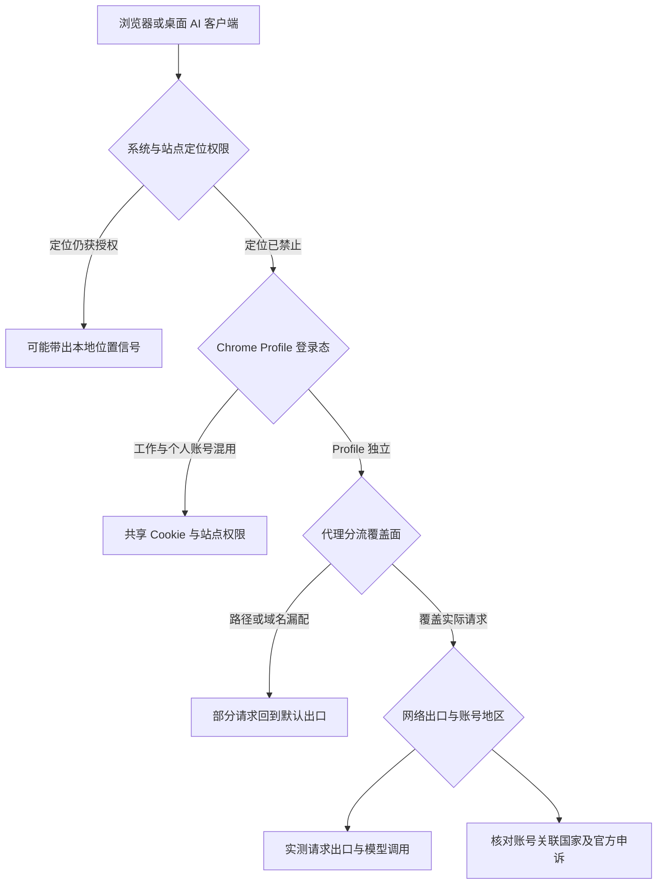

<callout emoji="💡"><p><b>当前验证版：agy CLI 1.5.18，macOS Apple Silicon。</b>本地地区补丁只解除客户端的一处资格拦截，模型调用仍需要可用的网络出口。2026 年 11 月 26 日，同一份补丁副本在原分流下报地区 400，切到新加坡全局后 Neon、Carbon、文件工具、跨版本会话恢复和 ACP 历史回放均通过。</p><p>正式升级后，还要把新的 <code>managed-1.5.18/agy</code> 路径加入 Antify。只保留旧版路径和外层启动器规则，可能漏掉真正发请求的程序。本文保留定位治理、网络切换和官方账号路线，并补入客户端补丁机制、升级方法与<a href="#工具下载">脚本下载</a>。补丁不改变账号关联国家或服务端权益，也不能保证未来版本继续兼容。</p></callout>

# 一、为什么总被判回中国：四层泄漏面

挂上海外代理、关闭某个站点的定位，并不代表 Google 看到的所有地区信号都已变化。[Google 服务条款](https://policies.google.com/terms)显示的国家、当前请求出口和账号历史关联地区也不能混为一谈。排查时先拆开下面四层：



| 泄漏层级 | 常见现象 | 排查重点 | 处理方式 |
|-|-|-|-|
| **定位权限层** | `google.com` 或其他站点曾获定位授权 | 站点可能调用 macOS 定位服务；代理 IP 不会代替定位坐标 | Chrome Profile 默认定位改为禁止，清理允许白名单，在系统设置核对浏览器和 AI 客户端定位权限 |
| **Profile 容器层** | 工作窗口里又添加了个人 Gmail | 同一 Profile 共享 Cookie、设备信息和站点权限 | 工作 Profile 只登工作号；个人号使用独立 Profile，各自维护权限和扩展 |
| **分流漏网层** | 只代理少数 AI 域名，或仍匹配旧 CLI 路径 | 条款、账号、搜索和 API 可能走默认出口；可执行文件升级后路径也会变化 | 浏览器覆盖核心域名；桌面端覆盖实际程序路径，启用远程 DNS，并验证真实模型请求 |
| **出口与账号地区** | 当前出口是新加坡，账号仍关联其他国家 | 账号关联国家不会随 VPN 立即改变，网页地区也不等于 API 放行 | 分别核对出口和账号；官方申诉如实说明情况，不以 VPN 出口冒充居住经历 |

# 二、网络方案二选一：精细分流与个人代理

桌面端 `agy` / Gemini 客户端与浏览器分处不同进程。按工作环境选一套主方案，避免两套代理同时接管同一条连接。

## 2.1 日常办公网：桌面按进程，浏览器按域名

如果内网访问需要保持直连，可用 Antify 接管桌面 AI 程序和 CLI，再由 FoxyProxy 接管个人浏览器 Profile 的 Google 请求。

- **桌面端与 CLI：** Antify 规则应覆盖实际可执行文件，开启远程 DNS，并关闭“派生子进程继承”。这样 AI 程序自己的流量走代理，它启动的 `git`、`ssh` 等工具仍可按原网络访问。
- **浏览器：** FoxyProxy 使用“按规则代理”和远程 DNS，只覆盖 `*.google.com`、`*.googleapis.com`、`*.gstatic.com`、`*.antigravity.google`、`*.recaptcha.net` 五条核心域名。办公系统和普通国内站点保持直连。

**CLI 更新后必须核对路径。** `~/.local/bin/agy` 可以只是包装脚本，最终执行的是 `~/.gemini/antigravity-cli/bin/managed-1.5.18/agy`。

路径规则只覆盖包装脚本或 `managed-1.5.13`，不代表新二进制也被接管。本次正式切换后，给 Antify 新增实际 1.5.18 路径，入口真实请求才恢复成功。

Antify 也会提示版本目录在下次升级时失效，并建议改用父目录规则。若选择目录匹配，要确认目录内有哪些程序；按单个版本路径匹配更明确，但每次升级需刷新。附带的 `build-antify` 命令会扫描本机多版本 CLI 路径，导入后仍要核对当前生效规则。

- 不要为了省事代理整个 Chrome 进程。如果上游只放行白名单域名，整进程代理可能让普通网页卡顿或超时。对轮换出口或白名单代理，换代理后先实测核心域名。
- 流媒体和无 Cookie 下载 CDN 可单独处理。本机曾遇到代理 `youtube.com` / `googlevideo.com` 后视频无法播放，以及代理 `googleusercontent.com` / `gvt1.com` / `withgoogle.com` 后扩展下载返回 504。

这些域名不必与账号核心域名使用同一组规则；具体是否直连，取决于网络可达性与使用需求。

## 2.2 独立个人 Mac：OpenSurge / Mihomo 规则模式 TUN

使用 [OpenSurge for Mac](https://github.com/YTwsy/OpenSurge-for-Mac) 或 Clash/Mihomo 时，核对以下设置：

- **专用策略组不带 `DIRECT` 回退：** `agy`、`language_server` 与 Google 相关域名指向可用海外节点，避免节点波动时请求静默回到本地直连。
- **DNS 与代理分开配置：** Google 域名可走代理解析；代理节点域名和普通国内域名使用明确上游，避免解析循环或影响内网。
- **切换后用真实模型验收：** 网页测速返回 204、出口查询显示支持区，都不能单独证明模型 API 可用。先开独立测试进程发一条目标模型请求；故障旧进程如仍沿用旧连接，再在可中断点退出并精确恢复，保留其他正常任务。

## 2.3 三场景网络切换速查表

| 所在场景 | 主方案 | 需要检查的冲突项 | 切换后验收 |
|-|-|-|-|
| **办公网，内网需直连** | Antify + Chrome FoxyProxy | 同时运行的 OpenSurge / Mihomo TUN、系统全局代理 | `status` 检查配置，核对新 CLI 路径，目标模型真实生成 |
| **家、咖啡厅或手机热点** | OpenSurge / Mihomo 规则模式 TUN | 残留的 Antify 和 FoxyProxy 旧代理 | 停用不可达旧代理，测试出口及目标模型 |
| **海外可用直连** | 无分流直接访问 | 未停用的代理或 TUN | `discover` 检查当前路由，再测试目标模型 |

**全局 VPN 可用于诊断对照。** 本次新加坡全局模式下，新版模型恢复了，但这是改变整机路由的诊断条件。回到精细分流后仍要核对实际程序路径、DNS 和目标接口；不能把一次全局成功当成旧分流配置也已正确。

# 三、账号与地区：官方路线与本地补丁

Google 与 Apple 生态中至少有三类地区信息：

| 概念 | 查看入口 | 影响 | 常见误解 |
|-|-|-|-|
| **服务条款关联国家** | [Google 服务条款](https://policies.google.com/terms) | 账号在相关服务中的地区归属 | 改付款币种或 Google Play 地区，不等于这里也变 |
| **付款资料国家** | [Google Payments](https://pay.google.com/) | 订阅结算与家庭组地区条件 | 付款国家、账号关联国家、当前请求出口是不同信息；不要误关在用订阅的钱包 |
| **App Store 地区** | Apple 设备商店账号 | iOS 下载与内购 | 与 Google 账号关联国家无关，不必强求一致 |

使用官方账号路线时，可以选择国家关联申诉，或符合条件的支持区账号与家庭组共享：

- **官方申诉：** 到 [Google 国家／地区关联申请页](https://policies.google.com/country-association-form)如实提交情况。单一稳定出口便于减少排查变量，但 VPN 本身不是居住事实，也不保证申诉成功。
- **家庭组共享：** 由已订阅主号邀请符合地区条件的家庭成员；确认 [Google One](https://one.google.com/) 中“与家人共享”已开启。成员保留独立账号与历史，共享不会改变其账号关联国家。

家庭组的管理员与成员需要符合 Google 的国家条件。保留正常扣费的钱包，避免反复创建、关闭资料。改区和切换家庭组的时间限制，以账号页面和 [Google 家庭组帮助](https://support.google.com/families/answer/7103337)为准。

## 3.1 两个开源方案的实现不同

本次客户端补丁参考了以下公开来源：

| 方案 | 核对版本 | 改动范围 | 对 CLI 的作用 |
|-|-|-|-|
| [liuhanzhang Gist](https://gist.github.com/liuhanzhang/bd36e89cce9a4354898b9c2c2ec0ccca) | 2026-11-19，`a84aa96d547b` | 通过本机 CDP 临时替换桌面 `main.js` 的资格与引导页判断 | 依赖 Electron 窗口，不能直接应用到终端 CLI |
| [antigravity-hakimi](https://github.com/cli117/antigravity-hakimi) | 2026-11-25，`4a4225211fb0` | 动态解析 Go 函数表，修改 `ValidateAndOnboardAccount` 中 `ineligibleTiers` 的 `free-tier` 分支 | 上游明确支持 macOS ARM64 和 Linux CLI；本次在 1.5.18 核验 |
| 本文的 `reapply_checked.py` | `1.0.0`，本次验证 CLI 1.5.18 | 默认只读；唯一匹配后，只在指定新副本中改一条指令并保留签名权限 | 用于保守适配和升级前隔离验证，未知结构拒绝修改 |

Gist 读取 `HasAuthToken`、`GetAuthStatus`，必要时刷新模型缓存，再让桌面页面进入主界面；它没有把后端 `hasValidAuth` 改成 `true`。能进入界面不等于生成请求一定会被放行。

哈基米修改 Go 二进制中的本地资格判断，同时保留 `allowedTiers` 检查。补丁不更改账号地区、不提供订阅权益，也不解除生成服务的网络地区限制。作者的成功记录可以提供线索，自己使用的版本和网络仍需验证。

## 3.2 地址变化，靠特征重新定位

1.5.13 的补丁点为文件偏移 `0x1c9d228`，1.5.18 为 `0x1f73a78`。**不要把旧地址直接写到新文件。** 脚本先解析 Mach-O 和 Go 函数表，再验证完整 `free-tier` 字符串、当前函数内的回跳与相邻类型调用，只接受一个语义候选。

本次最新上游 Node、Python 检查器与本机脚本都命中新版同一位置，写入 `c8 ff ff 17`。修改范围是一条四字节指令；重签名还会改变签名元数据，不能把“只改四字节指令”理解为“整个文件只有四字节变化”。

本次只需要这处地区补丁。排查时尝试过另一个 Orchestrator 兼容改动，但它没有解决错误；切换网络后，最小地区补丁副本已成功，因此正式版没有加入该实验改动。也没有改内置系统提示词、工具声明或会话正文。

# 四、400、401 与版本升级

先看错误发生在本地资格阶段，还是模型生成阶段：

| 报错类型 | 典型特征 | 排查与恢复 |
|-|-|-|
| **本地资格未通过** | `Eligibility check failed`，尚未开始生成 | 核对官方账号资格；若使用补丁，检查当前二进制指纹、补丁状态和签名，不只看版本号 |
| **生成服务地区 `400`** | `FAILED_PRECONDITION`、`User location is not supported` | 核对真实请求出口、DNS、分流规则及新程序路径；用相同补丁副本做网络对照，不能默认需要更多补丁 |
| **认证 `401`，续期后异常** | 长任务突然出现 `UNAUTHENTICATED` | 保存相关日志，先在原会话尝试一次“继续”；若仍失败，只退出故障进程并精确恢复，不关其他正常窗口 |
| **认证 `401`，授权被撤销** | 在账号设备页退出了关联 CLI 的授权会话 | 凭据可能已失效；确认网络可用后通过官方入口重新登录，不能仅靠重复“继续”解决 |

小时级续期异常有 [Google 开发者论坛的公开报告](https://discuss.ai.google.dev/t/bug-antigravity-cli-1-3-6-a-running-turn-fails-with-401-unauthenticated-right-after-the-hourly-token-refresh/190499)，但不能据此断言所有 401 都是同一竞态。

本次没有做长时间或每小时续期验证。[Gemini API 错误定义](https://ai.google.dev/gemini-api/docs/api-errors)可帮助区分认证、限流和过载，不代替 CLI 的具体日志。

## 4.1 1.5.18 升级实测

2026 年 11 月 26 日，同一份补丁二进制在原分流下生成失败，新加坡全局模式下恢复。公开出口查询显示 SG；Antify 的具体失败规则未逐条定位。旧版成功不能单独证明新版请求已走正确出口。

| 测试 Case | 验证思路 | 验证证据 | 最终结论 |
|-|-|-|-|
| 最新上游补丁与本机副本 | 比较指令范围及签名前后摘要 | 新版唯一补丁点一致，严格签名检查通过 | 通过 |
| 原网络下 1.5.18 | 独立目录发起最小 Neon 请求 | 返回生成地区 400 | 未通过 |
| 新加坡全局下 Neon／Carbon | 同一二进制，分别发真实请求 | 两者均 `SUCCESS` | 通过 |
| 新加坡全局下 1.5.13 对照 | 同账号、同类最小请求 | `SUCCESS` | 通过 |
| 文件工具和流输出 | 要求读取测试文件里的随机字符串 | `read_file` 有 `ACTIVE`／`DONE`，最终返回正确内容 | 通过 |
| 1.5.13→1.5.18 会话恢复 | 新版恢复旧版创建的独立测试会话 | 同一会话 ID，记住上一条回复，`SUCCESS` | 通过 |
| ACP 历史回放 | 初始化并加载测试会话，不发生成提示词 | 4 条历史更新，原回复正确回放 | 通过 |
| 正式切换后的 Antify 路径 | 补入 `managed-1.5.18/agy`，再从统一入口请求 | 入口运行 1.5.18，返回“升级验证通过” | 通过 |
| 原任务保护 | 比较文件指纹、进程启动时间与路径 | 原四个 1.5.13 任务继续运行，相关配置未改 | 通过 |

以上是本机特定版本与网络的结果。会话恢复使用独立测试数据；ACP 验证了初始化和回放，没有重新测试 ACP 生成。长任务与每小时续期仍需实际运行观察，不承诺未来版本自动适配。

## 4.2 安全升级与回退

### 固定版本，先判断升级是否值得

**当前固定在已验证的 1.5.18，自动更新持续关闭。** 官方更新或重装会用新原件替换本地程序，原有二进制补丁不会随之保留，因此不能让后台更新器直接覆盖正在使用的版本。

每次准备升级，先阅读官方发布说明，判断新增功能或修复是否解决当前需求，再核对兼容变化和迁移代价。没有明确收益就继续使用固定版，不因版本号更高而升级。

值得升级时也先处理副本：按新版的函数和指令特征重新检查补丁，必要时适配脚本，保留官方原件并重签。旧偏移和上次成功记录都不能代替本次验证；未知结构时停止，保持当前版本。

升级记录保留目标版本、升级理由、官方原件与补丁指纹、验收结果和回退入口。隔离验证通过、用户确认后，才切换正式入口；切换后继续禁自动更新，再核对真实程序路径和模型回执。

### 下载原件并生成副本

先下载官方原件并核对发布清单的哈希，再生成新副本。`https://antigravity.google/cli/install.sh` 可能取得更高版本，不能把今天的下载地址当成永久 1.5.18。

官方安装脚本即使指定 `--dir`，仍可能使用共享缓存并配置 shell。需要隔离时，先阅读脚本，按 [官方发布清单](https://antigravity-cli-auto-updater-974169037036.us-central1.run.app/manifests/darwin_arm64.json)取包并校验。

测试安装不能覆盖正在使用的入口。

本文脚本的最短用法：

```bash
python3 reapply_checked.py --source "/路径/官方/agy"
python3 reapply_checked.py --source "/路径/官方/agy" \
  --output "/已创建的新目录/agy"
```

只读结果为 `needs_patch` 时可生成副本；`already_applied` 不必重复修补；`rejected` 时停止，保留原件，不能放宽检查或猜地址。

### 验证独立配置与真实请求

普通 CLI 本次实测的隔离参数是：

```bash
AGY_CLI_DISABLE_AUTO_UPDATE=true "/新副本目录/agy" \
  --gemini_dir "/绝对路径/测试配置" \
  --app_data_dir antigravity-cli \
  --model "Orchestrator (Neon)" \
  --print "兼容性验证，只回复验证通过，不调用工具。" \
  --output-format json
```

`--gemini_dir` 是绝对路径，`--app_data_dir` 是其下的相对目录。仅设置目录环境变量，本次普通 CLI 仍回退到正式存储；须从日志确认 `appDataDir` 指向测试区。测试工作目录也应独立，必要时加系统写保护，防止误写正式配置。

### 切换固定入口并保留旧版

验收通过后，将程序放在版本目录，统一入口保持禁自动更新：

```sh
#!/bin/sh
export AGY_CLI_DISABLE_AUTO_UPDATE=true
exec "$HOME/.gemini/antigravity-cli/bin/managed-1.5.18/agy" "$@"
```

**变量值使用字符串 `true`。** 仅在 `.zshrc` 设置它，不能覆盖桌面应用或脚本直接调用 CLI 的情况。手动重装仍可能覆盖包装入口，升级后同时核对版本、指纹和补丁状态。

切换入口只影响新启动的任务，已经运行的旧版进程继续使用原程序。保留旧程序和入口备份；若新版有异常，先恢复入口供后续任务使用，不终止其他正常进程。Antify 分流还要覆盖新版本的真实路径。

### 多窗口精确恢复

多窗口恢复用准确 ID：

```bash
agy --conversation <完整会话ID>
```

1.5.18 也支持 `agy --resume <id>` 和 `agy -r <id>`。不记得 ID 时在交互界面用 `/resume` 按标题检索；多窗口避免 `-c`，它可能选中最近的测试会话。

终端显示 `Session Contents Restored` 只代表屏幕回放，不证明任务进程仍活着，也不要同时用两个进程打开同一个会话。

# 五、可下载脚本与使用范围

<a id="工具下载"></a>

完整脚本放在附件中，正文保留用途和必要短示例。下载包没有账户令牌、私人代理地址或原会话；也没有预先改好的客户端二进制。

| 下载 | 用途 | 验证与边界 |
|-|-|-|
| [网络体检脚本 google-clean-kit.sh](/assets/downloads/google-region-20261126/google-clean-kit.sh) | 状态检查、出口探测、定位清理、FoxyProxy／Antify 配置生成 | 从本文原七合一脚本移出，脚本内容保留；会读本地配置，修改类命令按用途执行 |
| [地区补丁脚本 reapply_checked.py](/assets/downloads/google-region-20261126/reapply_checked.py) | 默认只读检查，在指定新副本中适配并重签 | 本次验证 macOS ARM64、CLI 1.5.18；未知结构拒绝，不能当作长期版本保证 |
| [完整脚本包与说明](/assets/downloads/google-region-20261126/google-region-tools-20261126.zip) | 两份脚本、使用说明及校验文件 | 使用前解压阅读 README，先检查后修改 |
| [下载说明](/assets/downloads/google-region-20261126/README.md)／[SHA-256](/assets/downloads/google-region-20261126/SHA256SUMS.txt) | 查看依赖、动作范围及核对文件 | 完整性校验不代替阅读脚本或目标版本验证 |

`google-clean-kit.sh` 依赖 `bash`、Python 3、`curl` 和部分命令所需的 `osascript`。先运行只读命令：

```bash
bash google-clean-kit.sh status --json
bash google-clean-kit.sh discover --json
```

七个子命令的范围：

- **`status [--json]`：** 检查代理进程、系统代理、Chrome Profile、配置快照、CLI 路径覆盖和 DNS。旧备份不一定反映 Antify 当前策略，最终以应用中的生效规则和真实请求为准。
- **`discover [--json] [--candidate <proxy_url>]...`：** 探测本机已有出口和公开端点，按结果推荐候选；不扫描内网网段。
- **`auto`：** 串联出口探测和配置生成，接受 `--output`、`--antify-output`。生成文件不等于已导入或已生效。
- **`clean-chrome`：** 备份偏好，优雅退出 Chrome，清理定位允许项并设为禁止；随后打开系统定位设置供本人确认。
- **`build-foxyproxy <host> <port> [type] [output] [title]`：** 经指定代理探测五条核心域名，生成 FoxyProxy 配置。
- **`build-antify <host> <port> [type] [output] [proxy_name]`：** 扫描本机应用与多版本 CLI 路径，生成 Antify 备份；导入前核对路径和代理。
- **`verify <proxy_url> [country_keyword] [country_code]`：** 检查条款、搜索、变体接口和 YouTube 可达性及地区特征。这些指标不能证明模型生成已放行，仍需目标模型真实回执。

# 六、换新电脑或新网络的落地顺序

1. **先下载脚本，做状态与出口检查：**
   ```bash
   bash google-clean-kit.sh status
   bash google-clean-kit.sh discover
   ```
   有明确代理地址时可用 `--candidate http://proxy.example.com:8118`。先分清直连、代理和 TUN，不同时叠加多个接管方案。
2. **核对定位与浏览器 Profile：**
   ```bash
   bash google-clean-kit.sh clean-chrome
   ```
   保存工作后再执行修改类命令。系统定位开关由本人确认；工作号与个人号放到独立 Profile。
3. **需要分流时生成配置：**
   ```bash
   bash google-clean-kit.sh auto \
     --output ./foxyproxy-generated.json \
     --antify-output ./antify-generated.json
   ```
   FoxyProxy 导入后保存并选择“按规则代理”；Antify 导入后确认当前策略、远程 DNS、派生子进程设置，以及新 CLI 的实际路径。
4. **逐个账号核对云端与付款状态：** 查看 [活动控件](https://myactivity.google.com/activitycontrols)、[数据与隐私](https://myaccount.google.com/data-and-privacy)、[已登录设备](https://myaccount.google.com/device-activity)与 [Payments](https://pay.google.com/)。按需求管理定位，保留在用订阅的钱包和关联正常 CLI 的授权。
5. **安装或迁移 CLI：** 保留官方原件和已验证备份；补丁先在新副本检查，配置与会话不覆盖。目标模型、工具调用和恢复验证通过后再切统一入口。

# 七、实战中容易混淆的细节

1. **设备页退出授权可能导致 401。** 关联 `Google Antigravity` 的设备会话可能承载本机 CLI 凭据。需要重置时先确认网络可用，再通过官方登录恢复；不要为清理页面随意退出正在使用的授权。
2. **网页账号与 Chrome 同步账号不同。** Google 网页右上角切号只影响网页登录态；书签、历史和密码由 Profile 同步账号管理。换绑前导出书签备份，不选择清除本地数据。
3. **付款资料检查要保留在用钱包。** 已有海外订阅并不要求每次 API 请求都使用付款国家的 IP；不要为排查地区问题关闭正常扣费资料。
4. **新出口可能触发二次验证。** 账号安全页、设备页和付款页可能要求手机或验证码。按官方流程完成，不能仅凭验证提示就判断分流配置错误。
5. **手机定位按实际用途设置。** 不需要定位的 Google 应用可关闭；出差旅行时地图按使用需要授权。定位坐标、当前出口和账号关联国家各自核对。
6. **出口变化不等于账号改区。** 当前请求可以立即走新出口，账号关联国家仍需官方流程；没有固定“养号天数”或保证成功的方法。
7. **版本号不等于补丁指纹。** 同版本也可能被重装覆盖，只有路径、版本、哈希、补丁状态及真实回执一起核对，才能知道正在用的是哪一份程序。

# 八、给 AI Agent 的执行约定

将本文和脚本交给 Coding Agent 时，说明工程目录、当前网络、准确目标版本，以及哪些任务正在运行。

1. **先检查再修改：** 只读核对当前版本、实际程序路径、分流覆盖及出口。源码、日志和本轮回执优先，历史成功记录不代表当前可用。
2. **固定版本，升级先评估：** 自动更新持续关闭。先说明发布内容对当前使用是否有明确收益；值得升级时，按新版特征重新检查并适配补丁，在独立副本验收，保留升级记录与回退材料。用户确认后才切正式入口，不覆盖原配置、会话或正在跑的任务。
3. **保留正在运行的任务：** 更新入口和新增版本路径无需结束旧任务。只有某个进程确需断开旧连接时，在可中断点只处理该进程，按准确 ID 恢复。
4. **按错误分层处理：** 本地资格、生成地区 400、认证 401 分开。补丁已生效却生成失败时先验证出口；不能吞掉错误、伪造成功，或修改内置提示词、工具和消息来凑结果。
5. **人工动作按需确认：** 登录、验证码、系统权限、云端账号变更由本人完成。已经授权的本地检查、可逆改动和验收连续执行，不重复索取许可。
6. **公开资料去除私有信息：** 不发布令牌、代理口令、账户邮箱、私人路径、原始会话或内部文档全文。正文保留可复用结论与公开来源，完整代码提供附件。

# 九、公开参考与版本说明

- [Antigravity 官方 CLI 安装脚本](https://antigravity.google/cli/install.sh)与 [macOS ARM64 发布清单](https://antigravity-cli-auto-updater-974169037036.us-central1.run.app/manifests/darwin_arm64.json)：下载前检查当前版本及校验值。
- [Antigravity 官方更新记录](https://antigravity.google/docs/changelog)：本次页面列到 1.5.16，实际下载清单提供 1.5.18，两者更新时间可能不同。
- [liuhanzhang 的桌面地区提示页方案](https://gist.github.com/liuhanzhang/bd36e89cce9a4354898b9c2c2ec0ccca)：本次核对 11 月 19 日修订。
- [哈基米固定提交的 CLI 地区脚本](https://github.com/cli117/antigravity-hakimi/blob/4a4225211fb0f8d0072dc28c9c9584dd2de0837d/unlock/agy-cli/agy-patch.py)与 [项目 README](https://github.com/cli117/antigravity-hakimi/blob/4a4225211fb0f8d0072dc28c9c9584dd2de0837d/README.md)：本次核对 11 月 25 日主仓提交；上游更新后重新阅读。
- [Google 国家关联申诉](https://policies.google.com/country-association-form)、[家庭组帮助](https://support.google.com/families/answer/7103337)与 [Google One](https://one.google.com/)：账号、家庭与订阅条件以官方页面为准。
- [小时级认证异常的社区报告](https://discuss.ai.google.dev/t/bug-antigravity-cli-1-3-6-a-running-turn-fails-with-401-unauthenticated-right-after-the-hourly-token-refresh/190499)与 [API 错误说明](https://ai.google.dev/gemini-api/docs/api-errors)：作为排查线索，不泛化为本机故障根因。

本文合并了使用、升级与排障材料，公开版保留本机验证范围和可复用方法。当前 CLI 固定为已验证的 1.5.18，自动更新持续关闭；以后按“评估升级收益、按新版适配补丁、隔离验收、用户确认切换”执行，并保留升级与回退记录。
