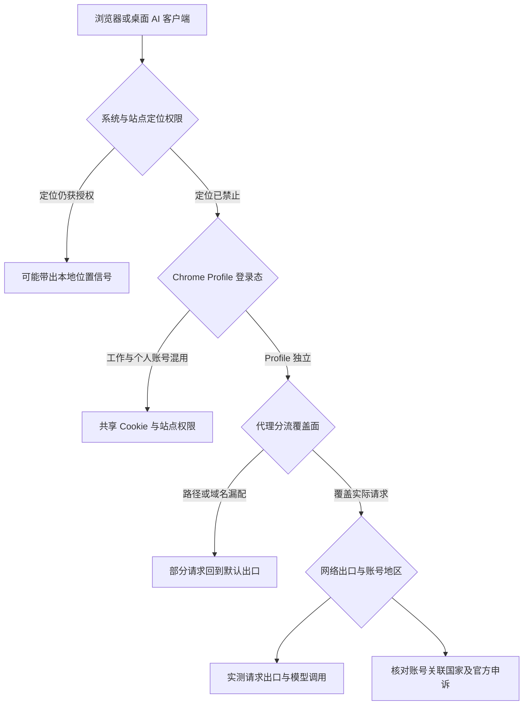

<callout emoji="💡"><p><b>当前验证版：agy CLI 1.5.18，macOS Apple Silicon。</b> 新 Mac 从<a href="#fresh-mac">安装清单</a>开始。顺序是：下载并校验 → 让固定版本的实际程序落盘 → 配好网络规则 → 本人登录 → 真实请求验收 → 启用固定入口。<a href="#工具下载">完整脚本和 README</a>都在下载区。</p><p>只给 AI 这篇网址就能开始。网络接入、符合服务条件的账号和系统授权需要本人准备。源码和候选程序在已有 Mac 的隔离目录验过，未做全新 Mac 首次登录与系统授权的端到端验收。</p></callout>

# 一、为什么总被判回中国：四层泄漏面

挂上海外代理、关闭某个站点的定位，并不代表 Google 看到的所有地区信号都已变化。[Google 服务条款](https://policies.google.com/terms)显示的国家、当前请求出口和账号历史关联地区也不能混为一谈。排查时先拆开下面四层：



| 泄漏层级 | 常见现象 | 排查重点 | 处理方式 |
|-|-|-|-|
| **定位权限层** | `google.com` 或其他站点曾获定位授权 | 站点可能调用 macOS 定位服务；代理 IP 不会代替定位坐标 | Chrome Profile 默认定位改为禁止，清理允许白名单，在系统设置核对浏览器和 AI 客户端定位权限 |
| **Profile 容器层** | 工作窗口里又添加了个人 Gmail | 同一 Profile 共享 Cookie、设备信息和站点权限 | 工作 Profile 只登工作号；个人号使用独立 Profile，各自维护权限和扩展 |
| **分流漏网层** | 只代理少数 AI 域名，或仍匹配旧 CLI 路径 | 条款、账号、搜索和 API 可能走默认出口；可执行文件升级后路径也会变化 | 浏览器覆盖核心域名；桌面端覆盖实际程序路径，启用远程 DNS，并验证真实模型请求 |
| **出口与账号地区** | 当前出口是新加坡，账号仍关联其他国家 | 账号关联国家不会随 VPN 立即改变，网页地区也不等于 API 放行 | 分别核对出口和账号；官方申诉如实说明情况，不以 VPN 出口冒充居住经历 |

# 二、网络方案二选一：精细分流与个人代理

桌面端 `agy` / Gemini 客户端与浏览器分处不同进程。按工作环境选一套主方案，避免两套代理同时接管同一条连接。

## 2.1 日常办公网：桌面按进程，浏览器按域名

如果内网访问需要保持直连，可用 Antify 接管桌面 AI 程序和 CLI，再由 FoxyProxy 接管个人浏览器 Profile 的 Google 请求。

- **桌面端与 CLI：** Antify 规则应覆盖实际可执行文件，开启远程 DNS，并关闭“派生子进程继承”。这样 AI 程序自己的流量走代理，它启动的 `git`、`ssh` 等工具仍可按原网络访问。
- **浏览器：** FoxyProxy 使用“按规则代理”和远程 DNS，只覆盖 `*.google.com`、`*.googleapis.com`、`*.gstatic.com`、`*.antigravity.google`、`*.recaptcha.net` 五条核心域名。办公系统和普通国内站点保持直连。

**CLI 更新后必须核对路径。** `~/.local/bin/agy` 可以只是包装脚本，最终执行的是 `~/.gemini/antigravity-cli/bin/managed-1.5.18/agy`。

先让目标二进制落盘，再生成 Antify 配置。只覆盖包装脚本不够：导入后在 Antify 的生效规则里确认 `managed-1.5.18/agy` 指向选定代理。

Antify 也会提示版本目录在下次升级时失效，并建议改用父目录规则。若选择目录匹配，要确认目录内有哪些程序；按单个版本路径匹配更明确，但每次升级需刷新。附带的 `build-antify` 命令会扫描本机多版本 CLI 路径，导入后仍要核对当前生效规则。

- 不要为了省事代理整个 Chrome 进程。如果上游只放行白名单域名，整进程代理可能让普通网页卡顿或超时。对轮换出口或白名单代理，换代理后先实测核心域名。
- 流媒体和扩展下载可单独处理。若代理下视频无法播放或扩展下载返回 504，分别检查这些域名的可达性，再决定是否分流。

这些域名不必与账号核心域名使用同一组规则；具体是否直连，取决于网络可达性与使用需求。

## 2.2 独立个人 Mac：OpenSurge / Mihomo 规则模式 TUN

使用 [OpenSurge for Mac](https://github.com/YTwsy/OpenSurge-for-Mac) 或 Clash/Mihomo 时，核对以下设置：

- **专用策略组不带 `DIRECT` 回退：** `agy`、`language_server` 与 Google 相关域名指向可用海外节点，避免节点波动时请求静默回到本地直连。
- **DNS 与代理分开配置：** Google 域名可走代理解析；代理节点域名和普通国内域名使用明确上游，避免解析循环或影响内网。
- **切换后用真实模型验收：** 网页测速返回 204、出口查询显示支持区，都不能单独证明模型 API 可用。先开独立测试进程发一条目标模型请求；故障旧进程如仍沿用旧连接，再在可中断点退出并精确恢复，保留其他正常任务。

## 2.3 三场景网络切换速查表

| 所在场景 | 主方案 | 需要检查的冲突项 | 切换后验收 |
|-|-|-|-|
| **办公网，内网需直连** | Antify + Chrome FoxyProxy | 同时运行的 OpenSurge / Mihomo TUN、系统全局代理 | `status` 检查配置，核对新 CLI 路径，目标模型真实生成 |
| **家、咖啡厅或手机热点** | OpenSurge / Mihomo 规则模式 TUN | 残留的 Antify 和 FoxyProxy 旧代理 | 停用不可达旧代理，测试出口及目标模型 |
| **海外可用直连** | 无分流直接访问 | 未停用的代理或 TUN | `discover` 检查当前路由，再测试目标模型 |

**全局 VPN 可用于诊断对照。** 只有在网络策略允许时才切换整机路由。切回精细分流后，要用实际程序重新发一条最小请求，确认程序路径、DNS 和规则都生效。

# 三、账号与地区：官方路线与本地补丁

Google 与 Apple 生态中至少有三类地区信息：

| 概念 | 查看入口 | 影响 | 常见误解 |
|-|-|-|-|
| **服务条款关联国家** | [Google 服务条款](https://policies.google.com/terms) | 账号在相关服务中的地区归属 | 改付款币种或 Google Play 地区，不等于这里也变 |
| **付款资料国家** | [Google Payments](https://pay.google.com/) | 订阅结算与家庭组地区条件 | 付款国家、账号关联国家、当前请求出口是不同信息；不要误关在用订阅的钱包 |
| **App Store 地区** | Apple 设备商店账号 | iOS 下载与内购 | 与 Google 账号关联国家无关，不必强求一致 |

使用官方账号路线时，可以选择国家关联申诉，或符合条件的支持区账号与家庭组共享：

- **官方申诉：** 到 [Google 国家／地区关联申请页](https://policies.google.com/country-association-form)如实提交情况。单一稳定出口便于减少排查变量，但 VPN 本身不是居住事实，也不保证申诉成功。
- **家庭组共享：** 由已订阅主号邀请符合地区条件的家庭成员；确认 [Google One](https://one.google.com/) 中“与家人共享”已开启。成员保留独立账号与历史，共享不会改变其账号关联国家。

家庭组的管理员与成员需要符合 Google 的国家条件。保留正常扣费的钱包，避免反复创建、关闭资料。改区和切换家庭组的时间限制，以账号页面和 [Google 家庭组帮助](https://support.google.com/families/answer/7103337)为准。

## 3.1 当前 CLI 副本

可用官方原件时，优先使用原件。需要维护现有本地副本时，只以本文固定的 macOS ARM64 1.5.18 和配套说明为准。`reapply_checked.py` 默认只读，遇到未知结构会拒绝处理。本地改动不会改变账号归属、订阅权益或生成服务的地区要求。

# 四、400、401 与版本升级

先看错误发生在本地资格阶段，还是模型生成阶段：

| 报错类型 | 典型特征 | 排查与恢复 |
|-|-|-|
| **本地资格未通过** | `Eligibility check failed`，尚未开始生成 | 核对官方账号资格；若使用补丁，检查当前二进制指纹、补丁状态和签名，不只看版本号 |
| **生成服务地区 `400`** | `FAILED_PRECONDITION`、`User location is not supported` | 核对真实请求出口、DNS、分流规则及新程序路径；用相同补丁副本做网络对照，不能默认需要更多补丁 |
| **认证 `401`，续期后异常** | 长任务突然出现 `UNAUTHENTICATED` | 保存相关日志，先在原会话尝试一次“继续”；若仍失败，只退出故障进程并精确恢复，不关其他正常窗口 |
| **认证 `401`，授权被撤销** | 在账号设备页退出了关联 CLI 的授权会话 | 凭据可能已失效；确认网络可用后通过官方入口重新登录，不能仅靠重复“继续”解决 |

地区 `400` 偶发时，记下失败和成功的时间，对照同一程序的 Antify 连接与实际出口。小时流量汇总只能证明有连接走过代理，不能说明哪条请求走了哪条路。[Gemini API 错误定义](https://ai.google.dev/gemini-api/docs/api-errors)可辅助区分认证、限流和过载。

## 4.1 1.5.18 验收标准

| 检查 | 怎么验 | 通过条件 |
|-|-|-|
| 程序与分流 | 核对 SHA-256、签名和 Antify 生效规则 | 校验通过；分流覆盖发请求的实际程序 |
| 模型调用 | 在独立目录登录后，用日常需要的模型发一条短请求 | 收到真实文本响应，JSON 中有 `status: SUCCESS` |
| 正式入口 | 新开终端核对 PATH，再从正式入口做一次短请求 | 命中固定版，启动日志确认自动更新关闭，模型返回成功 |
| 可选功能 | 在单独测试会话里验证文件工具、恢复或 ACP | 按实际用途核对返回值；ACP 能回放历史不代表能生成 |

当前版已在已有 Mac 验证 Neon、Carbon、文件读取、独立会话恢复及 ACP 历史回放。未验证长任务、每小时续期、ACP 生成或跨机迁移。

## 4.2 安全升级与回退

### 固定版本，先判断升级是否值得

**当前固定在已验证的 1.5.18，自动更新持续关闭。** 官方更新或重装会用新原件替换本地程序，原有二进制补丁不会随之保留，因此不能让后台更新器直接覆盖正在使用的版本。

每次准备升级，先阅读官方发布说明，判断新增功能或修复是否解决当前需求，再核对兼容变化和迁移代价。没有明确收益就继续使用固定版，不因版本号更高而升级。

值得升级时也先处理副本：按新版的函数和指令特征重新检查补丁，必要时适配脚本，保留官方原件并重签。旧偏移和上次成功记录都不能代替本次验证；未知结构时停止，保持当前版本。

升级记录保留目标版本、升级理由、官方原件与补丁指纹、验收结果和回退入口。隔离验证通过、用户确认后，才切换正式入口；切换后继续禁自动更新，再核对真实程序路径和模型回执。

### 下载原件并生成副本

固定版按[包内下载说明](/assets/downloads/google-region-20261126/README.md)提取和核对官方原件。当前发布清单会变动，不要拿它代替包内锁定的 1.5.18 下载记录。测试安装不得覆盖正在使用的入口。

本文脚本的最短用法：

```bash
python3 reapply_checked.py --source "/路径/官方/agy"
python3 reapply_checked.py --source "/路径/官方/agy" \
  --output "/已创建的新目录/agy"
```

只读结果为 `needs_patch` 时可生成副本；`already_applied` 不必重复修补；`rejected` 时停止，保留原件，不能放宽检查或猜地址。

### 验证独立配置与真实请求

普通 CLI 本次实测的隔离参数是：

```bash
AGY_CLI_DISABLE_AUTO_UPDATE=true "$HOME/.gemini/antigravity-cli/bin/managed-1.5.18/agy" \
  --gemini_dir "/绝对路径/测试配置" \
  --app_data_dir antigravity-cli \
  --model "Orchestrator (Neon)" \
  --print "兼容性验证，只回复验证通过，不调用工具。" \
  --output-format json
```

先在独立工作目录用相同程序和目录参数交互启动（不加 `--print`），由本人完成 Google 登录和验证码，再发短请求。`--gemini_dir` 是绝对路径，`--app_data_dir` 是其下的相对目录。日志中的 `appDataDir` 必须指向测试区；目录隔离不保证系统钥匙串里的账号凭据独立。

### 切换固定入口并保留旧版

让程序先落在下方版本目录；只有独立验收通过并获确认，才在 `~/.local/bin/agy` 写入统一入口：

```sh
#!/bin/sh
export AGY_CLI_DISABLE_AUTO_UPDATE=true
exec "$HOME/.gemini/antigravity-cli/bin/managed-1.5.18/agy" "$@"
```

给入口执行权限，按当前 shell 的启动文件把 `~/.local/bin` 加到 PATH 前部。新开终端用 `command -v agy` 和 `type -a agy` 确认第一项是这个入口，核对它确实指向 1.5.18 并设置 `AGY_CLI_DISABLE_AUTO_UPDATE=true`，再发实际请求确认生效。

改动前备份已有入口、程序和分流配置；新机若原本没有入口，就记录「原本不存在」。回退时恢复原有配置和入口；若没有旧入口，只撤销本次新增项，再在新终端验证。不清空账号数据，不终止正常进程。

### 多窗口精确恢复

多窗口恢复用准确 ID：

```bash
agy --conversation <完整会话ID>
```

1.5.18 也支持 `agy --resume <id>` 和 `agy -r <id>`。不记得 ID 时在交互界面用 `/resume` 按标题检索；多窗口避免 `-c`，它可能选中最近的测试会话。

终端显示 `Session Contents Restored` 只代表屏幕回放，不证明任务进程仍活着，也不要同时用两个进程打开同一个会话。

# 五、可下载脚本与使用范围

<a id="工具下载"></a>

两份完整脚本可单独下载，ZIP 内有相同源码及 README。新 AI 应先读说明和脚本，再执行；不依赖作者的机器、仓库或会话。

| 下载 | 用途 | 验证与边界 |
|-|-|-|
| [网络体检脚本 google-clean-kit.sh 完整源码](/assets/downloads/google-region-20261126/google-clean-kit.sh) | 状态检查、出口探测、定位清理、FoxyProxy／Antify 配置生成 | 会读取本地配置；修改类命令按需执行 |
| [地区补丁脚本 reapply_checked.py 完整源码](/assets/downloads/google-region-20261126/reapply_checked.py) | 默认只读检查，在指定新副本中适配并重签 | 本次验证 macOS ARM64、CLI 1.5.18；未知结构拒绝，不能当作长期版本保证 |
| [完整源码包与说明](/assets/downloads/google-region-20261126/google-region-tools-20261126.zip) | 两份完整脚本、使用说明、固定版本信息及校验文件 | 使用前解压阅读 README，先检查后修改 |
| [固定 1.5.18 官方原件信息](/assets/downloads/google-region-20261126/agy-1.5.18-darwin-arm64.json) | 官方下载URL、归档SHA-512、原件及补丁SHA-256 | 供新 AI 复现固定版，不自动选择最新版本 |
| [下载说明](/assets/downloads/google-region-20261126/README.md)／[SHA-256](/assets/downloads/google-region-20261126/SHA256SUMS.txt) | 查看依赖、动作范围及核对文件 | 完整性校验不代替阅读脚本或目标版本验证 |

## 5.1 下载与完整性校验

`google-clean-kit.sh` 依赖 Bash、Python 3、curl 和部分命令所需的 osascript；补丁生成依赖 macOS codesign。先新建独立目录，将网站源码下载到本机：

```bash
tool_dir="$(mktemp -d "${TMPDIR:-/tmp}/google-region-tools.XXXXXX")" &&
  curl -fL "https://jobyang.cn/assets/downloads/google-region-20261126/google-region-tools-20261126.zip" \
    -o "$tool_dir/tools.zip" &&
  unzip -q "$tool_dir/tools.zip" -d "$tool_dir" &&
  (cd "$tool_dir" && shasum -a 256 -c SHA256SUMS.txt) &&
  printf '校验通过，目录：%s\n' "$tool_dir"
```

只有看到「校验通过」，才进入打印出的目录，读完 README 和源码后运行。固定版的官方原件下载、签名核对和副本准备见[下载说明](/assets/downloads/google-region-20261126/README.md)。

## 5.2 七个网络命令的作用

七个子命令的范围：

- **`status [--json]`：** 检查代理进程、系统代理、Chrome Profile、配置快照、CLI 路径覆盖和 DNS。旧备份不一定反映 Antify 当前策略，最终以应用中的生效规则和真实请求为准。
- **`discover [--json] [--candidate <proxy_url>]...`：** 探测本机已有出口和公开端点，按结果推荐候选；不扫描内网网段。
- **`auto`：** 串联出口探测和配置生成，接受 `--output`、`--antify-output`。生成文件不等于已导入或已生效。
- **`clean-chrome`：** 备份偏好，优雅退出 Chrome，清理定位允许项并设为禁止；随后打开系统定位设置供本人确认。
- **`build-foxyproxy <host> <port> [type] [output] [title]`：** 经指定代理探测五条核心域名，生成 FoxyProxy 配置。
- **`build-antify <host> <port> [type] [output] [proxy_name]`：** 扫描本机应用与多版本 CLI 路径，生成 Antify 备份；导入前核对路径和代理。
- **`verify <proxy_url> [country_keyword] [country_code]`：** 检查条款、搜索、变体接口和 YouTube 可达性及地区特征。这些指标不能证明模型生成已放行，仍需目标模型真实回执。

# 六、换新电脑或新网络的落地顺序

<a id="fresh-mac"></a>

1. **新机预检。** 确认 `uname -m` 为 `arm64`，准备 Python 3.9+、Bash、curl、unzip、tar、shasum 和 macOS codesign。先选一种网络方式：可用直连、Antify 按路径分流，或已获准使用的 TUN。需要代理时由本人提供获准使用的配置；没有配置或网络扩展被管理策略禁止，就停在这一步。
2. **下载校验，再让程序落盘。** 按第 5.1 节校验源码，按 README 获取并核对固定 1.5.18。将要验收的程序放到 `~/.gemini/antigravity-cli/bin/managed-1.5.18/agy`，确认可执行。如果同路径已有不同程序，先保留原文件，停下来核对。此时不改正式入口，不启动程序。
3. **让实际程序命中网络规则。** 进入工具包目录，用 `bash google-clean-kit.sh status --json` 检查冲突，再用 `bash google-clean-kit.sh discover --json` 查看候选。选择直连时可跳过导入；`auto` 认定可用直连时也不会生成配置。使用 Antify 时，在目标程序已落盘后再生成配置：
   ```bash
   bash google-clean-kit.sh auto \
     --output ./foxyproxy-generated.json \
     --antify-output ./antify-generated.json
   ```
   导入前备份现有规则。本人批准网络扩展后，确认 Antify 生效规则覆盖实际程序路径。Chrome 才需要 FoxyProxy：在个人 Profile 导入并选择按规则代理，和工作账号分开。`clean-chrome` 会备份并修改全部可见的 Chrome Profile，按需执行；先保存浏览器工作。
4. **本人登录，独立验收。** 按第 4.2 节从实际路径在独立目录启动，由本人完成 Google 登录、MFA 或系统授权。确认日志里的配置目录正确，再发目标模型短请求。资格、地区或认证错误按第 4 节分别处理；失败就保持原入口。
5. **验收通过后再启用正式入口。** 记录所用版本、文件指纹、实际路径、网络方式、模型回执和回退点。确认后按第 4.2 节启用固定入口，新开终端核对 PATH、版本和禁自动更新状态，再发一条短请求。回退时恢复留存的入口和规则；旧会话迁移另行验证。

# 七、实战中容易混淆的细节

1. **设备页退出授权可能导致 401。** 关联 `Google Antigravity` 的设备会话可能承载本机 CLI 凭据。需要重置时先确认网络可用，再通过官方登录恢复；不要为清理页面随意退出正在使用的授权。
2. **网页账号与 Chrome 同步账号不同。** Google 网页右上角切号只影响网页登录态；书签、历史和密码由 Profile 同步账号管理。换绑前导出书签备份，不选择清除本地数据。
3. **付款资料检查要保留在用钱包。** 已有海外订阅并不要求每次 API 请求都使用付款国家的 IP；不要为排查地区问题关闭正常扣费资料。
4. **新出口可能触发二次验证。** 账号安全页、设备页和付款页可能要求手机或验证码。按官方流程完成，不能仅凭验证提示就判断分流配置错误。
5. **手机定位按实际用途设置。** 不需要定位的 Google 应用可关闭；出差旅行时地图按使用需要授权。定位坐标、当前出口和账号关联国家各自核对。
6. **出口变化不等于账号改区。** 当前请求可以立即走新出口，账号关联国家仍需官方流程；没有固定“养号天数”或保证成功的方法。
7. **版本号不等于补丁指纹。** 同版本也可能被重装覆盖，只有路径、版本、哈希、补丁状态及真实回执一起核对，才能知道正在用的是哪一份程序。

# 八、给 AI Agent 的执行约定

把本文网址交给 Coding Agent 时，可以直接说：「按新 Mac 安装清单执行当前固定版本。到账号登录、系统授权或缺少合规网络配置时停下来告诉我；给我看实际版本、分流命中和模型回执，确认后再切入口。」

1. **先检查再修改：** 只读核对当前版本、实际程序路径、分流覆盖及出口。源码、日志和本轮回执优先，历史成功记录不代表当前可用。
2. **固定版本，升级先评估：** 自动更新持续关闭。先说明发布内容对当前使用是否有明确收益；值得升级时，按新版特征重新检查并适配补丁，在独立副本验收，保留升级记录与回退材料。用户确认后才切正式入口，不覆盖原配置、会话或正在跑的任务。
3. **保留正在运行的任务：** 更新入口和新增版本路径无需结束旧任务。只有某个进程确需断开旧连接时，在可中断点只处理该进程，按准确 ID 恢复。
4. **按错误分层处理：** 本地资格、生成地区 400、认证 401 分开。补丁已生效却生成失败时先验证出口；不能吞掉错误、伪造成功，或修改内置提示词、工具和消息来凑结果。
5. **人工动作按需确认：** 登录、验证码、系统权限、云端账号变更由本人完成。已经授权的本地检查、可逆改动和验收连续执行，不重复索取许可。
6. **公开资料去除私有信息：** 不发布令牌、代理口令、账户邮箱、私人路径、原始会话或内部文档全文。正文保留可复用结论与公开来源，完整代码提供附件。

# 九、公开参考与版本说明

- [Antigravity 官方 CLI 安装脚本](https://antigravity.google/cli/install.sh)与 [macOS ARM64 发布清单](https://antigravity-cli-auto-updater-974169037036.us-central1.run.app/manifests/darwin_arm64.json)：下载前检查当前版本及校验值。
- [Antigravity 官方更新记录](https://antigravity.google/docs/changelog)：评估是否值得升级时参考。本文安装步骤使用锁定的 1.5.18 原件。
- [本地工具的上游来源](https://github.com/cli117/antigravity-hakimi)。
- [Google 国家关联申诉](https://policies.google.com/country-association-form)、[家庭组帮助](https://support.google.com/families/answer/7103337)与 [Google One](https://one.google.com/)：账号、家庭与订阅条件以官方页面为准。
