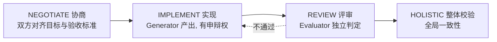

<callout emoji="💡">
**一句话感想：**外面聊 Harness 多在讨论怎么塞上下文和调工具；读完公司内四篇材料发现，大家真正抠破头的其实是**权责分配与可纠偏性**——在一个必然出错的系统里，到底谁有资格拍板「这活做对了」。
</callout>

这篇是学习笔记：记一下前因后果、打破原来认知的四个点，以及几篇文档之间还在争执的分歧。

# 为什么又回头重看 Harness

之前看外部资料，满脑子都是 **Agent = Model + Harness**：模型外头套一层壳管记忆、工具和循环。概念都能复述，但总觉得只停在怎么拼零件，没摸清为什么非得这样搭。顺着这个疑问翻了四篇内部文档，果然挖出不少外部少提的深水区。

<callout emoji="📝">
说明：下文提及的状态名称、角色设定与实验数据均源自文末附上的四篇内部实践文章，这里保留原称呼方便对照。
</callout>

---

# 打破原来认知的四个切面

## 控制论视角：出错先诊断，别一律重试

外部讲 Harness 都在堆能力；有篇内部文档却直接搬出钱学森《工程控制论》和维纳，讨论这套系统「到底可不可控」。出了问题不能只靠换句提示词再跑一次，它按性质把偏差切成三类：

| 偏差类型 | 实际表现 | 对应的纠偏动作 |
|-|-|-|
| 执行型偏差 | 大目标没错，只做歪了某一步骤 | 局部重试或修正单步，成本最低 |
| 语义型偏差 | 理解歪了，做的事情偏离了原本需求 | 退回上一步决策点重新对齐意图 |
| 控制型偏差 | 计划本身有问题，越跑离目标越远 | 触发全局重来，不在错路子上补补丁 |

为了把这套纠偏落下去，它还配了两招：**双轨验收**（黑盒核对结果，白盒审计过程），以及**限幅、阻尼、熔断、降级**四项控制机制，避免 Agent 自己纠偏时陷入死循环自我震荡。

<callout emoji="💡">
遇到 Agent 出错，第一步不该是猛点重试，而是先分诊：**执行失手、理解歪了，还是方向本身错了？**
</callout>

## 去掉中心 Planner：谁也不能独占裁判权

常见多 Agent 设计总爱放个「超级大脑」当 Planner 拆任务定标准。另一篇直接砍掉了中心 Planner，理由很直接：所有规划压在一个角色手里，既是效率瓶颈，也是偏见放大器。

取而代之的 Sprint Contract 把协作切成四段协商式推进：

这四步里有两个很实在的设计：一是允许实现方（Generator）在被拒时申辩，避免评审一言堂误杀；二是让评审方（Evaluator）和实现方完全隔离上下文，立场不纠缠。

<callout emoji="✅">
**重点是没人能垄断对错标准。**「做没做好」必须在协商和独立校验里得出结论，不能让单个计划角色自说自话。
</callout>

## Agent 系统：用权限和状态机把纪律卡死

和上面去中心化刚好相反，程楠写的 Agent 系统 承认系统需要一个协调核心，但它把协作纪律做成系统硬约束，比如只读角色在底层干脆没有写文件权限，从物理上断掉越界可能。

具体落了四条规则：

- **调度层不下场干活：**Team Lead 只做拆解、派单与验收，和执行角色彻底分开
- **23 个专精角色绑死权限：**能看什么、改什么由权限配置硬性限定，不靠软提醒
- **9 个状态显式流转：**`standby`、`classifying`、`brainstorming`、`routing`、`task_assignment`、`monitoring`、`plan_review`、`plan_confirmation`、`backflow`，每步走到哪清晰可查
- **回流优于盲目重试：**出问题按状态机回流（backflow）到对应环节重处理，加上防空转熔断阈值

流程前后还卡了两道闸：动手前先过一遍 Plan Gate，避免在错计划上白烧算力；交付前再走一轮双重评审。

<callout emoji="❗">
**硬约束胜过好脾气提示词：**任务一复杂、对话一拉长，写在 prompt 里的温柔约定迟早被绕穿；只有系统权限和状态机能真卡住边界。
</callout>

## 四层状态容器：怎么记状态才不越跑越乱

讲运行时 Agent 运行时 的那篇，专门回答了一个工程问题：Agent 连续跑几天后，状态该怎么存、怎么接续，同时避免历史越滚越脏。它把状态装进了四层嵌套容器：

| 层级 | 存什么 | 关键规矩 |
|-|-|-|
| Tool Call / Result | 单次工具调用和它的返回 | 必须成对落账，不允许只有发起没有返回 |
| Turn | 完整一轮来回交互 | 由若干对调用与结果拼成 |
| Session | 一段连续会话（落进 SQLite） | 状态持久化的基本存储单位 |
| Lineage | 会话血缘（`parent_session_id`） | 上下文快满时另起新会话挂回父 ID，不原地无限拉长 |

我觉得最巧的设计在上下文压缩（compaction）：它不直接在原消息数组里咔嚓删旧历史，而是新开一个干净 session，通过 `parent_session_id` 指向前面那段会话。新窗口轻量好跑，真要回头查原现场时也能顺着血缘爬回去。

---

# 四篇文档打架的地方，恰恰最有信息量

本来想把这几篇归拢出一份统一做法，写着写着发现它们在好几个关键点上完全拧着：

| 分歧点 | 一派主张 | 另一派主张 |
|-|-|-|
| 要不要中心计划者 | Agent 系统 设 Team Lead 统一派单，靠硬纪律维持秩序 | Sprint Contract 拿掉 Planner，让双方先协商标准 |
| 权力集中还是制衡 | 集中编排配合角色权限切分，纪律靠系统卡死 | 分散协商配合独立评审，靠多角色互相制衡 |
| 出错后的主修路子 | 按状态机回流（backflow）到前面指定环节 | 评审打回加实现方申辩，来回对齐到过线为止 |

虽然方案选型还在打架，但有一点四篇全站在一边：

<callout emoji="⭐">
**模型自己评不准自己做的事。**不管架构怎么搭，判定「做对、做完」的权力都必须移交给外部机制：独立的 Evaluator、双轨验收，或者另起分类器审权限。差别只在谁当裁判，不在要不要裁判。
</callout>

---

# 记下来的两个量化结果

下面两个数字直接摘自这几篇内部文档里的实验对比，说明分权与编排做对了既能提质也能省钱：

<grid>
<column width-ratio="0.500000">
<callout emoji="📈">
**质量：+13.7 分**
把独立评审和双轨验收外置出来后，评测得分提高 13.7 分。
</callout>
</column>
<column width-ratio="0.500000">
<callout emoji="💰">
**单任务成本：从 \$124.70 降到 \$9**
换用更合理的 Harness 编排，单任务花费压低了一个数量级（具体测试口径见文末原文档）。
</callout>
</column>
</grid>

---

# 看完最大的收获

之前以为 Harness 只是拼装上下文、工具和循环的代码活；这四篇看完更明白，真正的难点其实是**治理**：在一个一定会出错的系统里，规定清楚谁拍板、错了退回哪、状态记在谁名下。

带走的三条原则：

- **把判定对错的权力拆出去：**无论集中编排还是去中心化，执行方都不许自己判通过
- **出错先分型再处理：**分清是执行失手、理解跑偏还是计划本身就错，再挑纠偏动作
- **纪律做进权限和状态机：**靠工具可见性与系统约束兜底，别指望提醒词

<callout emoji="💡">
这个方向还没定型，但这四篇给了几把很好使的尺子。下次再评估哪个 Agent 架构，最先看的不再是它接了多少工具，而是权责、状态和纠偏怎么设计。
</callout>

---

# 参考的四篇内部文档

<callout emoji="📌">
笔记里引用的角色、状态机和数字都出自下面四篇内部文章，原文入口附在下方：
</callout>

当 Agent 开始协作：Agent 系统 的 Harness Engineering 实践

工程控制论在 AI Agent Harness 设计中的应用与演进

Agent Harness 可靠性基础设施

AI Agent 工程化深度解读：从 Harness 执行外壳到 Hermes 自进化内核
