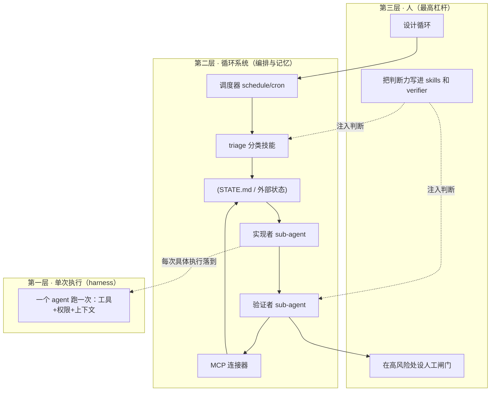
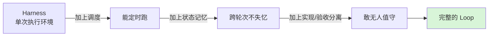
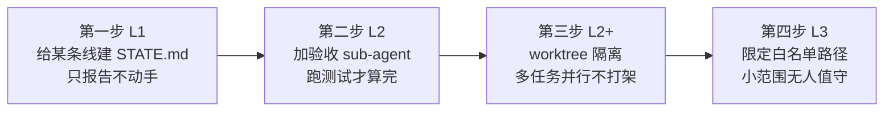

<callout emoji="💡">
**核心结论：**Loop Engineering 的核心主张是别再一条条给 AI 敲指令，而是搭一套能自动派活、自动验收、自动记进度的循环。它最大的价值是把单轮跑好的 Harness 和连续跑稳的 Loop 分成上下两层。
</callout>

原仓库：[cobusgreyling/loop-engineering](https://github.com/cobusgreyling/loop-engineering)。作者是 Cobus Greyling，本质上是篇带示例配置的思考文章（目前 23 个 star），适合用来梳理设计框架，不适合直接当现成工具库套用。

# 它到底在讲什么

全篇核心就是一次注意力转移：重点从打磨单条 prompt，转到搭建编排 Agent 的控制系统。

> 「你不该再给编程 agent 写 prompt 了。你该去设计那些替你给 agent 写 prompt 的循环。」——Peter Steinberger

> 「我现在不给 Claude 写 prompt 了。我让一堆循环跑着，由它们去给 Claude 写 prompt、自己琢磨该干啥。我的活儿，是写循环。」——Boris Cherny（Anthropic Claude Code 负责人）

作者把「循环」定义为**一个递归的目标（recursive goal）**：你给出终局目的，AI 自己一轮轮派活、自检、把进度写进外部存储，直到达成目标，或判断搞不定时打包上下文交还给人。

---

# 三层模型与六个零件

原仓库把整套系统拆成「人 → 循环系统 → 单次执行」三层架构。

## 三层心智模型

人在最顶层管设计和拍板，循环系统在中间负责发现任务、派活、验收、记账，最底层才是每次单跑的 Agent。

## 六个零件各自治什么病

这套系统一共由五个基础零件加一个记忆模块拼成，按它们实际解决的问题看最清楚：

| 零件 | 解决什么问题 | 常见做法 |
|-|-|-|
| **1. 调度（Scheduling）** | 充当心跳。没它的话 AI 跑完一次就停，转不成循环 | Grok /loop、Claude Code 定时任务、GitHub Actions |
| **2. Worktrees** | 防改冲突。两个 Agent 同改一批文件必打架，各自给独立工作目录 | git worktree、isolation: worktree |
| **3. Skills** | 存长期规矩。把项目约定、构建命令和踩坑记录写一次，每轮自动读 | SKILL.md + 脚本 |
| **4. 连接器（MCP）** | 接真实系统，让循环能读写 Jira、发消息、查数据库、提 PR | MCP Server |
| **5. Sub-agents（验收分离）** | **作者最看重的一环**：写代码的 Agent 不能给自己判分，必须另派一个验收 | Task + 独立模型或指令 |
| **+ 记忆（State）** | 防失忆。大模型每轮都清空，得把进度、试错记录和卡点写进持久文件 | STATE.md、Linear 看板 |

<callout emoji="✅">
**起步原则：**别一上来把六样全堆齐。最小可用闭环只需要「调度 + 一个 triage 技能 + 一个状态文件」。等这版跑出效果并暴露具体卡点后，再依次补 worktree 隔离、独立验收和外部连接器。
</callout>

---

# 和 Harness 是上下层，不是谁替谁

很多人容易把 Loop 和 Harness 混在一起，原仓库用一条公式把层级关系钉死了：

<callout emoji="📌">
**Harness** = 单次会话的环境配置（给一个 Agent 配工具、定权限、塞上下文）
**Loop** = Harness + 调度 + 状态记忆 + 验证链条
</callout>

打个比方，两者的分工是这样的：

| 概念 | 打个比方 |
|-|-|
| **Harness** | 单个工人的工位，上面摆好工具、划清权限边界、放好这轮任务的资料 |
| **Loop** | 整套工厂排班，包含工位、排班表、交接本和质检员，让工位连轴转还不乱套 |

Harness 是循环最底层的执行单元，Loop 负责把无数次单轮执行串起来、记下来、查起来。

<callout emoji="❗">
**别把两件事混为一谈：**很多人以为把单个 harness 塞满工具和上下文，就已经做出 loop 了。单次能力再强，也只能保证一次做好；要连续跑还不翻车，中间还隔着调度、记忆和验收三道独立工程。
</callout>

---

# L0 到 L3：分四级慢慢放权

仓库里仿照自动驾驶写了一套就绪度评级，还配了 CLI 检查工具 `loop-audit` 给循环打分。

| 等级 | 放权到什么程度 | 前置条件 |
|-|-|-|
| **L0 草稿** | 只写清楚想干什么 | 目标与非目标 |
| **L1 报告** | 只分类、写状态，不自动动手 | 加上调度、triage 技能与状态文件 |
| **L2 辅助** | 带独立验收的小修小补 | 加上实现与验收分离、人工闸门与连接器 |
| **L3 无人值守** | 不盯着也能自己跑 | 补齐成本上限、可观测与安全清单 |

只要撞上下面五条红线之一，就说明循环不稳，得先停下来修：

- 同一个 PR 自动修了超过 3 次仍没进展
- 验收方和实现方是**同一个** Agent 会话（自己给自己判分）
- 没有状态文件，循环每轮都在失忆
- 不管有没有问题，每轮都给人发通知（发多了很快会被彻底无视）
- 没设路径白名单就开了自动合并

---

# 三个值得记住的概念

相比具体脚本模板，作者借 Addy Osmani 引出来的三个概念更经琢磨。

<grid>
<column width-ratio="0.500000">
<callout emoji="📝">
**意图债（Intent Debt）**
AI 每次冷启动都会缺背景，缺的那块它会靠瞎猜补上。Skills 的作用就是把约定写下来，每轮自动读。
</callout>
</column>
<column width-ratio="0.500000">
<callout emoji="📝">
**理解债（Comprehension Debt）**
循环跑得越快，你没亲手写的代码越多。若不定期读变更 diff，很快就会看不懂自己的仓库。
</callout>
</column>
</grid>

<callout emoji="💡">
**认知投降（Cognitive Surrender）：**用循环辅助思考，和用循环逃避思考，外表动作一模一样，结果完全两回事。循环分辨不出来，只有你自己清楚。
</callout>

> 「去搭那个循环。但要像一个打算继续当工程师的人那样搭它，而不是一个只想按下开始键的人。」——Addy Osmani

---

# 用在大仓里该怎么落

结合目前在短视频平台大仓用 TRAE 跑任务、让它自己补全方案细节的经验，这套做法主要帮我们理顺组织方式：

- **其实已经踩出半步：**让 TRAE 自补全方案细节，本质就是在搭建自动闭环，目前最缺的是显式 `STATE` 状态文件和独立验收环节。
- **先补实现与验收分离：**现在 TRAE 写完代码常由同一个会话宣布完成，应该另起一个独立 Agent（最好换模型和提示词）跑测试、做对抗审阅。
- **把人工读 diff 设成 L2 硬闸门：**大仓代码体量大，循环跑得太顺很容易攒下理解债，合并前必须由人亲眼看一遍改动范围。

## 推进路线

| 阶段 | 做什么 | 对应零件 |
|-|-|-|
| **立刻能做** | 挑一条低风险工作流（如依赖更新或 changelog 起草），建一份 `STATE.md`，每天只输出分类报告由人拍板 | 调度 + 状态 |
| **第二步** | 给编码任务配独立验收 Agent，跑过测试才允许标完成；实现方自己说了不算 | 实现与验收分离 |
| **第三步** | 多任务用 worktree 隔离目录；MCP 连接器从只读和写评论开始，给最小权限 | Worktrees + MCP |
| **最后再开** | 只对白名单路径上的低风险改动放开自动提交；鉴权、支付、密钥和基建路径一律禁入 | 安全闸门 |

<callout emoji="❗">
**在短视频平台大仓落地的提醒：**原仓库默认每轮循环跑全量 `npm ci && npm test` 验收。大仓体量太大，全量跑成本和耗时都扛不住，验收范围必须收窄到本次实际改动的路径。这点原仓库没有现成解法，得按大仓规则自己改。
</callout>

---

# 读完之后：给 iLoop 带来的几个参照

读这个仓库本来是为了对照手头在做的 iOS Agent（**iLoop**）。那些通用模板倒不用照搬，真正照出差距的是下面四件事。

## 把「配好一次」和「连续跑稳」分开看

第三章那个公式很有用：配齐工具、权限和上下文只是把单次执行搭好，要让系统连续跑起来不塌，中间还隔着调度、记忆和验收三道独立工程。

回头看 iLoop，之前大部分精力都花在打磨单轮 prompt、工具和上下文上；要往真闭环走，最缺的就是**持久状态记忆**和**独立验收**。

## 实现方不能自己判通过

写代码的 Agent 最容易犯的毛病就是改完直接宣布「我做完了」。按 Loop 的思路，iLoop 必须把验收拆给独立环节，哪怕只是换一组指令、单独跑一轮真机或编译校验，也不能由执行方自己标 `done`。

## 给每条工作流标出放权刻度

仓库里那套 L0 到 L3 分级和 `loop-audit` 打分工具，把 Agent 的自治边界标得很明白。iLoop 现在的每个 flow 缺这把尺子，用户分不清哪条流只会给建议、哪条流会直接改代码。

具体可以抄两点：给每个 flow 标清楚放权级别（只报告、辅助修改、自主运行），开场就亮出来；再把现有的 `verify` / `doctor` 从单纯过或不过，改成带分数和改进项的接入就绪度检查。

## 补齐状态文件和反模式目录

iLoop 现在的轮次记录偏流水账，跨会话接不上，每轮冷启动都会重犯旧错。一方面要补一份能跨会话续写的显式状态文件；另一方面可以把踩过的坑整理成反模式目录，每轮开跑前自动读一遍，省得同一类错误反复交学费。

## 明确不搬的部分

原文里几样东西虽然流行，但现阶段先不碰：

- **worktree 并行与定时 cron 无人值守：**依赖外部调度器和多目录运行时，而 iLoop 定位是人在环里逐轮推进，硬上只会把问题做复杂。
- **GitHub 仓库运维套路：**比如每日 issue 分类、PR 看护和 CI 清理，跟 iOS 工程闭环不是一回事，用不上。

<callout emoji="📌">
**对 iLoop 的结论：**补齐顺序排成四步：**独立验收 → 放权分级 → 状态记忆 → 反模式目录**。先把这四项做实，再谈无人值守。
</callout>
