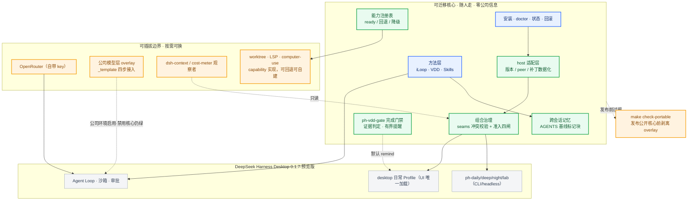
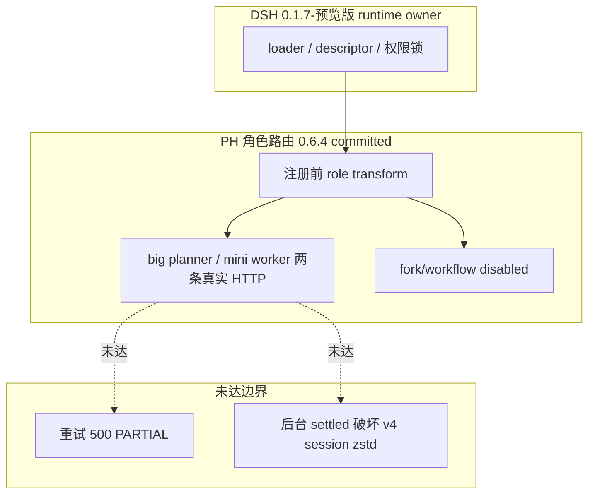

适用版本：Personal Harness 0.4.0（第 7–9 节含 0.5.0 组合治理，第 13 节含 0.6.0–0.6.5 更新）　最后核验：2026-09-29

<callout emoji="💡">
**一句话定位：**一套能跨宿主机、按环境插拔模型与账号、靠真实反馈验证结果的个人研发工作台。稳定工作流与方法收进公共核心，模型网关、公司配置与凭据放在可替换边界。
</callout>

# 为什么要做

iLoop、VDD、OPC 和 Skills 之前全绑在单个宿主软件里。一换 IDE 或换环境，工具链与会话机制一变，研发流就得重搭。

做 Personal Harness 就是为了在宿主之上架起个人固定工作台，让整套研发方法可以跨项目、跨模型、跨公司直接复用。

| 原来的问题 | 如果不处理 | Personal Harness 的回答 |
|-|-|-|
| 方法依赖具体宿主 | 换工具或换公司后，需要重新拼装工作流 | 用 Personal Workbench 固定运行入口，用 Skills 保存方法 |
| 模型和公司账号混在工作流里 | 模型来源变化会牵动整个系统 | 把 Provider 与 Company Overlay 放到可替换边界 |
| “安装成功”常被当成“能力可用” | 真实任务里才暴露权限、协议和兼容问题 | 以真实工具调用、运行结果和独立验收作为完成标准 |
| 插件越多，维护成本越高 | 上下文、权限面和版本冲突持续膨胀 | 默认集合保持克制，同时保留开放插件市场 |

# 设计原则

当前架构由五条原则约束。它们比某个插件或模型更稳定，也是后续迭代时判断能力归属的依据。

1. **稳定核心向内收。**工作流、Skills、安装规则、验证方法和迁移契约进入公共仓库。
2. **环境差异向外插拔。**模型网关、公司 SSO、内部平台和本机凭据只存在于 Provider 或 Overlay。
3. **运行时只保留一个。**DeepSeek Harness 负责 Agent Loop、工具、会话和权限；Personal Harness 负责装配，不重复实现第二套 Agent Runtime。
4. **所有权必须清楚。**安装器只升级和卸载自己管理的依赖；用户自行安装或修改的插件不会被静默覆盖。
5. **结论必须可验证。**插件进入默认集合前，要经过安装、真实任务、失败恢复和升级兼容验证。

# 总体架构

下面的架构图回答两个问题：一次研发任务如何从用户进入工作台并调用外部能力；换到新环境时，哪些部分随仓库迁移，哪些部分需要重新接入。


迁移时只搬走中间的 **Personal Harness 可迁移核心**，公司账号和本地数据留在边界外。0.5.0 落地了接缝清单、准入流水线与 Profile 分层，0.6.0 补齐了跨会话记忆和可移植检查（上图保留为 0.5 边界示意）。

| 层 | 负责什么 | 不负责什么 |
|-|-|-|
| DeepSeek Harness Runtime | Agent Loop、文件与终端工具、会话、权限、Desktop UI、Cordis 插件生命周期 | 个人方法、公司账号和业务判断 |
| Personal Workbench | 把 Prompt、目标、计划、会话、工具和委派策略组合成日常入口 | 模型鉴权和公司平台实现 |
| iLoop、VDD、OPC 与 Skills | 需求、设计、研发、验证、文档和交付的方法 | 替代宿主的沙箱、会话和插件机制 |
| 生产力扩展 | 工作区隔离、代码理解、子智能体、桌面操作和 3D 创作 | 把所有市场插件都纳入默认集合 |
| 组合治理（0.5.0 已交付） | 接缝所有权清单、插件准入流水线、Profile 分层，以及上下文、成本与轨迹的本机度量 | 替插件做业务判断，或让未经对照的插件直接进入主力 Profile |
| Provider、MCP 与 Overlay | 连接模型、浏览器、Apple 工具链和公司内部能力 | 把凭据和环境私有数据写入公共仓库 |

# 任务如何运行

Personal Harness 不是在 DeepSeek Harness 外再套一层对话机器人。它通过 Preset 和插件，把一次任务装配成稳定的执行链。

1. **用户从 Personal Workbench 发起任务。**DeepSeek Harness 建立会话，提供文件、终端、权限和 Session 能力。
2. **方法层先确定做法。**iLoop 负责反馈闭环和证据，VDD 约束完成声明，OPC 与个人 Skills 处理需求、设计、文档和专项任务。
3. **生产力扩展执行具体工作。**Worktree 隔离代码改动，Code Graph 和 LSP 理解代码，Subagent 并行处理，Computer Use 与 Blender 连接桌面和 3D 场景。
4. **适配层连接外部能力。**Provider Adapter 选择模型，MCP Pack 接入浏览器和 Apple 工具链，公司 Overlay 连接只在当前环境存在的能力。
5. **结果回到同一会话验收。**测试、截图、UI 状态、日志和独立评审形成可复查证据；失败时由安装和状态层提供回退。

# 工作流与方法层

这一层决定“任务应该怎样完成”，而不是“工具按钮在哪里”。把方法放在 Skills，把执行交给宿主，可以避免个人流程被某个模型或 IDE 锁死。

| 模块 | 当前职责 | 稳定接口 |
|-|-|-|
| Personal Workbench | 提供默认 Agent 人设、目标、计划、压缩、委派、网页、会话检索和交付工具 | Preset 与 Cordis Bundle |
| 开源 iLoop | 任务规划、反馈闭环、证据记录、风险分级和独立验收 | Skill 与本机数据目录 |
| VDD | 在“完成”“可用”“没有问题”之前要求真实验证 | 验证方法，不绑定模型 |
| OPC 与个人 Skills | 覆盖机会发现、产品定义、设计、技术文档、调研和表达 | 按需加载的 SKILL.md 与资源 |

# 生产力扩展

0.4.0 的默认扩展覆盖了日常研发闭环，但没有接管整个插件生态。默认版本由仓库固定，用户仍可通过市场自行发现、安装、禁用和卸载其他插件。

| 能力组 | 模块 | 带来的能力 |
|-|-|-|
| 工作区与交付 | Plugin Market、Better Sidebar、Git Worktree | 开放扩展入口、集中工作界面、会话级代码隔离与人工交付 |
| 代码智能 | SourceKit LSP、Code Graph、Subagent Workspace UI | 符号导航、调用链和影响面、并行任务可视化与生命周期管理 |
| 自动化与创作 | macOS Computer Use、Blender Production | 按应用读取和控制桌面 UI；建模、绑骨、动画、渲染与导出 |
| 按需工具包 | Playwright MCP、XcodeBuildMCP | 浏览器自动化，以及 iOS/macOS 构建、运行和调试 |

插件是否进入默认集合，不以数量为标准。它必须解决高频问题，与现有能力不重复，并且具备明确的权限边界、安装与卸载路径、真实任务验证和失败降级方式。第 7 节给出基于生态调研的候选名单，第 8 节说明插件之间怎样组合，第 9 节把这些条件落成可执行的准入流水线。

# 插件生态调研：哪些扩展真正提效

截至 2026-09-28，`awesome-dsh-plugin` 注册表收了 4382 个插件。筛选时先看星标、近 30 天下载和红线清单，再精读其中 66 个 README 对照事件接缝和量化实证。

热度往往失真：4382 个里 2131 个没有任何 npm 下载记录，362 个同时碰凭据加外网。注册表自己明确提示安装插件等效授权运行第三方代码，先看实证别迷信星标。

**有对照实验的插件屈指可数。**在精读的 66 个插件中，只有下表几个给出了可复查的对照或实测数据，其余大多只有测试用例数量或功能描述。因此本章的推荐只代表“值得进入评估”，进入默认集合仍要按第 2 节原则 5 在真实任务上验证。

| 插件 | 可复查的证据 | 局限 |
|-|-|-|
| dsh-experience-memory | 24 个隔离的真实模型回合：无记忆 0/24，有记忆 20/24（Fisher 精确检验 p 远小于百万分之一）；每轮固定开销约 204 字节 | 增益限于“用户说过、文件里查不到”的约定；不在 npm 发布，需下载发布包安装 |
| Aegis | 120 次有效运行：契约通过率 61.67% → 93.33%，不安全结果 13.33% → 0% | 测于 Codex 而非 DSH，DSH 冒烟测试尚未完成；作者称其为有界的参考证据 |
| dsh-todo-continuity | 真实会话受控 A/B：回合中断后，计划列表从丢失变为完整保留 | 只解决计划可见性这一个问题 |
| dsh-dcp | 约 8 万 token 的历史压缩到约 700 token，全程零 LLM 调用 | 单会话自测；只做规则裁剪，不做语义归纳 |
| dsh-better-edit | 哈希锚点编辑：token 减少 31%–56%（不同口径）；不经模型的工具正确性测试 23/23 | 单次运行，数据来自上游 pi 生态，尚未在 DSH 上复测 |
| GraphFlow | 同口径对照 token 节省 95.6%；技能飞轮开启与关闭的任务成功率为 100% 对 61.5%（26 个任务） | 全部为作者自建基准；默认改写超出预算的工具结果 |
| dsh-review | 一次发布前审计调度 73 个 agent：49 个发现被确认，14 个被驳回 | 没有 A/B，也没有误报率基线；单次成本高 |

**Harness 定制有真实收益，但也有上限。**Can Bölük 在 2026 年 2 月只替换编辑工具的格式，就让 16 个模型中的 14 个编辑成功率上升，其中 Grok Code Fast 1 从 6.7% 升到 68.3%。另一方面，独立复现发现对当代模型而言编辑格式已不是主要瓶颈，Terminal-Bench 2.0 的作者也认为模型选择通常比 Harness 的差异更重要。对 Personal Harness 的含义是：先选对模型，再用插件消除具体的、可以测量的瓶颈。

**真正带来提效的四类闭环能力：**观测上下文与成本、用门禁兜住完成声明、隔离执行支持回滚、配合远程审批释放人力。下表优先把本地运行、机制透明的插件列进待评估区：

| 能力 | 建议进入评估 | 备选或观望 | 判断依据 |
|-|-|-|-|
| 上下文与成本观测 | dsh-context；dsh-cost-meter | dsh-fast（与 dsh-context 重叠）；dsh-budget（可硬封顶，但价表不含峰谷） | 只读官方 token 计量，零侵入；按请求发起时刻计算峰谷价 |
| 上下文压缩 | 官方 compaction（默认） | dsh-dcp 试用；billion-context 不建议 | 同一 Profile 只能有一个压缩后端；billion-context 走 MITM 代理，且会强制更新 |
| 模型路由与容错 | dsh-llm-fallbacks | dsh-tier-router（强档规划评审、弱档实现，暂无成本实测） | 未配置时等同未安装；支持按时段切换回退链 |
| 编辑与会话连续性 | dsh-todo-continuity | dsh-better-edit；dsh-btw（旁路提问，不污染主上下文） | 零依赖、出错时放行；替换核心编辑工具前须在本机复测 |
| 代码理解 | 官方 ctx.lsp 与 dsh-lsp-actions；dsh-code-index | codegraph 托管（已在用 codegraph 时）；GraphFlow 观望 | LSP 负责精度，repo map 负责广度；注入型只留一个 |
| 验证与完成门禁 | dsh-doublecheck；dsh-verify（Web 项目） | dsh-evidence-gate；dsh-completion-guard；Aegis | 先提醒再阻断，可输出 SARIF；浏览器验收以退出码判定 |
| 代码评审 | dsh-code-review（/review 独立子智能体） | dsh-review（发布前对抗式评审） | /review 命令名与 dsh-github 冲突，只能装一个 |
| 并行与隔离 | 现有 Git Worktree；dsh-agent-teams | dsh-swarm-orchestrator（批量扇出） | 与官方实验性 agentTeams 二选一；并行数受评审带宽约束 |
| 长任务与自动化 | 官方 goal 与 schedule；dsh-lowtide | dsh-automation（夜间巡检）；loopx、ouroboros 观望 | 低谷时段半价；loopx 会引入第二套目标状态 |
| 记忆与经验 | dsh-experience-memory 或 dsh-mnemon，二选一 | memsearch（跨 Agent 共享）；hindsight、OpenViking 观望 | 本地、无外部服务；hindsight 默认连云端，并为所有项目开启记忆 |
| 安全与回滚 | 装前 dsh-trust-check 与 dsh-plugin-doctor；dsh-permission-rules；dsh-defend；官方 workspace-changes | dsh-auto-review（替 ask 代答）；checkpoint-rewind；secret-guard | 确定性、本地运行、可先试运行；LLM 审批只做补充 |
| 通知与远程审批 | dsh-lark（放在 Company Overlay） | dsh-notifier（28 个出站通道）；dsh-lark-bot 观望 | 卡片审批可回传；走飞书长连接，无需公网服务器和回调地址 |
| 跨 Harness 资产复用 | dsh-skills-anywhere；dsh-movein（一次性迁移） | dsh-agent-plugins-market 观望 | 只读挂载、按 commit 锁定；后者会引入第三方 hook，且工具限制不生效 |
| 插件治理 | 现有 Plugin Market；现有 Better Sidebar（需复核版本） | dsh-plugin-gating-hub（仅 Observer 模式，勿与 Market 并用）；upstream-radar | Better Sidebar 自 0.23.0 起文件路由不再限制在工作区内 |

**宿主版本基线冲突：**部分插件仅适配 DSH `0.1.7-预览版`，另一批已切向 `0.2.0-预览版`（例如 Better Sidebar 0.24.1 要求 0.2.0+）；应当先定死宿主基线再逐个钉插件版本。

**第三方供应链实发风险：**2026 年已曝光 SANDWORM_MODE 恶意 npm 包、Snyk ToxicSkills（3984 个里 76 个确认恶意）与 ClawHub/JetBrains 盗密样本。具体到候选：Better Sidebar 0.23.0 后取消路径限制，`billion-context` 使用本地 MITM 代理改流；装第三方插件等同放开本机用户权限，必须过准入。

主要依据：[awesome-dsh-plugin 注册表](https://github.com/awesome-dsh-plugin/awesome-dsh-plugin)；[DeepSeek Harness 仓库与文档](https://github.com/deepseek-ai/deepseek-harness)；[Anthropic：长任务 Harness](https://www.anthropic.com/engineering/effective-harnesses-for-long-running-agents)；[Anthropic：上下文工程](https://www.anthropic.com/engineering/effective-context-engineering-for-ai-agents)；[Claude Code Hooks 指南](https://code.claude.com/docs/en/hooks-guide)；[Can Bölük：The Harness Problem](https://blog.can.ac/2026/02/12/the-harness-problem/)；[Terminal-Bench 2.0](https://arxiv.org/abs/2601.11868)；[METR 2025 随机对照实验](https://metr.org/blog/2025-07-10-early-2025-ai-experienced-os-dev-study/)；[METR 2026 使用调查](https://metr.org/blog/2026-05-11-ai-usage-survey/)；[Faros AI 生产力悖论](https://www.faros.ai/blog/ai-software-engineering)；[Socket：SANDWORM_MODE](https://socket.dev/blog/sandworm-mode-npm-worm-ai-toolchain-poisoning)；[Snyk：ToxicSkills](https://snyk.io/blog/toxicskills-malicious-ai-agent-skills-clawhub/)；[DeepSeek 官方价格](https://api-docs.deepseek.com/quick_start/pricing)。

# 插件如何组合：按事件接缝与研发阶段编排

DeepSeek Harness 把所有能力挂在一条完整事件链上（系统提示组装、单步前后、流式返回、工具前后与回合结束）。装配的核心原则是分清每个接缝的唯一决策拥有者（`owner`）与多路只读观察者（`observer`）：


| 接缝 | 触发时机 | 拥有者（独占，只选一个） | 可叠加（观察或只收紧） |
|-|-|-|-|
| `system-prompt/assemble` | 组装系统提示 | 不独占，但总量要有预算：AGENTS.md、Skills 目录和 repo map（dsh-code-index）各留一份 | — |
| `ctx.compaction` | 上下文超过阈值 | 压缩后端：官方 compaction（默认）或 dsh-dcp | dsh-context 展示上下文压力与构成 |
| `agent/pre-step` | 每步请求前 | 自动注入型记忆：dsh-experience-memory 或 dsh-mnemon | dsh-defend 的注入检测 |
| `agent/request` | 每次模型请求 | 推理强度或强弱档：dsh-tier-router 或 dsh-thinking-levels | — |
| `llm/stream` | 模型流式返回 | 预算硬阻断：dsh-budget（可选） | dsh-cost-meter 计费 |
| `tools/pre-execute` | 工具执行前 | 放行与改写策略：dsh-permission-rules | 只拒绝的守卫，例如 dsh-defend；回滚类插件的执行前快照 |
| `ctx.approval` | 调用需要确认 | AI 应答者：官方 auto-review 或 dsh-auto-review，也可以不设 | 人类应答通道：终端、Web、飞书卡片（dsh-lark） |
| `tools/post-execute` | 工具返回后 | 结果改写：dsh-defend 的密钥遮蔽或 secret-guard，二选一 | dsh-evidence-gate 记录证据索引 |
| `agent/turn-stopping` | 回合即将结束 | 续跑推动者：dsh-doublecheck 或自研 VDD 门禁，与 goal 自动续跑、Ralph 同时只开一个 | workspace-changes 生成回合快照 |
| `agent/request-error` | 模型请求失败 | 换模型或续跑：dsh-llm-fallbacks | — |
| `turn/end`、`session/event` | 回合结束与全部会话事件 | — | dsh-context、dsh-todo-continuity、dsh-trajectory-governance、观测导出、飞书通知 |
| 斜杠命令 | 用户输入命令 | /review、/rewind 等命令名各归一个插件 | — |

在这张分工表背后，是五条组合规则：

1. **独占接缝只有一个拥有者，只收紧的守卫可以叠加。**两个压缩后端会争抢同一个 compaction 服务；两个自动注入型记忆会双重注入，还可能把对方注入的内容当成对话再次采集，形成自我强化；dsh-github 与 dsh-code-review 都注册 /review，checkpoint-rewind 与 dsh-rewind 都注册 /rewind。相反，`tools/pre-execute` 上的守卫只能收紧、不能放宽，多个只做拒绝的守卫叠加不会互相推翻，代价只是误拦截增多，需要用拦截率来衡量。
2. **确定性在前，模型判定在后。**官方管线先跑 `tools/pre-execute` 和守卫，再进入审批。让 dsh-permission-rules 的拒绝在这里直接终止调用，不耗 token，也不受提示注入影响；只有需要确认的调用才交给 AI 应答者，不可逆操作始终留给人。
3. **稳定前缀，易变尾部。**DeepSeek Flash 命中缓存的输入价是未命中的 1/50（低谷时段每百万 token 0.003 美元对 0.15 美元）。时间、记忆召回、任务状态这类每步都变的内容不要写进系统提示前缀，而应放在尾部消息，并用 dsh-context 和缓存命中率验证效果。
4. **所有自动续跑都要有上限。**`agent/turn-stopping` 是串行事件，任何一个监听器提出异议，回合就会继续，监听器顺序不影响结果。官方 Claude Code hook 桥也没有实现连续阻止上限，一个无条件阻止的 Stop hook 会让每一步都被强制续跑；Claude Code 自己则在连续阻止 8 次仍无进展时放行。完成门禁、goal 自动续跑和 Ralph 同一时间只开一个，并设最大轮数，例如连续阻止 3 次仍缺证据就交给人。
5. **先度量，再进入默认。**METR 2025 年的随机对照实验中，资深开源开发者使用 AI 后完成任务反而慢了 19%，事后却仍认为自己快了约 20%。每个候选插件都应在自己的任务集上做开关对照，比较 token、回合数、人工介入次数和完成率，再决定去留。

**按研发阶段编排。**把拥有者和观察者放回 Personal Harness 已有的方法层，就得到下面的阶段组合。每个阶段都产出可复查的证据，由下一个阶段消费；这也是 Anthropic 在长任务 Harness 实践中强调的做法：用进度文件、功能清单和逐项提交让下一轮能接得上。

| 阶段 | 方法层 | 插件组合 | 产出的证据 |
|-|-|-|-|
| 需求澄清 | OPC、iLoop 规划 | 官方 plan-mode；dsh-doublecheck 的 grill 阶段把需求共识记为证据 | 需求规格与验收条款 |
| 计划 | iLoop 风险分级 | 强档模型负责规划（dsh-tier-router）；dsh-code-index 给出 repo map 与变更影响 | 计划、影响面、可能受影响的测试 |
| 实现 | 个人 Skills | Worktree 隔离会话；弱档模型实现；dsh-lsp-actions 做诊断与重命名；dsh-todo-continuity 保持计划可见 | 每个回合的 workspace-changes 快照 |
| 验证 | VDD | doublecheck 先红后绿；XcodeBuildMCP 或项目测试命令作为红绿信号；dsh-verify 做浏览器验收；Computer Use 截图 | 测试结果、截图与浏览器验收回执 |
| 评审 | iLoop 独立验收 | /review 交给独立子智能体（dsh-code-review）；发布前再跑对抗式评审（dsh-review） | 经过复核的缺陷清单 |
| 交付 | OPC 表达 | Worktree 人工确认后交付；dsh-lark 飞书卡片审批与通知（Company Overlay） | 交付记录与审批记录 |
| 学习 | 个人 Skills 演进 | dsh-experience-memory 只收候选经验；验证通过的规则由人晋升到 AGENTS.md 或 Skill；dsh-trajectory-governance 诊断死循环与目标漂移 | 经验库、规则变更与轨迹报告 |

**用 Profile 分层，而不是一个 Profile 装全部。**插件以用户权限运行，独占接缝又互斥，把所有插件装进一个 Profile 会同时放大风险和冲突。DeepSeek Harness 的每个 Profile 都有独立的插件集合，建议按使用场景拆成四个 Profile，共享同一套 Skills、Provider 和 Overlay：

| Profile | 用途 | 相对日常 Profile 的差异 | 权限边界 |
|-|-|-|-|
| ph-daily | 日常交互研发 | 基线：观测、确定性权限、代码理解、评审与通知 | workspace-write；需要确认的调用交给人 |
| ph-deep | 长任务与复杂重构 | 完成门禁从提醒升为阻断；启用 goal 自动续跑；轨迹治理在死循环时中止；强制使用 Worktree | workspace-write；续跑有轮数上限 |
| ph-night | 无人值守与低谷批处理 | dsh-lowtide 或定时任务；只跑可以机器验收的任务；结果推送到飞书 | 禁用 danger-full-access；审批无人应答即拒绝 |
| ph-lab | 新插件试验场 | 独立的 DSH_HOME，不放任何密钥；在这里做开关对照 | 与主力环境隔离，结论通过后才晋升 |

**常见反模式。**下面这些做法在插件文档和社区评测中反复出现，Personal Harness 应在安装器和准入流程里直接拦住：

| 反模式 | 后果 | 改为 |
|-|-|-|
| 按星标或下载量挑选插件 | 下载量会被客户端捆绑放大，近半数插件没有 npm 下载 | 以 README 机制核查和本地开关对照为准 |
| 同时装两个压缩或记忆插件 | 服务冲突、双重注入、互相采集 | 用接缝所有权清单在安装时拦截 |
| 门禁无条件阻止回合结束 | 无限续跑，token 失控 | 门禁内置连续阻止计数，超过上限交给人 |
| CLAUDE.md 与 AGENTS.md 内容重复 | 社区评测确认两者都会被读取，内容相同时系统提示翻倍 | 只保留 AGENTS.md 作为唯一来源 |
| 每步改写系统提示前缀 | 前缀缓存失效，命中与未命中的输入单价相差 50 倍 | 稳定内容放前缀，易变内容放尾部 |
| 在主力 Profile 里试新插件 | 第三方代码直接接触密钥和代码 | 先在 ph-lab 过准入流水线 |
| 并行 Agent 开得越多越好 | 评审成为瓶颈：Faros 的遥测显示合并 PR 数增加 98%，评审时间增加 91% | 并行数以每天能评审完的量为上限 |

# 基于个人工作流的定制

Personal Harness 的差异化在于把 iLoop、VDD 和 Skills 从提示词约定做成事件接缝上的硬机制：指令是建议，hook 和接缝才保必行。下表列出方法向机制的映射（VDD 门禁与 iLoop 证据索引自研，其余组合现有插件）：

| 方法 | 现在的形态 | 机制化方案 | 接缝 |
|-|-|-|-|
| VDD | Skill 约束完成声明 | 自研轻量门禁：回合结束前检查最终回复里“完成、可用、已修复”这类声明，本会话是否有对应的测试、截图或命令结果作证据；缺证据就提出异议并说明缺什么，连续 3 次仍缺则交给人 | `agent/turn-stopping`，证据取自 `tools/result` |
| iLoop 证据记录 | 模型手写证据 | 从工具结果事件和 workspace-changes 快照自动生成证据索引，模型只负责引用，不再手写 | `tools/result`、`turn/end` |
| iLoop 风险分级 | 在提示中分级 | 把风险等级映射为 dsh-permission-rules 的允许、确认、拒绝规则，高风险操作强制走人工审批 | `tools/pre-execute`、`ctx.approval` |
| OPC 调研与设计 | Skills | 做成只读权限的 agent preset；调研交给只回传摘要的子智能体，主会话只接收 1000–2000 token 的结论 | agent preset、`ctx.subagents` |
| 个人 Skills | 仓库内的 SKILL.md | 仓库保持唯一来源；dsh-skills-anywhere 只读挂载给 DSH，同时作为本地 MCP 服务器提供给 Claude Code 等其他宿主 | `ctx.skills`、MCP |
| Apple 开发闭环 | SourceKit LSP、XcodeBuildMCP | 官方 ctx.lsp 负责导航，dsh-lsp-actions 配置 sourcekit-lsp 提供诊断、格式化与重命名；把 xcodebuild test 登记为门禁认可的测试命令 | `ctx.lsp`、门禁的测试命令模式 |

**接缝所有权清单。**第 2 节原则 4 已经规定安装器只升级和卸载自己管理的依赖。插件组合起来之后，所有权还需要从“依赖”扩展到“决策”：仓库新增一份接缝所有权清单，声明每个 Profile 在每个独占接缝上由哪个插件负责；安装器写入 Profile 前先检查，两个插件声明同一个独占接缝时拒绝安装并说明冲突。下面是清单的示意格式，字段名还需要结合安装器的实现确定：

```yaml
# 实际落地为 config/seams.json（JSON，非 YAML）；下列 YAML 是 0.5 设计阶段示意，字段语义已保留
profile: ph-daily
owners:                          # 独占接缝，每项只能有一个
  compaction: official/compaction-basic
  memory-inject: dsh-experience-memory
  request-effort: none
  request-error: dsh-llm-fallbacks
  pre-execute-policy: dsh-permission-rules
  approval-ai: none              # 需要确认的调用全部交给人
  post-execute-rewrite: dsh-defend
  turn-stopping: ph-vdd-gate     # 自研 VDD 门禁
commands:
  /review: dsh-code-review
  /rewind: none
guards:                          # 只收紧，可以叠加
  - dsh-defend
observers:                       # 只读事件，可以叠加
  - dsh-context
  - dsh-cost-meter
  - dsh-todo-continuity
  - dsh-trajectory-governance
```

**落地校准（0.5/0.6 已实现）：**清单实际存成 `config/seams.json`，安装前即校验单 owner 冲突，准入经 `plugin-admit` 四闸写入 `admitted.json`。设计稿里的 `dsh-todo-continuity` 与 `dsh-trajectory-governance` 在 npm 上实测不存在，由自研门禁和 seams 接管。

**插件准入流水线。**第 6 节已经列出进入默认集合前要证明的条件，这里把它落成四道可执行的闸门：装前静态检查、包结构检查、隔离试用与开关对照、钉死版本。前三道可以直接用现成工具完成：

```bash
# 1. 装前静态检查：能力披露与红线。退出码 0 未检出、1 需确认、2 有红线、3 扫描失败
npx dsh-trust-check --dir ./candidate --exit-code

# 2. 包结构与 Cordis 契约检查：离线运行，不执行第三方代码
npx --yes @perrylink/dsh-plugin-doctor@0.4.0 --repo ./candidate --no-smoke --only "R,K"

# 3. 在不含密钥的 ph-lab 中安装精确版本，做开关对照
DSH_HOME=~/.dsh-lab dsh plugin --profile ph-lab add <plugin>@<exact-version>

# 4. 对照通过后，把精确版本写入 Personal Harness 的锁定清单，再进入 ph-daily
```

有两处容易踩坑：trust-check 返回 0 只代表本次静态扫描没有检出，不代表安全；plugin-doctor 要用带作用域的包名 @perrylink/dsh-plugin-doctor，npm 上不带作用域的同名包属于其他作者。从 git 安装的插件还应钉到具体 commit。

**分时段与分档调度：**DeepSeek 官方 API 工作日 09:00–12:00 和 14:00–18:00 为高峰（其余半价），Pro 未命中缓存单价约为 Flash 的四倍。可将自动化重任务挪去低谷并用强弱分档省费；当前主验 Provider TRAE GPT-5.6 Sol 不受此峰谷定价影响。

**飞书接入属 Company Overlay：**`dsh-lark` 走飞书长连接回调，无需公网服务器，但会话内容会进飞书云，因此明确隔在企业 Overlay 中不进公共核心。

# 客户端全栈与 OPC：插件落地与一键恢复

前几节回答了哪些插件值得评估、怎样组合。这一节把结论落到仓库：以 iOS、Android、HarmonyOS 和服务端为主线，覆盖 OPC 从想法到上线，并保证换电脑或换公司时，用同一个仓库就能恢复工作台。

结论是沿用仓库已有的 capability 机制，新增 6 个按需 pack 和 1 个公司 Overlay pack，默认插件集合保持不变；另有几个候选，等对应阶段出现真实需求时再评估。依据是 2026-09-29 的实测：在 Linux 沙箱中用仓库自己的命令真实安装，由 DSH `0.1.7-预览版` 校验生成的配置，并按生成的命令逐个完成 MCP 握手。对应改动与下文的迁移修正都在仓库的 MR !1 中。

**按平台的选择。**下表列出每个平台接入的 pack、实测结果和候选。

| 平台 | 接入方式 | 实测 | 候选 |
|-|-|-|-|
| iOS／macOS | `apple`：xcodebuildmcp 2.7.0（已有）；`apple-docs`：sosumi 远程文档 | sosumi 握手得到 4 个工具；xcodebuildmcp 此前在 macOS 握手得到 24 个 | MobileBuildMCP 2.7.1（上游改名，旧包不再更新，需在 Mac 上复核工具契约）；App Store Connect CLI |
| Android | `android`：mobile-mcp 1.0.4，关闭遥测 | 握手得到 32 个工具；从公司 npm 镜像安装成功 | Google Android CLI 与 android/skills；Maestro |
| HarmonyOS | `harmony`：DevEco CLI 1.3.4 的 `serve mcp`，启用时绑定工程 | 安装和配置生成通过；Linux 上缺少 DevEco 工具链，服务无法启动 | dsh-hdc-bridge |
| 服务端 | `go`：gopls v0.23.0 的 MCP 模式，启用时绑定工程 | 握手得到 8 个工具；绑定工程后 `go_workspace` 返回该模块 | DBHub、kubernetes-mcp-server（均只读） |
| 通用文档 | `docs`：Context7 远程服务，本机零安装 | 握手得到 2 个工具 | — |
| 公司层 | `company-cli`：`bytedcli mcp`，只放行 11 个平台域 | 握手得到 2 个元工具 `list_commands` 和 `run_command` | — |

**为什么做成按需 pack。**MCP 的工具描述会常驻上下文，进程也常驻；平台 SDK 和设备也不是每台机器都有。按需启用让 iOS、Android、HarmonyOS 和服务端的工具只在需要时出现，符合第 2 节的最小默认集合原则。公司 Overlay 在自己的目录里声明 pack，核心清单不引用它，换公司时整体不启用即可。

**项目级 pack。**gopls 按进程的工作目录识别 Go 工作区，DevEco CLI 读 `PROJECT_PATH` 或 MCP roots；而 DSH 的 MCP 客户端初始化时不声明 roots。因此 `go` 和 `harmony` 启用时必须用 `--project` 绑定一个工程，否则 gopls 会回答“This is not a Go workspace”。当前一次只绑定一个工程，换工程要重新启用。

**OPC：从想法到上线。**OPC 的前半程已经由仓库里的 Skills 覆盖，后半程按阶段接入 pack，候选只在对应阶段出现真实需求时再评估：

| 阶段 | 已有能力 | 候选 |
|-|-|-|
| 机会发现和评估 | opportunity-radar、opportunity-scorecard、outside-view | — |
| PRD 和方案 | product-brief、engineering-docs、style-compass | spec-kit |
| 实现 | iLoop／VDD、Worktree、Code Graph、SourceKit LSP；`go`、`harmony`、`docs`、`apple-docs` | — |
| 验证 | iLoop 验收；`browser`、`apple`、`android` | Maestro、qa-skills |
| 发布 | 项目自己的签名和发布脚本 | App Store Connect CLI、fastlane |
| 线上 | 公司 Overlay 的平台 MCP（稳定性、日志、部署等） | Sentry MCP（需要令牌） |

候选的许可证都已核对：spec-kit、qa-skills 和 App Store Connect CLI 是 MIT，Maestro 和 android/skills 是 Apache-2.0。harmony-next.skills 的仓库没有许可证文件，按仓库规则不纳入。

**一键恢复。**仓库只保存 pack 清单和精确版本；工具装到本机 `~/.personal-harness/tools/<pack>`，凭据留在各自的所有者那里，例如 TRAE、bytedcli 登录态和系统钥匙串。新机器上的恢复顺序如下：

```bash
git clone <personal-harness 仓库> && cd personal-harness
bash install.sh
bin/personal-harness capability enable apple
bin/personal-harness capability enable android
bin/personal-harness capability enable go --project ~/code/api
bin/personal-harness capability enable harmony --project ~/code/app
bin/personal-harness capability enable docs
# 仅公司环境
python3 overlays/company/manage.py setup
bin/personal-harness capability enable company-cli
bin/personal-harness capability doctor
```

**实测发现的恢复隐患。**下面的问题大多在本轮实测中复现过，少数来自代码核查；处理方式都已写进仓库：

| 隐患 | 影响 | 处理 |
|-|-|-|
| DSH 的 MCP 客户端不声明 roots | gopls 和 DevEco CLI 在 tools 目录启动，找不到工程 | pack 标为项目级，启用时 `--project` |
| pnpm 11 起入口从 `bin/pnpm.cjs` 改为 `bin/pnpm.mjs` | Desktop 内置 pnpm 升级后，安装器误报找不到运行时 | 安装器同时识别两个入口 |
| 公司 npm 镜像滞后：mobile-mcp 1.0.5 发布 6 天仍未同步，pnpm 12 又优先读用户级 `.npmrc` | 新机器在公司网络里装不上 | 钉两边都有的 1.0.4，镜像同步后再升级；临时换源用 `PERSONAL_HARNESS_NPM_REGISTRY` |
| DSH `0.2.0-预览版` 在安装时按 peer 范围检查插件 | 8 个默认插件中 5 个被拒，见下表 | Desktop 暂留 `0.1.7-预览版`，插件出新版后按宿主线分别钉版本 |
| pnpm 12 默认拒绝未批准的构建脚本（`ERR_PNPM_IGNORED_BUILDS`） | 带 protobufjs 的插件（如 dsh-lark-channel）装不上 | 在 Profile 的 `pnpm-workspace.yaml` 里给 `allowBuilds` 写明布尔值 |
| `desktop` Profile 由 Electron 独占 | CLI 不能直接加载它来校验配置 | 把同一托管块放进同模板的 Profile，用 `--dump-config` 校验 |
| 默认的 Blender 插件要求本机已装 Blender | 没有 Blender 的新机器整次安装失败 | 缺 Blender 时只跳过这一个插件，`doctor` 注明原因，装好后重跑安装补齐 |
| 安装器只在 `/Applications` 查找 Desktop | Desktop 装在别处时误报找不到运行时 | 同时查找 `~/Applications`，也可用 `PERSONAL_HARNESS_DSH_APP` 指定 |
| 公司网络检查 HTTPS 流量 | Desktop 自带的 Node 不读 macOS 钥匙串，npm 下载因证书校验失败 | 安装前设置 `NODE_EXTRA_CA_CERTS` 指向公司根证书 |
| GitHub 连接被代理瞬断 | iLoop 或 Code Graph 引擎拉取失败，整次安装回滚 | 这两步自动重试三次；实测两次瞬断都在重试后完成 |
| pnpm 10、11 的隔离布局漏装共享的可选依赖，DevEco CLI 还引用未声明的依赖 | 装出的 DevEco CLI 启动即报缺模块 | 工具包改用 hoisted 布局，旧布局的目录先清空再装 |

**升级到 DSH 0.2.0 之前。**npm 上 `@deepseek-ai/dsh` 的 `next` 已是 `0.2.0-预览版`。用两条宿主线各自的插件管理器安装默认插件，结果如下；“被拒”指 DSH 在安装时按 peer 范围拒绝：

| 插件 | 0.1.7-预览版 | 0.2.0-预览版 |
|-|-|-|
| dshmarket 1.66.3 | 通过 | 被拒；1.66.5 两条线都通过 |
| dsh-tool-lsp 0.1.2 | 通过 | 通过 |
| dsh-better-sidebar 0.22.1 | 通过 | 被拒；0.24.1 只支持 0.2.x，需按宿主线分开钉版本 |
| dsh-git-worktree 0.9.3 | 通过 | 被拒，暂无新版本 |
| dsh-subagent-workspace-ui 1.9.0 | 通过 | 通过 |
| @hoyyang/dsh-code-graph 0.2.0 | 通过 | 通过 |
| @anionex/dsh-computer-use 0.3.2 | 通过 | 被拒，暂无新版本 |
| dsh-blender 0.2.2 | 通过 | 被拒，暂无新版本 |

安装检查只证明 peer 范围，不证明运行正确。Worktree、Computer Use 和 Blender 出新版之前，Desktop 不应升级到 0.2.x。

**验证边界：**上述 pack 只在 Linux x64 沙箱用同版本 Node/pnpm 与 CLI 完成配置与握手，尚未在真实 Mac Desktop 会话、HarmonyOS DevEco 或 Android 真机上端到端跑通。

独立 HOME 目录迁移实测中，仅走 `PERSONAL_HARNESS_NPM_REGISTRY` 公网源或仅走字节镜像均已完整装卸通过，仍待空白 Mac 真机最终补验。

# 模型与环境适配

工作流不直接依赖模型供应商。每个模型来源统一声明协议、地址、凭据引用、模型目录和可选健康检查；模型变化只影响 Provider 层。

```text
provider id
+ protocol
+ base URL
+ credential reference
+ model catalog
+ optional health endpoint
```

当前正式环境已验证 TRAE GPT-5.6 Sol 的文本与工具调用。公共架构也支持 OpenAI、Anthropic 和本地兼容服务的接入方式。豆包工作加强套餐尚未找到可复用的外接接口；Xeart Router 的个人授权与工具往返尚未完成，因此二者都没有被写成当前可用来源。

公司能力统一放在 Company Overlay。Overlay 可以包含 SSO、本机代理、代码平台、日志和 CI，但不能反向污染公共核心。离开当前公司时，禁用对应 Overlay，工作流、Skills 和安装机制保持不变。

# 安装、状态与迁移

仓库保存可公开复用的定义，本机目录保存运行状态和凭据引用。两者分离后，同一仓库既能迁移，也不会把旧环境的账号带到新环境。

| 位置 | 保存内容 | 处理原则 |
|-|-|-|
| Git 仓库 | Preset、Skills、插件目录、Provider 模板、安装与验证代码 | 可评审、可版本化、可在新环境重新安装 |
| \~/.personal-harness | 当前版本、Provider 选择、路由、插件所有权、伴随运行时和兼容设置 | 只在本机保存，升级时备份，失败后恢复 |
| \~/.dsh | DeepSeek Harness Profile、会话与用户自行安装的插件 | 安装器只修改自己拥有的区块，不覆盖用户改动 |
| 环境凭据 | 模型 Key、SSO、设备状态和公司私有数据 | 不进入仓库，不随迁移包复制 |

迁移到新环境时，执行顺序保持简单：

1. 安装 DeepSeek Harness Desktop。
2. 克隆 Personal Harness 仓库并运行安装器。
3. 选择一个在当前环境可用的 Provider。
4. 按需安装公司 Overlay 和项目工具包。
5. 运行回归、Doctor 和一次真实模型工具调用。

安装器固定插件版本、记录所有权并保留失败回滚。它不会把“命令退出码为 0”直接当成可用，而是继续核对 Bundle、伴随运行时、兼容补丁和真实行为。

**换电脑或换公司。**新机器只需要 macOS、Python 3.9+、Git 和 Desktop `0.1.7-预览版`，其余由安装器完成。安装器在 `/Applications` 和 `~/Applications` 查找 Desktop，也可以用 `PERSONAL_HARNESS_DSH_APP` 指定；本机没有 Blender 时只跳过 Blender 插件，其余工作台照常可用。核心就绪但还没有可用模型时，`doctor` 输出 `degraded`；只有核心缺项才输出 `blocked`。

安装会访问下表这些来源。换到网络受限的公司时，只按表中的变量换源，不改仓库：

| 来源 | 用途 | 受限网络下的做法 |
|-|-|-|
| npm 源 | Personal Harness 包、默认插件和 MCP 工具包 | 默认沿用本机 `~/.npmrc`；公司镜像缺版本时用 `PERSONAL_HARNESS_NPM_REGISTRY` 只为本套件换源 |
| GitHub | 开源 iLoop、Code Graph 引擎的原生二进制 | 失败自动重试三次；离线时用 `--iloop-source` 指向本地 iLoop |
| PyPI | Blender 分析环境 | `PIP_INDEX_URL` |
| Playwright CDN | `browser` 工具包的 Chromium | `PLAYWRIGHT_DOWNLOAD_HOST` |
| Go 模块代理 | `go` 工具包的 gopls | `GOPROXY` |

公司网络检查 HTTPS 流量时，Desktop 自带的 Node 不读 macOS 钥匙串，要先设置 `NODE_EXTRA_CA_CERTS` 指向公司根证书。当前全部固定版本及其完整依赖树，在公网 npm 和字节镜像上都能解析。

**代码仓分布：**本轮变更仅推至公司 GitLab，GitHub 地址 `Job-Yang/personal-harness` 对外当前 404。跨公司迁移前需先把公共核心同步至 GitHub 并确认合规，公司 Overlay 单独剥离留内网。

# 版本演进

0.1 到 0.4 打通安装、运行、扩展和交付基础；0.5.0 加上接缝与准入治理，0.6.0 把宿主适配、跨会话记忆和可移植性做实。

| 版本 | 解决的问题 | 新增能力 |
|-|-|-|
| 0.1.0 | 先把个人方法装进同一个宿主 | Personal Workbench、Provider 声明、iLoop/OPC/VDD/个人 Skills、安装/诊断/卸载 |
| 0.2.0 | 让模型和伴随服务真正可运行、可恢复 | TRAE native 代理、命名路由、模型探针、内容寻址安装、失败恢复、Browser/Apple MCP Pack |
| 0.3.0 | 开放插件生态并改善日常工作界面 | Plugin Market、SourceKit LSP、Better Sidebar、插件所有权、直接模型选择 |
| 0.4.0 | 补齐并行、隔离、代码理解和跨应用执行 | Git Worktree、Subagent UI、Code Graph、Computer Use、Blender、兼容与持久化修正 |
| 0.5.0（已交付） | 插件多了以后组合得稳、用得省 | 接缝所有权清单、插件准入流水线、Profile 分层、VDD 门禁插件化、上下文与成本观测、飞书 Company Overlay |
| 0.6.0（已交付） | 基线拉齐后把可迁移与可维护做实 | host 适配层（版本与补丁数据化）、OpenRouter 默认模型通路、公司模型层 Overlay 模板、跨会话记忆、desktop 日常 VDD 门禁、能力标识解耦与 doctor 降级提示、check-portable 可移植门 |

**MVP 收口结果：**在 0.4.0 基础上补齐了 Android、HarmonyOS、Go 与文档工具包、按工程绑定与 Overlay 包，并解决换源、缺 Blender 降级、GitHub 重试与 hoisted 依赖布局问题，全部提交见 MR !1。

**宿主升级条件。**Desktop 继续锁定 `0.1.7-预览版`。升级到 `0.2.x` 需要同时满足：Worktree、Computer Use 和 Blender 发布支持 `0.2.x` 的版本；dshmarket 升到 `1.66.5`，Better Sidebar 按宿主线分开钉版本；并在全新 HOME 重跑安装和第 10 节的准入检查。

## 跨宿主与跨会话机制落地状态（0.6.0）

0.5.0 的组合治理与 0.6.0 的可迁移基线均已落地并通过回归（117 项 Python、26 项 Node），实际表现与前文设计差异如下：

- **接缝所有权与准入已可执行**：独占接缝、宿主内置 owner、guard/observer 规则落在 config/seams.json，写 Profile 前冲突即拒；plugin-admit 四闸（trust-check、plugin-doctor、隔离精确安装与 peer 校验、锁定）支持离线 fixture。
- **Profile 分层落地，但 Desktop 0.1.x 只加载 desktop**：ph-daily/deep/night/lab 可离线渲染、CLI/headless 可用；因主进程写死 profiles/desktop 且无选择器，完成门禁另以默认 remind 的覆盖行进 desktop 日常入口，不靠 ph-\* 目录。
- **VDD 完成门禁是自有 Cordis 插件**：挂 agent/turn-stopping，只认持久会话日志里的测试/构建/截图证据，连续提醒有上限、达上限交人，纯规则零额外 LLM；可用 vdd-gate status|off|remind|warn|block 调节。
- **模型层可迁移**：新装默认 seed 一个关闭的 OpenRouter provider，provider enable 强制 OPENROUTER_API_KEY 并跑真实流式+工具往返；公司内部网关走 overlays/\_template 四步接入，核心 config 不含任何公司信息。
- **维护成本收敛**：版本、desktop 路径、peer 范围、compat 补丁收进 config/hosts/<version>.json，升宿主改为加一个适配文件；插件按 capability 解耦，doctor 报 ready/回退/降级/跳过/建议并给自建造提示。
- **跨会话记忆**：核实 DSH 的 instructions 原样读取全局 AGENTS.md、不展开 @path 引用，因此记忆以带标记的文本块并入全局基线，首次播种、用户编辑跨升级保留。
- **发布前有可移植门**：make check-portable 默认拦运行时代码里的密钥与公司标识，--strict 在含公司 overlay 或文档提及公司时失败；npm 包只打 overlays/\_template，不打公司目录。

**仍待真机/真任务补证。**ph-\* 在正式 Desktop 会话切换、VDD 长任务的提醒与误报率、admit 对真实第三方插件的联网端到端、OpenRouter 真 key 联网冒烟，都还没跑；这些不阻塞安装，但在宣称“更高效”前需要真实任务的完成率、人工介入和成本数据。



# 如何继续扩展

新增能力时，先判断它改变的是方法、执行能力、模型来源、公司环境还是安装生命周期。选对层，比直接把代码塞进仓库更重要。

| 新增内容 | 应该接入 | 进入默认前要证明 |
|-|-|-|
| 新的工作方法或专项流程 | Skill | 真实任务中比通用提示更稳定，且不绑定具体公司 |
| 新的常驻运行能力或界面 | Cordis 插件 | 权限、版本、卸载、失败降级和宿主升级兼容 |
| 拦截或改写 Agent 行为的能力 | Cordis 插件，并登记到接缝所有权清单 | 独占接缝无冲突、确定性规则优先、自动续跑有上限，开关对照显示净收益 |
| 新的项目工具 | MCP Pack 或项目命令 | 实际项目的构建、运行或验证结果 |
| 新的模型服务 | Provider Adapter | 模型目录、文本、工具调用、错误分类和凭据保护 |
| 只在某家公司存在的能力 | Company Overlay | 禁用后公共核心仍可正常运行 |
| 安装、升级或状态规则 | Installer 与本机状态层 | 重复安装、失败回滚、用户改动保护和卸载边界 |

# 当前边界

截至 0.6.0，工作台的基本执行闭环、组合治理和可迁移基线都已落地，并由 117 项 Python、26 项 Node 自动化测试守护，但仍不能据此宣称“全面优于 Codex 或 TRAE”。结论只覆盖已经运行或自动化验证过的能力；下列边界除特别说明外仍然成立。

- 默认模型通路已切到 OpenRouter（自带 key），安装与状态切换可跑，但用真实 OPENROUTER_API_KEY 的联网流式与工具往返冒烟还没执行；当前唯一真实验证过的 Provider 仍是公司 TRAE 代理。
- 公司内部模型层通过 overlays/\_template 四步接入，核心配置与公开包不含任何公司信息；但“外部新公司网关能否快速接好”只在模板和三协议契约层验证过，没有在第二家真实环境里走过。
- 尚未用本套件构建真实 Android 或 HarmonyOS 业务工程。
- Blender 已通过双骨骼动画冒烟，但复杂角色自动绑骨仍需真实资产验收。
- 长期稳定性和跨团队效率增益，需要继续用真实任务数据验证。
- 第 7–9 节的插件结论来自注册表数据（截至 2026-09-28）、README 核查和外部研究；除少数自带对照实验的插件外，尚未在本工作台的真实任务上做开关对照。
- 社区插件大多只在 DSH 0.1.7-预览版 或 0.2.0-预览版 其中一条版本线上验证过，宿主升级后需要重新过准入流水线。
- 第 10 节新增的 pack 只在 Linux 沙箱中完成了安装、配置校验和 MCP 握手；HarmonyOS 服务的实际调用、真机和模拟器上的 Android 操作，以及正式 Desktop 会话中的工具调用尚未验证。
- 8 个默认插件中有 5 个在 DSH 0.2.0-预览版 上被安装检查拒绝，其中 Worktree、Computer Use 和 Blender 暂无新版本；它们更新之前，Desktop 不应升级到 0.2.x。
- DeepSeek Harness 仍是开发者预览版：官方明确提示会有破坏兼容的变更，SAFETY.md 也说明它尚未经过安全审计。
- 新机器迁移只在 Linux 沙箱中用模拟的 Desktop 运行时走通；尚未在一台全新的 Mac 和正式 Desktop 上从零实跑，Computer Use 授权、Blender 和 Desktop 首次启动仍需真机补验。
- Desktop 0.1.x 主进程写死 `profiles/desktop` 且 UI 没有 profile 选择器，`ph-daily/deep/night/lab` 只能在 CLI/headless 生效；日常完成门禁已单独覆盖进 desktop，UI 端切换要等宿主放开，超出了本套件能自行绕过的边界。
- VDD 完成门禁和 plugin-admit 都做了事件级与离线 fixture 验证，但前者在长任务上的提醒/误报率、后者对真实联网第三方插件的端到端准入，还没有在真实任务里跑完。

# 维护方式

这份文档应当随着架构演进持续更新。新增默认插件、改变 Provider 契约、调整状态目录或修改迁移步骤时，必须同时复核架构图、模块表、接缝所有权清单、版本演进和当前边界。

后续迭代重点盯三类数字：真实任务完成率、人工介入次数与升级回归结果。接入插件组合后，再用 `dsh-context`、`dsh-cost-meter` 和 `dsh-trajectory-governance` 记录 token 成本、缓存命中率及连续拦截次数，靠实测数据而非主观手感评估效果。

仓库：[GitHub：Job-Yang/personal-harness](https://github.com/Job-Yang/personal-harness)　｜　仓库镜像

# 多模型决策与执行分层：核心机制与双路由边界

本节整理多模型分层验证结论（参考内部《Local Codex MCP 技术方案》的纪律思路但不复用实现），核心源码 0.6.4，终态时间 2026-10-29。

<callout emoji="✅">
**0.6.4 双路由验证结论：**个人与企业受限双任务范围配合 AgentScope 主路由已在真实签名模块跑通：企业受限与未定范围任务禁用个人源，个人任务优先公司 API，仅在不可用且尚未输出并允许外发时兜底原生 DeepSeek。
本机已核实源码、本机与桌面包 scoped guard SHA（`8f613`）一致，`HEAD = origin/main = 16c7c14`。早期原生账号连通测试确有少量计费调用（短连通加工具测试 19×23=437），不称零付费；后续回归全部走本地与 mock，不产生计费。
</callout>

## 实测矩阵

| 项 | 实证 | 状态 |
|-|-|-|
| planner / worker HTTP | 正确 target 真实 HTTP：planner=big、worker=mini/medium，结果回收（c1db0e3 / 265a992 背景单次 run） | PASS |
| fork / workflow | disabled 生效，未在 tools 暴露 | PASS |
| 显式同模型 foreground | main=mini / worker=mini，独立读 raw SSE 13–22 一致（cc1c9de） | PASS |
| 后台硬门 / 路由锁 | hardgate=true 实际拒绝；modelSelectionSettings:false 拒绝逐调用改模型 | PASS |
| CLI disable / reload | 正确 path 清文件、requires reload PASS；旧 runtime roles null、重新 boot roles registered 曾实证 | PASS |
| copy install 白名单 | 排除 runtime + skin + DerivedData/releases；Python 202/202、Node 50/50 | PASS |
| worker mini×6 + main big 重试 | 返回 500 status + parent error，尚未录至 partial | PARTIAL 未录 |
| 前台工具续跑 | 前台工具实际一次性 start；本轮未执行原生 send_message 续跑，不断言此版本不可能 | 未达 / 未断言 |
| 后台 settled 通知续跑 | 后台续跑路径：历史上报告过一次格式错误，本轮根因原始材料已丢失、未重新复现，按隔离实验对待（不再断言根因已证） | 隔离实验 |

说明：不同 provider 间 big/mini 为同一 role transform 机制；本轮未对跨 provider 全 case 逐项重跑 runtime，PASS 限于已实测项，不外推为全部组合。

## 环境与版本边界

- 本机 PH 安装基线为 0.4.0；宿主 DSH 锁定 `0.1.7-预览版`，不另起第二套运行时或强制升级宿主。



关系说明：DSH 充当 runtime owner；PH 注册前 `role transform` 已在正确 target 上验证通过，后续续跑限制来自宿主会话机制边界。

## 薄任务记录与只读顾问（0.6.5）

在双路由之上加了两块薄能力：一是把「谁在干、改到哪一版、批准了什么」记下来以便重启后核对，二是一个默认关闭的只读顾问（只给建议不做批准），主模型继续统筹全局。

任务记录就像一张工单，只认任务身份与版本号，不绑死单次聊天会话；上次执行回执若标记为「未知」，会先只读比对文件与仓库 checkpoint，核对不上就停下来等人确认。


图：薄任务记录与运行时的关系。句柄由宿主会话派生，记录只做关联而不持有它；恢复时只做只读核对。

路由严格遵循双规则：个人任务决策层优先走公司 API，仅在公司通道不可用、尚未产生输出且任务允许外发时兜底原生 DeepSeek，执行层按授权配个人 DeepSeek；企业受限或范围未知的任务禁用个人及未分类来源，限流、超时或鉴权异常均不绕过范围校验。


图：顾问、决策与执行分工。顾问默认关闭且只读，不开 shell、不驱动控制器、不建账户；用户确认、模型假设与顾问建议分存，批准动作只来自控制面。

已接入 `create / read / recover / revise / feedback / disable` 六条命令，JSON manifest 携带 `task_id`、版本、checkpoint、`approved scope`、roots 与 resources；其中 `read` 与 `recover` 只读。顾问模式默认关闭、按需配置，不替换用户主模型。

<callout emoji="📌">
**0.6.5 当前验证状态：**已发布安装，源码、本机与桌面包 11 个模块及 CLI 逐字节一致（`HEAD = origin/main = 0b523d1`），旧生产 root 选择与路由未改动。
新字段独立回归全过（Python 214/214、Node 223/223，roles 含新 slots 定向用例 35 项）；`configure --file` 与 Node 侧读取、企业受限别名和非法路径拦截均符合预期。现用进程待用户重开 App 后生效，已批准范围内操作无需再额外授权。
</callout>
