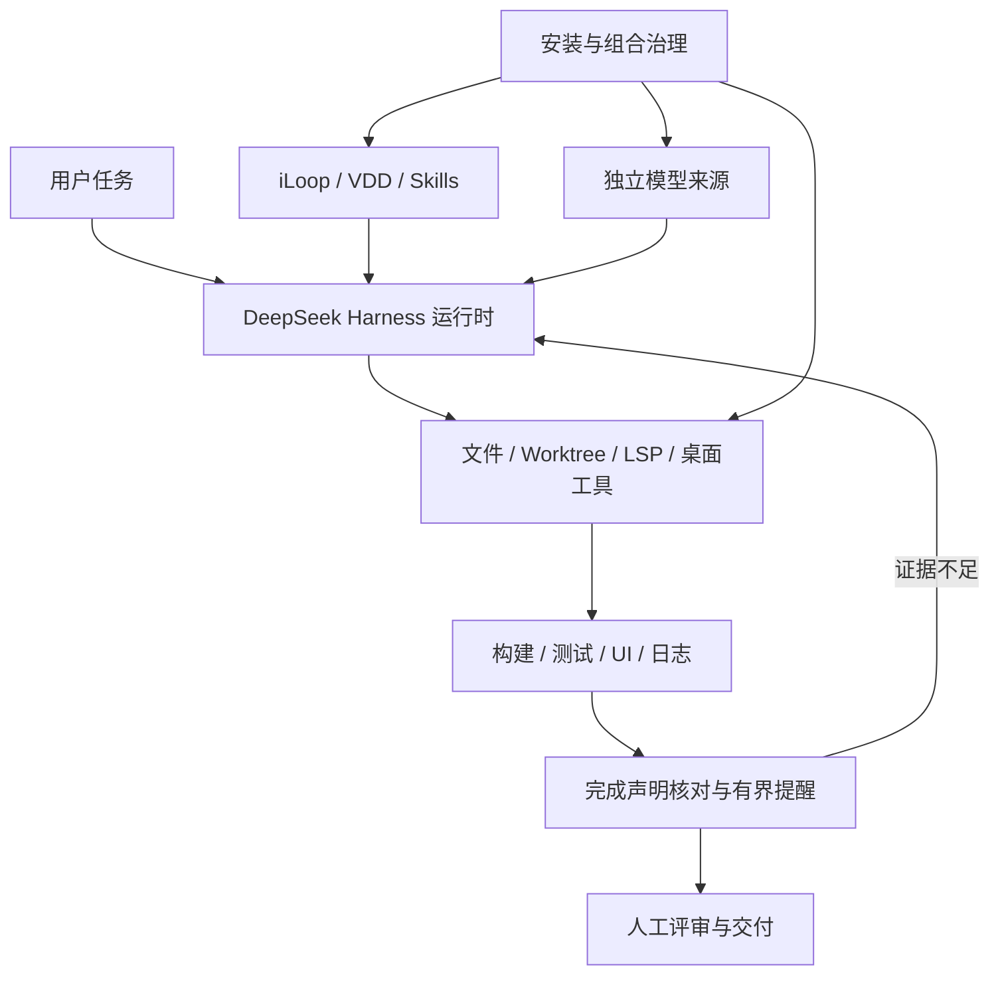

本文说明架构与设计取舍，具体版本和可用能力以项目自身的验证记录为准。

> [!NOTE]
>  **核心判断：**  高效工作台不是一组 Prompt 或插件清单，而是一套能随人迁移、按环境替换、用真实反馈持续验证的研发系统。Personal Harness 把稳定的方法与运行规则收进公共核心，把模型、环境账号和本机工具留在可插拔边界。

这份文档面向未来维护者、团队研发同学，以及希望把个人研发流程迁移到不同项目和设备的人。读完后，应能回答四件事：为什么要做 Personal Harness；工作台由哪些模块组成；新增能力应该接在哪一层；哪些社区插件值得引入，以及怎样组合才能互不冲突、真正提效。

# 为什么要做

过去沉淀下来的 iLoop、VDD、OPC 和个人 Skills 已经能改善研发过程，但它们必须依附在某个宿主里运行。宿主一旦更换，模型入口、工具权限、插件能力和会话体验都会变化，方法本身虽然还在，交付能力却未必能完整复现。

Personal Harness 要解决的不是“再做一个 IDE”，而是把宿主之上的个人研发系统固定下来，让同一套工作方式可以跨项目、跨模型、跨环境复用。

| 原来的问题 | 如果不处理 | Personal Harness 的回答 |
|-|-|-|
| 方法依赖具体宿主 | 换工具或更换环境后，需要重新拼装工作流 | 用 Personal Workbench 固定运行入口，用 Skills 保存方法 |
| 模型和环境账号混在工作流里 | 模型来源变化会牵动整个系统 | 把 Provider 与 Company Overlay 放到可替换边界 |
| “安装成功”常被当成“能力可用” | 实际调用时才暴露权限、协议和兼容问题 | 以真实工具调用、运行结果和独立验收作为完成标准 |
| 插件越多，维护成本越高 | 上下文、权限面和版本冲突持续膨胀 | 默认集合保持克制，同时保留开放插件市场 |

# 设计原则

当前架构由五条原则约束。它们比某个插件或模型更稳定，也是后续迭代时判断能力归属的依据。

1.  **稳定核心向内收。** 工作流、Skills、安装规则、验证方法和迁移契约进入公共仓库。
2.  **环境差异向外插拔。** 模型网关、环境认证、专属平台和本机凭据只存在于 Provider 或 Overlay。
3.  **运行时只保留一个。** DeepSeek Harness 负责 Agent Loop、工具、会话和权限；Personal Harness 负责装配，不重复实现第二套 Agent Runtime。
4.  **所有权必须清楚。** 安装器只升级和卸载自己管理的依赖；用户自行安装或修改的插件不会被静默覆盖。
5.  **结论必须可验证。** 插件进入默认集合前，要经过安装、真实任务、失败恢复和升级兼容验证。

# 总体架构

下方架构说明回答两个问题：一次研发任务如何从用户进入工作台并调用外部能力；换到新环境时，哪些部分随仓库迁移，哪些部分需要重新接入。

工作台保留一套运行时，将方法、执行工具和外部接口分别装配。迁移保留公共定义，本机账号、会话和私有数据留在原环境。下方模块表说明职责，后文给出任务反馈链路。

| 层 | 负责什么 | 不负责什么 |
|-|-|-|
| DeepSeek Harness Runtime | Agent Loop、文件与终端工具、会话、权限、Desktop UI、Cordis 插件生命周期 | 个人方法、环境账号和业务判断 |
| Personal Workbench | 把 Prompt、目标、计划、会话、工具和委派策略组合成日常入口 | 模型鉴权和外部平台实现 |
| iLoop、VDD、OPC 与 Skills | 需求、设计、研发、验证、文档和交付的方法 | 替代宿主的沙箱、会话和插件机制 |
| 生产力扩展 | 工作区隔离、代码理解、子智能体、桌面操作和 3D 创作 | 把所有市场插件都纳入默认集合 |
| 组合治理（0.5.0 已交付） | 接缝所有权清单、插件准入流水线、Profile 分层，以及上下文、成本与轨迹的本机度量 | 替插件做业务判断，或让未经对照的插件直接进入主力 Profile |
| Provider、MCP 与 Overlay | 连接模型、浏览器、Apple 工具链和环境专属能力 | 把凭据和环境私有数据写入公共仓库 |

# 任务如何运行

Personal Harness 不是在 DeepSeek Harness 外再套一层对话机器人。它通过 Preset 和插件，把一次任务装配成稳定的执行链。

1.  **用户从 Personal Workbench 发起任务。** DeepSeek Harness 建立会话，提供文件、终端、权限和 Session 能力。
2.  **方法层先确定做法。** iLoop 负责反馈闭环和证据，VDD 约束完成声明，OPC 与个人 Skills 处理需求、设计、文档和专项任务。
3.  **生产力扩展执行具体工作。** Worktree 隔离代码改动，Code Graph 和 LSP 理解代码，Subagent 并行处理，Computer Use 与 Blender 连接桌面和 3D 场景。
4.  **适配层连接外部能力。** Provider Adapter 选择模型，MCP Pack 接入浏览器和 Apple 工具链，环境 Overlay 连接只在当前环境存在的能力。
5.  **结果回到同一会话验收。** 测试、截图、UI 状态、日志和独立评审形成可复查证据；失败时由安装和状态层提供回退。

# 工作流与方法层

这一层决定“任务应该怎样完成”，而不是“工具按钮在哪里”。把方法放在 Skills，把执行交给宿主，可以避免个人流程被某个模型或 IDE 锁死。

| 模块 | 当前职责 | 稳定接口 |
|-|-|-|
| Personal Workbench | 提供默认 Agent 人设、目标、计划、压缩、委派、网页、会话检索和交付工具 | Preset 与 Cordis Bundle |
| 开源 iLoop | 任务规划、反馈闭环、证据记录、风险分级和独立验收 | Skill 与本机数据目录 |
| VDD | 在“完成”“可用”“没有问题”之前要求真实验证 | 验证方法，不绑定模型 |
| OPC 与个人 Skills | 覆盖机会发现、产品定义、设计、技术文档、调研和表达 | 按需加载的 SKILL.md 与资源 |

# 生产力扩展

0.4.0 的默认扩展覆盖了日常研发闭环，但没有接管整个插件生态。默认版本由仓库固定，用户仍可通过市场自行发现、安装、禁用和卸载其他插件。

| 能力组 | 模块 | 带来的能力 |
|-|-|-|
| 工作区与交付 | Plugin Market、Better Sidebar、Git Worktree | 开放扩展入口、集中工作界面、会话级代码隔离与人工交付 |
| 代码智能 | SourceKit LSP、Code Graph、Subagent Workspace UI | 符号导航、调用链和影响面、并行任务可视化与生命周期管理 |
| 自动化与创作 | macOS Computer Use、Blender Production | 按应用读取和控制桌面 UI；建模、绑骨、动画、渲染与导出 |
| 按需工具包 | Playwright MCP、XcodeBuildMCP | 浏览器自动化，以及 iOS/macOS 构建、运行和调试 |

插件是否进入默认集合，不以数量为标准。它必须解决高频问题，与现有能力不重复，并且具备明确的权限边界、安装与卸载路径、真实任务验证和失败降级方式。后文先给出候选插件，再讨论组合与准入方式。

# 插件生态调研：哪些扩展真正提效

DeepSeek Harness 的插件生态在开源后迅速扩张。截至 2026-09-28，社区注册表 awesome-dsh-plugin 收录了 4382 个可以通过 `dsh plugin add` 安装的插件，分为 23 类，每个条目都校验过 `dsh.bundle` 清单。本次调研先用注册表的结构化数据（星标、近 30 天 npm 下载量、权限声明和能力红线）初筛，再按研发工作流的主题精读 66 个候选插件的 README，逐个核对它挂在哪个事件接缝、有没有量化证据、兼容哪条宿主版本线、存在哪些风险，最后结合外部一手研究给出结论。

**数量繁荣不等于可用。** 4382 个插件里只有 699 个星标达到 10、240 个达到 50；2131 个没有 npm 下载记录，只能从源码安装；下载量还会被桌面客户端的捆绑安装放大，不能直接当作质量信号。注册表为 455 个插件标出了能力红线，其中 362 个同时读取凭据并能联网。注册表自己也写明：安装插件等于以你的权限运行第三方代码，工具审批沙箱不住插件代码，入选列表也不代表通过了安全评审。

**有对照实验的插件屈指可数。** 在精读的 66 个插件中，只有下表几个给出了可复查的对照或实测数据，其余大多只有测试用例数量或功能描述。因此本章的推荐只代表“值得进入评估”，进入默认集合仍须用实际任务验证。

| 插件 | 可复查的证据 | 局限 |
|-|-|-|
| dsh-experience-memory | 24 个隔离的真实模型回合：无记忆 0/24，有记忆 20/24（Fisher 精确检验 p 远小于百万分之一）；每轮固定开销约 204 字节 | 增益限于“用户说过、文件里查不到”的约定；不在 npm 发布，需下载发布包安装 |
| Aegis | 120 次有效运行：契约通过率 61.67% → 93.33%，不安全结果 13.33% → 0% | 测于 Codex 而非 DSH，DSH 冒烟测试尚未完成；作者称其为有界的参考证据 |
| dsh-todo-continuity | 真实会话受控 A/B：回合中断后，计划列表从丢失变为完整保留 | 只解决计划可见性这一个问题 |
| dsh-dcp | 约 8 万 token 的历史压缩到约 700 token，全程零 LLM 调用 | 单会话自测；只做规则裁剪，不做语义归纳 |
| dsh-better-edit | 哈希锚点编辑：token 减少 31%–56%（不同口径）；不经模型的工具正确性测试 23/23 | 单次运行，数据来自上游 pi 生态，尚未在 DSH 上复测 |
| GraphFlow | 同口径对照 token 节省 95.6%；技能飞轮开启与关闭的任务成功率为 100% 对 61.5%（26 个任务） | 全部为作者自建基准；默认改写超出预算的工具结果 |
| dsh-review | 一次发布前审计调度 73 个 agent：49 个发现被确认，14 个被驳回 | 没有 A/B，也没有误报率基线；单次成本高 |

**Harness 定制有真实收益，但也有上限。** Can Bölük 在 2026 年 2 月只替换编辑工具的格式，就让 16 个模型中的 14 个编辑成功率上升，其中 Grok Code Fast 1 从 6.7% 升到 68.3%。另一方面，独立复现发现对当代模型而言编辑格式已不是主要瓶颈，Terminal-Bench 2.0 的作者也认为模型选择通常比 Harness 的差异更重要。对 Personal Harness 的含义是：先选对模型，再用插件消除具体的、可以测量的瓶颈。

**提效来自闭环，而不是更多工具。** 把候选插件放回研发流程看，真正改变效率的是四类闭环能力：让上下文与成本可见，才能有依据地调整压缩、路由和预算；把“完成”变成可验证的门禁，才能减少返工；隔离与回滚到位，放手让 Agent 执行才是安全的默认；通知与远程审批，把人从盯着屏幕中解放出来。浏览器、桌面操作、3D 创作这类新增能力价值很高，但更适合作为按项目启用的工具包。下表按能力分组给出评估名单，“建议进入评估”一列优先选择本地运行、机制清楚、与官方能力不冲突的插件。

| 能力 | 建议进入评估 | 备选或观望 | 判断依据 |
|-|-|-|-|
| 上下文与成本观测 | dsh-context；dsh-cost-meter | dsh-fast（与 dsh-context 重叠）；dsh-budget（可硬封顶，但价表不含峰谷） | 只读官方 token 计量，零侵入；按请求发起时刻计算峰谷价 |
| 上下文压缩 | 官方 compaction（默认） | dsh-dcp 试用；billion-context 不建议 | 同一 Profile 只能有一个压缩后端；billion-context 走 MITM 代理，且会强制更新 |
| 模型路由与容错 | dsh-llm-fallbacks | dsh-tier-router（强档规划评审、弱档实现，暂无成本实测） | 未配置时等同未安装；支持按时段切换回退链 |
| 编辑与会话连续性 | dsh-todo-continuity | dsh-better-edit；dsh-btw（旁路提问，不污染主上下文） | 零依赖、出错时放行；替换核心编辑工具前须在本机复测 |
| 代码理解 | 官方 ctx.lsp 与 dsh-lsp-actions；dsh-code-index | codegraph 托管（已在用 codegraph 时）；GraphFlow 观望 | LSP 负责精度，repo map 负责广度；注入型只留一个 |
| 验证与完成门禁 | dsh-doublecheck；dsh-verify（Web 项目） | dsh-evidence-gate；dsh-completion-guard；Aegis | 先提醒再阻断，可输出 SARIF；浏览器验收以退出码判定 |
| 代码评审 | dsh-code-review（/review 独立子智能体） | dsh-review（发布前对抗式评审） | /review 命令名与 dsh-github 冲突，只能装一个 |
| 并行与隔离 | 现有 Git Worktree；dsh-agent-teams | dsh-swarm-orchestrator（批量扇出） | 与官方实验性 agentTeams 二选一；并行数受评审带宽约束 |
| 长任务与自动化 | 官方 goal 与 schedule；dsh-lowtide | dsh-automation（夜间巡检）；loopx、ouroboros 观望 | 低谷时段半价；loopx 会引入第二套目标状态 |
| 记忆与经验 | dsh-experience-memory 或 dsh-mnemon，二选一 | memsearch（跨 Agent 共享）；hindsight、OpenViking 观望 | 本地、无外部服务；hindsight 默认连云端，并为所有项目开启记忆 |
| 安全与回滚 | 装前 dsh-trust-check 与 dsh-plugin-doctor；dsh-permission-rules；dsh-defend；官方 workspace-changes | dsh-auto-review（替 ask 代答）；checkpoint-rewind；secret-guard | 确定性、本地运行、可先试运行；LLM 审批只做补充 |
| 通知与远程审批 | dsh-lark（放在 Company Overlay） | dsh-notifier（28 个出站通道）；dsh-lark-bot 观望 | 卡片审批可回传；走飞书长连接，无需公网服务器和回调地址 |
| 跨 Harness 资产复用 | dsh-skills-anywhere；dsh-movein（一次性迁移） | dsh-agent-plugins-market 观望 | 只读挂载、按 commit 锁定；后者会引入第三方 hook，且工具限制不生效 |
| 插件治理 | 现有 Plugin Market；现有 Better Sidebar（需复核版本） | dsh-plugin-gating-hub（仅 Observer 模式，勿与 Market 并用）；upstream-radar | Better Sidebar 自 0.23.0 起文件路由不再限制在工作区内 |

**宿主版本是隐藏的组合约束。** 大量插件只声明兼容 DSH 0.1.7 开发预览版（依赖上限低于 0.2.0），另一批以 0.2.0 开发预览版 为基线；Better Sidebar 0.24.1 就要求 0.2.0 开发预览版 以上，留在 0.1.7 线必须钉在 0.22.1。Personal Harness 应先选定一条宿主基线，再为每个插件选定版本，而不是逐个追最新。

**供应链风险已经从假设变成事件。** 2026 年，Socket 披露了 SANDWORM_MODE 蠕虫：至少 19 个恶意 npm 包，其中 3 个冒充 Claude Code，会向 Agent 配置写入恶意 MCP 服务器，再用提示注入诱导读取 SSH 与云凭据。Snyk 扫描了 3984 个 Agent Skills，13.4% 含严重问题，76 个被确认是恶意载荷；Koi Security 在 ClawHub 的 2857 个 skills 中发现 341 个恶意样本；JetBrains 市场上有 15 个冒充 AI 编程助手的恶意插件，累计约 7 万次安装，窃取包括 DeepSeek 在内的 API Key。具体到本次候选：Better Sidebar 自 0.23.0 起去掉了文件路由的工作区包含检查，可以读写宿主用户能访问的任意路径；billion-context 通过证书 MITM 代理改写模型流量，会按公告强制安装指定版本，作者也承认真实模型集成测试尚未完成。

主要依据：[awesome-dsh-plugin 注册表](https://github.com/awesome-dsh-plugin/awesome-dsh-plugin)；[DeepSeek Harness 仓库与文档](https://github.com/deepseek-ai/deepseek-harness)；[Anthropic：长任务 Harness](https://www.anthropic.com/engineering/effective-harnesses-for-long-running-agents)；[Anthropic：上下文工程](https://www.anthropic.com/engineering/effective-context-engineering-for-ai-agents)；[Claude Code Hooks 指南](https://code.claude.com/docs/en/hooks-guide)；[Can Bölük：The Harness Problem](https://blog.can.ac/2026/02/12/the-harness-problem/)；[Terminal-Bench 2.0](https://arxiv.org/abs/2601.11868)；[METR 2025 随机对照实验](https://metr.org/blog/2025-07-10-early-2025-ai-experienced-os-dev-study/)；[METR 2026 使用调查](https://metr.org/blog/2026-05-11-ai-usage-survey/)；[Faros AI 生产力悖论](https://www.faros.ai/blog/ai-software-engineering)；[Socket：SANDWORM_MODE](https://socket.dev/blog/sandworm-mode-npm-worm-ai-toolchain-poisoning)；[Snyk：ToxicSkills](https://snyk.io/blog/toxicskills-malicious-ai-agent-skills-clawhub/)；[DeepSeek 官方价格](https://api-docs.deepseek.com/quick_start/pricing)。

# 插件如何组合：按事件接缝与研发阶段编排

DeepSeek Harness 的插件之所以能自由组合，是因为所有能力都挂在同一条事件链上：组装系统提示、每步请求前、模型请求与流式返回、工具执行前后、审批、回合结束。组合的关键不是“装哪些”，而是“每个接缝上谁拥有决策权、谁只观察”。拥有者会改变 Agent 的行为，例如压缩上下文、替人审批、切换模型、推动续跑或注入记忆，同一个 Profile 里每个独占接缝只能有一个；观察者只读取事件做计费、观测或通知，可以有多个。下表给出建议的接缝分工。

| 接缝 | 触发时机 | 拥有者（独占，只选一个） | 可叠加（观察或只收紧） |
|-|-|-|-|
| `system-prompt/assemble` | 组装系统提示 | 不独占，但总量要有预算：AGENTS.md、Skills 目录和 repo map（dsh-code-index）各留一份 | — |
| `ctx.compaction` | 上下文超过阈值 | 压缩后端：官方 compaction（默认）或 dsh-dcp | dsh-context 展示上下文压力与构成 |
| `agent/pre-step` | 每步请求前 | 自动注入型记忆：dsh-experience-memory 或 dsh-mnemon | dsh-defend 的注入检测 |
| `agent/request` | 每次模型请求 | 推理强度或强弱档：dsh-tier-router 或 dsh-thinking-levels | — |
| `llm/stream` | 模型流式返回 | 预算硬阻断：dsh-budget（可选） | dsh-cost-meter 计费 |
| `tools/pre-execute` | 工具执行前 | 放行与改写策略：dsh-permission-rules | 只拒绝的守卫，例如 dsh-defend；回滚类插件的执行前快照 |
| `ctx.approval` | 调用需要确认 | AI 应答者：官方 auto-review 或 dsh-auto-review，也可以不设 | 人类应答通道：终端、Web、飞书卡片（dsh-lark） |
| `tools/post-execute` | 工具返回后 | 结果改写：dsh-defend 的密钥遮蔽或 secret-guard，二选一 | dsh-evidence-gate 记录证据索引 |
| `agent/turn-stopping` | 回合即将结束 | 续跑推动者：dsh-doublecheck 或自研 VDD 门禁，与 goal 自动续跑、Ralph 同时只开一个 | workspace-changes 生成回合快照 |
| `agent/request-error` | 模型请求失败 | 换模型或续跑：dsh-llm-fallbacks | — |
| `turn/end`、`session/event` | 回合结束与全部会话事件 | — | dsh-context、dsh-todo-continuity、dsh-trajectory-governance、观测导出、飞书通知 |
| 斜杠命令 | 用户输入命令 | /review、/rewind 等命令名各归一个插件 | — |

在这张分工表背后，是五条组合规则：

1.  **独占接缝只有一个拥有者，只收紧的守卫可以叠加。** 两个压缩后端会争抢同一个 compaction 服务；两个自动注入型记忆会双重注入，还可能把对方注入的内容当成对话再次采集，形成自我强化；dsh-github 与 dsh-code-review 都注册 /review，checkpoint-rewind 与 dsh-rewind 都注册 /rewind。相反，`tools/pre-execute` 上的守卫只能收紧、不能放宽，多个只做拒绝的守卫叠加不会互相推翻，代价只是误拦截增多，需要用拦截率来衡量。
2.  **确定性在前，模型判定在后。** 官方管线先跑 `tools/pre-execute` 和守卫，再进入审批。让 dsh-permission-rules 的拒绝在这里直接终止调用，不耗 token，也不受提示注入影响；只有需要确认的调用才交给 AI 应答者，不可逆操作始终留给人。
3.  **稳定前缀，易变尾部。** DeepSeek Flash 命中缓存的输入价是未命中的 1/50（低谷时段每百万 token 0.003 美元对 0.15 美元）。时间、记忆召回、任务状态这类每步都变的内容不要写进系统提示前缀，而应放在尾部消息，并用 dsh-context 和缓存命中率验证效果。
4.  **所有自动续跑都要有上限。** `agent/turn-stopping` 是串行事件，任何一个监听器提出异议，回合就会继续，监听器顺序不影响结果。官方 Claude Code hook 桥也没有实现连续阻止上限，一个无条件阻止的 Stop hook 会让每一步都被强制续跑；Claude Code 自己则在连续阻止 8 次仍无进展时放行。完成门禁、goal 自动续跑和 Ralph 同一时间只开一个，并设最大轮数，例如连续阻止 3 次仍缺证据就交给人。
5.  **先度量，再进入默认。** METR 2025 年的随机对照实验中，资深开源开发者使用 AI 后完成任务反而慢了 19%，事后却仍认为自己快了约 20%。每个候选插件都应在自己的任务集上做开关对照，比较 token、回合数、人工介入次数和完成率，再决定去留。

**按研发阶段编排。** 把拥有者和观察者放回 Personal Harness 已有的方法层，就得到下面的阶段组合。每个阶段都产出可复查的证据，由下一个阶段消费；这也是 Anthropic 在长任务 Harness 实践中强调的做法：用进度文件、功能清单和逐项提交让下一轮能接得上。

| 阶段 | 方法层 | 插件组合 | 产出的证据 |
|-|-|-|-|
| 需求澄清 | OPC、iLoop 规划 | 官方 plan-mode；dsh-doublecheck 的 grill 阶段把需求共识记为证据 | 需求规格与验收条款 |
| 计划 | iLoop 风险分级 | 强档模型负责规划（dsh-tier-router）；dsh-code-index 给出 repo map 与变更影响 | 计划、影响面、可能受影响的测试 |
| 实现 | 个人 Skills | Worktree 隔离会话；弱档模型实现；dsh-lsp-actions 做诊断与重命名；dsh-todo-continuity 保持计划可见 | 每个回合的 workspace-changes 快照 |
| 验证 | VDD | doublecheck 先红后绿；XcodeBuildMCP 或项目测试命令作为红绿信号；dsh-verify 做浏览器验收；Computer Use 截图 | 测试结果、截图与浏览器验收回执 |
| 评审 | iLoop 独立验收 | /review 交给独立子智能体（dsh-code-review）；发布前再跑对抗式评审（dsh-review） | 经过复核的缺陷清单 |
| 交付 | OPC 表达 | Worktree 人工确认后交付；dsh-lark 飞书卡片审批与通知（独立渠道扩展） | 交付记录与审批记录 |
| 学习 | 个人 Skills 演进 | dsh-experience-memory 只收候选经验；验证通过的规则由人晋升到 AGENTS.md 或 Skill；dsh-trajectory-governance 诊断死循环与目标漂移 | 经验库、规则变更与轨迹报告 |

**用 Profile 分层，而不是一个 Profile 装全部。** 插件以用户权限运行，独占接缝又互斥，把所有插件装进一个 Profile 会同时放大风险和冲突。DeepSeek Harness 的每个 Profile 都有独立的插件集合，建议按使用场景拆成四个 Profile，共享同一套 Skills、Provider 和 Overlay：

| Profile | 用途 | 相对日常 Profile 的差异 | 权限边界 |
|-|-|-|-|
| ph-daily | 日常交互研发 | 基线：观测、确定性权限、代码理解、评审与通知 | workspace-write；需要确认的调用交给人 |
| ph-deep | 长任务与复杂重构 | 完成门禁从提醒升为阻断；启用 goal 自动续跑；轨迹治理在死循环时中止；强制使用 Worktree | workspace-write；续跑有轮数上限 |
| ph-night | 无人值守与低谷批处理 | dsh-lowtide 或定时任务；只跑可以机器验收的任务；结果推送到飞书 | 禁用 danger-full-access；审批无人应答即拒绝 |
| ph-lab | 新插件试验场 | 独立的 DSH_HOME，不放任何密钥；在这里做开关对照 | 与主力环境隔离，结论通过后才晋升 |

**常见反模式。** 下面这些做法在插件文档和社区评测中反复出现，Personal Harness 应在安装器和准入流程里直接拦住：

| 反模式 | 后果 | 改为 |
|-|-|-|
| 按星标或下载量挑选插件 | 下载量会被客户端捆绑放大，近半数插件没有 npm 下载 | 以 README 机制核查和本地开关对照为准 |
| 同时装两个压缩或记忆插件 | 服务冲突、双重注入、互相采集 | 用接缝所有权清单在安装时拦截 |
| 门禁无条件阻止回合结束 | 无限续跑，token 失控 | 门禁内置连续阻止计数，超过上限交给人 |
| CLAUDE.md 与 AGENTS.md 内容重复 | 社区评测确认两者都会被读取，内容相同时系统提示翻倍 | 只保留 AGENTS.md 作为唯一来源 |
| 每步改写系统提示前缀 | 前缀缓存失效，命中与未命中的输入单价相差 50 倍 | 稳定内容放前缀，易变内容放尾部 |
| 在主力 Profile 里试新插件 | 第三方代码直接接触密钥和代码 | 先在 ph-lab 过准入流水线 |
| 并行 Agent 开得越多越好 | 评审成为瓶颈：Faros 的遥测显示合并 PR 数增加 98%，评审时间增加 91% | 并行数以每天能评审完的量为上限 |

# 基于个人工作流的定制

通用插件解决的是所有人的问题，Personal Harness 真正的差异化在于把 iLoop、VDD、OPC 和个人 Skills 从“写在提示里的约定”变成“挂在事件接缝上的机制”。Claude Code 的官方最佳实践对此有准确的概括：CLAUDE.md 里的指令是建议性的，hook 才是确定性的，能保证动作一定发生。DeepSeek Harness 的接缝比 hook 更细，而且允许改写而不只是拦截，这正是它相对 Codex 等宿主的定制优势。下表是方法层到机制的映射，其中 VDD 门禁和 iLoop 证据索引需要自研，其余可以用现有插件组合实现。

| 方法 | 现在的形态 | 机制化方案 | 接缝 |
|-|-|-|-|
| VDD | Skill 约束完成声明 | 自研轻量门禁：回合结束前检查最终回复里“完成、可用、已修复”这类声明，本会话是否有对应的测试、截图或命令结果作证据；缺证据就提出异议并说明缺什么，连续 3 次仍缺则交给人 | `agent/turn-stopping`，证据取自 `tools/result` |
| iLoop 证据记录 | 模型手写证据 | 从工具结果事件和 workspace-changes 快照自动生成证据索引，模型只负责引用，不再手写 | `tools/result`、`turn/end` |
| iLoop 风险分级 | 在提示中分级 | 把风险等级映射为 dsh-permission-rules 的允许、确认、拒绝规则，高风险操作强制走人工审批 | `tools/pre-execute`、`ctx.approval` |
| OPC 调研与设计 | Skills | 做成只读权限的 agent preset；调研交给只回传摘要的子智能体，主会话只接收 1000–2000 token 的结论 | agent preset、`ctx.subagents` |
| 个人 Skills | 仓库内的 SKILL.md | 仓库保持唯一来源；dsh-skills-anywhere 只读挂载给 DSH，同时作为本地 MCP 服务器提供给 Claude Code 等其他宿主 | `ctx.skills`、MCP |
| Apple 开发闭环 | SourceKit LSP、XcodeBuildMCP | 官方 ctx.lsp 负责导航，dsh-lsp-actions 配置 sourcekit-lsp 提供诊断、格式化与重命名；把 xcodebuild test 登记为门禁认可的测试命令 | `ctx.lsp`、门禁的测试命令模式 |

**接缝所有权清单。** 第 2 节原则 4 已经规定安装器只升级和卸载自己管理的依赖。插件组合起来之后，所有权还需要从“依赖”扩展到“决策”：仓库新增一份接缝所有权清单，声明每个 Profile 在每个独占接缝上由哪个插件负责；安装器写入 Profile 前先检查，两个插件声明同一个独占接缝时拒绝安装并说明冲突。下面是清单的示意格式，字段名还需要结合安装器的实现确定：

```yaml
# 实际落地为 config/seams.json（JSON，非 YAML）；下列 YAML 是 0.5 设计阶段示意，字段语义已保留
profile: ph-daily
owners:                          # 独占接缝，每项只能有一个
  compaction: official/compaction-basic
  memory-inject: dsh-experience-memory
  request-effort: none
  request-error: dsh-llm-fallbacks
  pre-execute-policy: dsh-permission-rules
  approval-ai: none              # 需要确认的调用全部交给人
  post-execute-rewrite: dsh-defend
  turn-stopping: ph-vdd-gate     # 自研 VDD 门禁
commands:
  /review: dsh-code-review
  /rewind: none
guards:                          # 只收紧，可以叠加
  - dsh-defend
observers:                       # 只读事件，可以叠加
  - dsh-context
  - dsh-cost-meter
  - dsh-todo-continuity
  - dsh-trajectory-governance
```

**落地差异（0.5/0.6 已实现）。** 清单实际写成 config/seams.json，安装器在写 Profile 前做单 owner 冲突校验，guard/observer 可叠加、斜杠命令唯一归属；准入由 plugin-admit 四闸执行并锁定 admitted.json。设计阶段设想的 dsh-todo-continuity、dsh-trajectory-governance 在 npm 上核验为不存在，未纳入交付，相关需求改由自研 VDD 门禁和 seams 覆盖；本文其他位置出现这两个包名仅为设计时设想。

**插件准入流水线。** 第 6 节已经列出进入默认集合前要证明的条件，这里把它落成四道可执行的闸门：装前静态检查、包结构检查、隔离试用与开关对照、钉死版本。前三道可以直接用现成工具完成：

```bash
# 装前静态检查：能力披露与红线。退出码 0 未检出、1 需确认、2 有红线、3 扫描失败
npx dsh-trust-check --dir ./candidate --exit-code

# 包结构与 Cordis 契约检查：离线运行，不执行第三方代码
npx --yes @perrylink/dsh-plugin-doctor@0.4.0 --repo ./candidate --no-smoke --only "R,K"

# 在不含密钥的 ph-lab 中安装精确版本，做开关对照
DSH_HOME=~/.dsh-lab dsh plugin --profile ph-lab add <plugin>@<exact-version>

# 对照通过后把精确版本写入锁定清单，再进入 ph-daily
```

有两处容易踩坑：trust-check 返回 0 只代表本次静态扫描没有检出，不代表安全；plugin-doctor 要用带作用域的包名 @perrylink/dsh-plugin-doctor，npm 上不带作用域的同名包属于其他作者。从 git 安装的插件还应钉到具体 commit。

**成本感知的调度。** 如果主力模型走 DeepSeek 官方 API，要注意它的峰谷时段几乎和工作时间重合：工作日（不含中国法定节假日）北京时间 09:00–12:00 和 14:00–18:00 是高峰，其余时间半价。交互式工作留在白天；回归测试、大范围重构、文档生成和调研这类可以机器验收的任务，白天提交、低谷批量执行，可以用 dsh-lowtide，也可以用 dsh-llm-fallbacks 的时段路由在高峰时切到便宜的模型。Pro 与 Flash 的价差也支持分档：未命中缓存时，Pro 的输入单价约为 Flash 的 4.4 倍，输出约为 3.3 倍，适合“强档规划和评审、弱档实现”的分工。Provider 的成本规则需按实际服务验证，不能把一家供应商的价格套到其他来源。

**通知渠道独立接入。** 会话通知、工具审批和远程交互可以由渠道扩展提供。会话内容可能进入第三方服务，渠道应按环境启用；关闭渠道后，核心方法和本地工作台仍应能使用。

# 客户端全栈与 OPC：插件落地与一键恢复

前几节回答了哪些插件值得评估、怎样组合。这一节把结论落到仓库：以 iOS、Android、HarmonyOS 和服务端为主线，覆盖 OPC 从想法到上线，并保证迁移到新设备时，用同一个仓库就能恢复工作台。

项目工具按需接入，浏览器、Apple、Android、HarmonyOS、Go 和文档检索分别声明自己的依赖。安装、协议握手、设备操作和项目构建是不同层次的验证，不能相互替代。

| 方向 | 连接方式 | 项目验证依赖 |
| --- | --- | --- |
| iOS／macOS | XcodeBuildMCP、Apple 文档检索 | Xcode、模拟器或签名设备 |
| Android | mobile-mcp | adb、设备与项目 Gradle |
| HarmonyOS | DevEco CLI | DevEco 工具链与工程目录 |
| Go | gopls MCP | Go 工具链与工程目录 |
| 通用文档 | Context7 | 服务可达和检索结果核对 |

**为什么做成按需 pack。** MCP 的工具描述会常驻上下文，进程也常驻；平台 SDK 和设备也不是每台机器都有。按需启用让 iOS、Android、HarmonyOS 和服务端的工具只在需要时出现，符合第 2 节的最小默认集合原则。环境 Overlay 在自己的目录里声明 pack，核心清单不引用它，更换环境时整体不启用即可。

**项目级 pack。** gopls 按进程的工作目录识别 Go 工作区，DevEco CLI 读 `PROJECT_PATH` 或 MCP roots；而 DSH 的 MCP 客户端初始化时不声明 roots。因此 `go` 和 `harmony` 启用时必须用 `--project` 绑定一个工程，否则 gopls 会回答“This is not a Go workspace”。当前一次只绑定一个工程，换工程要重新启用。

**OPC：从想法到上线。** OPC 的前半程已经由仓库里的 Skills 覆盖，后半程按阶段接入 pack，候选只在对应阶段出现真实需求时再评估：

| 阶段 | 已有能力 | 候选 |
|-|-|-|
| 机会发现和评估 | opportunity-radar、opportunity-scorecard、outside-view | — |
| PRD 和方案 | product-brief、engineering-docs、style-compass | spec-kit |
| 实现 | iLoop／VDD、Worktree、Code Graph、SourceKit LSP；`go`、`harmony`、`docs`、`apple-docs` | — |
| 验证 | iLoop 验收；`browser`、`apple`、`android` | Maestro、qa-skills |
| 发布 | 项目自己的签名和发布脚本 | App Store Connect CLI、fastlane |
| 线上 | 项目自己的日志与监控入口 | 按平台权限独立接入 |

候选的许可证都已核对：spec-kit、qa-skills 和 App Store Connect CLI 是 MIT，Maestro 和 android/skills 是 Apache-2.0。harmony-next.skills 的仓库没有许可证文件，按仓库规则不纳入。

**一键恢复。** 仓库保存工具清单和精确版本；本机保存模型选择、凭据引用与运行状态。新设备重新安装宿主与工作台，再选择可用模型、启用所需项目工具，最后用真实工具往返确认。

宿主版本、插件 peer 范围、包管理器布局、工具工程目录和可选依赖都影响安装。安装通过只能证明配置结构；真实桌面会话、设备操作和项目构建仍需分别验证。

# 模型与环境适配

工作流不直接依赖模型供应商。每个模型来源统一声明协议、地址、凭据引用、模型目录和可选健康检查；模型变化只影响 Provider 层。

```text
provider id
+ protocol
+ base URL
+ credential reference
+ model catalog
+ optional health endpoint
```

模型接入应分别验证文本、流式返回、工具参数与结果回传；没有通过这些检查的来源，不能写成当前可用。

环境专属能力放在独立 Overlay。关闭它后，工作流、Skills 和其他模型来源应保持可用。

# 安装、状态与迁移

仓库保存可公开复用的定义，本机目录保存运行状态和凭据引用。两者分离后，同一仓库既能迁移，也不会把旧环境的账号带到新环境。

| 位置 | 保存内容 | 处理原则 |
|-|-|-|
| Git 仓库 | Preset、Skills、插件目录、Provider 模板、安装与验证代码 | 可评审、可版本化、可在新环境重新安装 |
| \~/.personal-harness | 当前版本、Provider 选择、路由、插件所有权、伴随运行时和兼容设置 | 只在本机保存，升级时备份，失败后恢复 |
| \~/.dsh | DeepSeek Harness Profile、会话与用户自行安装的插件 | 安装器只修改自己拥有的区块，不覆盖用户改动 |
| 环境凭据 | 模型 Key、SSO、设备状态和环境私有数据 | 不进入仓库，不随迁移包复制 |

迁移到新环境时，执行顺序保持简单：

1. 安装 DeepSeek Harness Desktop。
2. 克隆 Personal Harness 仓库并运行安装器。
3. 选择一个在当前环境可用的 Provider。
4. 按需安装环境 Overlay 和项目工具包。
5. 运行回归、Doctor 和一次真实模型工具调用。

安装器固定插件版本、记录所有权并保留失败回滚。它不会把“命令退出码为 0”直接当成可用，而是继续核对 Bundle、伴随运行时、兼容补丁和真实行为。

**恢复与兼容。** 新环境应先检查宿主版本与必要工具，再恢复托管配置。模型未配置、可选工具缺失与核心安装失败必须分别报告。网络来源、证书和工具路径由使用者按环境配置，不进入可迁移内容。

# 版本演进

0.1–0.4 四个版本补齐了“可安装、可运行、可扩展、可交付”四类能力；0.5.0 交付第五类“组合得稳、用得省”，0.6.0 在此之上把可迁移、可维护和发布隔离做实。后续版本继续沿同一结构演进，不另起入口。

| 版本 | 解决的问题 | 新增能力 |
|-|-|-|
| 0.1.0 | 先把个人方法装进同一个宿主 | Personal Workbench、Provider 声明、iLoop/OPC/VDD/个人 Skills、安装/诊断/卸载 |
| 0.2.0 | 让模型和伴随服务真正可运行、可恢复 | 模型接口适配、命名路由、模型探针、内容寻址安装、失败恢复、Browser/Apple MCP Pack |
| 0.3.0 | 开放插件生态并改善日常工作界面 | Plugin Market、SourceKit LSP、Better Sidebar、插件所有权、直接模型选择 |
| 0.4.0 | 补齐并行、隔离、代码理解和跨应用执行 | Git Worktree、Subagent UI、Code Graph、Computer Use、Blender、兼容与持久化修正 |
| 0.5.0（已交付） | 插件多了以后组合得稳、用得省 | 接缝所有权清单、插件准入流水线、Profile 分层、VDD 门禁插件化、上下文与成本观测、独立通知渠道 |
| 0.6.0（已交付） | 基线拉齐后把可迁移与可维护做实 | host 适配层（版本与补丁数据化）、OpenRouter 默认模型通路、环境模型层 Overlay 模板、跨会话记忆、desktop 日常 VDD 门禁、能力标识解耦与 doctor 降级提示、check-portable 可移植门 |

## 从设计到可验证的机制

接缝所有权清单、插件准入、分层 Profile、完成声明的有界提醒，以及模型和工具的独立接入，把约定逐步变成可执行机制。机制可以用离线夹具检查冲突与默认行为，实际效果仍须回到真实任务。

完成门禁只根据已有证据提醒，不代表能自动判定所有任务都成功。插件安装检查、MCP 握手、真实模型工具往返与项目交付各有自己的验收范围。



# 如何继续扩展

新增能力时，先判断它改变的是方法、执行能力、模型来源、特定环境还是安装生命周期。选对层，比直接把代码塞进仓库更重要。

| 新增内容 | 应该接入 | 进入默认前要证明 |
|-|-|-|
| 新的工作方法或专项流程 | Skill | 真实任务中比通用提示更稳定，且不绑定具体环境 |
| 新的常驻运行能力或界面 | Cordis 插件 | 权限、版本、卸载、失败降级和宿主升级兼容 |
| 拦截或改写 Agent 行为的能力 | Cordis 插件，并登记到接缝所有权清单 | 独占接缝无冲突、确定性规则优先、自动续跑有上限，开关对照显示净收益 |
| 新的项目工具 | MCP Pack 或项目命令 | 实际项目的构建、运行或验证结果 |
| 新的模型服务 | Provider Adapter | 模型目录、文本、工具调用、错误分类和凭据保护 |
| 只在特定环境存在的能力 | Company Overlay | 禁用后公共核心仍可正常运行 |
| 安装、升级或状态规则 | Installer 与本机状态层 | 重复安装、失败回滚、用户改动保护和卸载边界 |

# 当前边界

不能只凭安装、配置解析或测试夹具，宣称工作台在全部宿主和项目里更高效。可用性以模型往返、真实会话与项目验证为准。

- 工具安装和握手不等于 Android、HarmonyOS 或 Apple 工程已经交付。
- 简单骨骼动画验证不代表复杂角色自动绑骨的质量。
- 宿主升级可能破坏插件兼容，必须复核 peer 范围与运行行为。
- 项目级工具的工作目录、Profile 加载方式和伴随服务所有权都有宿主限制。
- 插件候选的社区对照只能支持进入评估，不能代替自己的任务完成率、人工介入与成本对照。
- 完成提醒、跨会话记忆和准入流程也需要真实任务验证，不能只依据功能存在下结论。

# 维护方式

这份文档应当随着架构演进持续更新。新增默认插件、改变 Provider 契约、调整状态目录或修改迁移步骤时，必须同时复核架构图、模块表、接缝所有权清单、版本演进和当前边界。

后续迭代优先积累三类事实：真实任务完成率、人工介入次数，以及升级后的回归结果。引入插件组合后，再补充每个任务的 token 与成本、缓存命中率、自动续跑与门禁拦截次数，以及评审发现中被确认的比例。前几项由 dsh-context、dsh-cost-meter 和 dsh-trajectory-governance 在本机采集，评审质量由人工抽样记录，避免依赖主观感受。只有这些事实持续变好，Personal Harness 才真正成为更高效的工作台，而不只是更复杂的工具集合。

仓库：[Job-Yang/personal-harness](https://github.com/Job-Yang/personal-harness)
