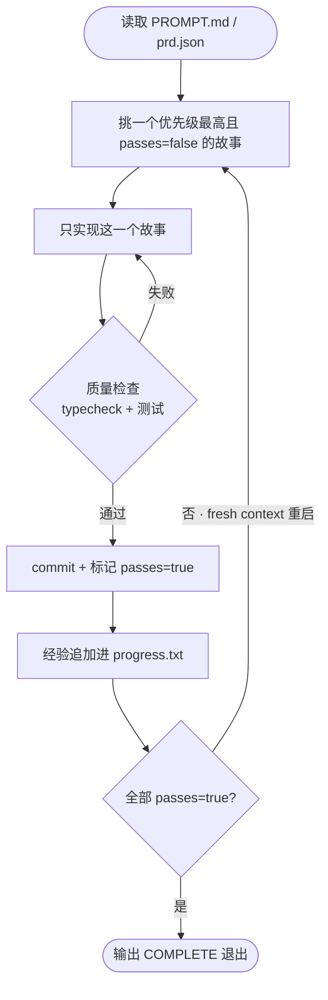

<callout emoji="💡">
**一句话看懂：**Ralph Loop 是一个把每轮重启做到极致的 Bash 死循环，靠每步丢掉旧上下文对抗模型退化；把它和 iLoop 摆到一起看，Ralph 重启狠但反馈很薄，iLoop 反馈极厚而重启克制，两边强弱恰好互补。
</callout>

---

# Ralph Loop 是什么

原型就一行 Bash 死循环，把同一份 `PROMPT.md` 一遍遍喂给编码 Agent 直到做完：

```bash
while :; do cat PROMPT.md | claude -p --dangerously-skip-permissions; done
```

名字是 Geoffrey Huntley 在 2025 年 7 月取的，出自《辛普森一家》里那个老往门框撞还喊着我在帮忙的 Ralph Wiggum；`snarktank/ralph` 是后面包上任务管理的开源实现。它抓人的关键不在循环本身，而在**每一轮都从全新的空白上下文起步**。

# 它在押哪三个判断

整套设计可以归成一句话：不赌模型中途不变蠢，靠外层结构把退化锁在当前一轮里：

| 核心赌注 | 做法 | 站得住的理由 |
|-|-|-|
| **1. 丢弃好过硬续** | 上下文一旦变脏就整轮烧掉重起 | 主流忙着压缩或 RAG 找回；Ralph 直接借循环边界清空重来，保证每轮起步状态满血 |
| **2. 记忆放到文件** | 进度不放对话历史，写进磁盘 | 对话会被静默压缩丢细节；写进 `git log`、`progress.txt`、`prd.json` 才持久、可 diff、能重启就续 |
| **3. 用死结构圈住活元件** | 单步平庸没关系，靠硬反馈慢慢逼近 | Huntley 称单次模型稳定地平庸（deterministically bad）；靠小步改动、硬反馈与反复试错把结果磨到收敛 |

<callout emoji="💡">
**这套玩法的死穴：**Ralph 作者也直认，只有反馈闭环够硬循环才转得动，不然错误会跨轮越滚越大。可 Ralph 自带的反馈只有 typecheck、单测和 CI，这一块恰好是 iLoop 的主场。
</callout>

# snarktank/ralph 的日常流转

包上工作流后，它坚持每轮只改一个子任务并自己判断是否结束：



要把这种裸循环跑通，得先满足几个硬条件，不然错误会一轮轮放大：

1. **单轮任务必须切小：**拆到一个上下文窗口吃得下的粒度（如加一列字段、改一个接口）；大需求直接扔进去必炸。
2. **反馈信号必须够硬：**typecheck 抓类型错、单测验行为、CI 保底不挂。
3. **`AGENTS.md` 随手写回：**每轮摸清的新约束和坑记进文件，留给下一轮冷启动读取。
4. **前端与 UI 改动要真点开验证：**在验收标准里写死用浏览器实际跑通检查。

---

# 把 iLoop 和 Ralph 摆在一起看

逐条核对底层假设，两者的出发点几乎一一对应：

| 底层判断 | Ralph 的做法 | iLoop 的做法 |
|-|-|-|
| 承认单次模型会退化 | 看成稳定平庸的元件（deterministically bad） | 不押宝模型自带自觉，配分层工具链护航 |
| 对抗长对话上下文腐烂 | 每轮烧掉上下文、全新冷启动 | 每轮只带命中的 flow、做归纳并从外存重建 |
| 状态存在磁盘文件里 | `progress.txt`、`prd.json`、`git log` | lessons 错题本、task 清单、轮次记录落盘 |
| 小步推进配合硬反馈 | 每轮只做一条任务，配测试和 CI | 最小步修改，配合编译、真机和端侧取证 |
| 出了失败再反补约束 | 出一次错就把对应规则写回指南 | 补一条工程断链，整个闭环长一截 |

<grid>
<column width-ratio="0.500000">
<callout emoji="🔁">
**Ralph 的强项：重启纪律**
每轮彻底清空上下文，保证每次起步脑子清醒；短板是反馈手段只有测试和 CI。
</callout>
</column>
<column width-ratio="0.500000">
<callout emoji="🔬">
**iLoop 的强项：反馈厚度**
端侧真机、UI 树、crash、抓包、埋点全接进闭环，按人在环的节奏按需冷启动。
</callout>
</column>
</grid>

# iLoop 可以从 Ralph 借走的四点

## 把 checkpoint 重建做成显式动作

iLoop 定位是人在环的交付助手，本就不需要每步强清上下文。不过把隐性的切会话升级成显式结构化重建，成本极低收益很大。

触发时机别卡 token 数量，改看准确性信号。命中下面任一条就立刻把 progress、lessons 和三层可信度写全并冷启动：

- 同一个错反复出现，Agent 已经在原地绕圈。
- 动作违背磁盘写死的约束（撞破 `§0` 或 Constitution）。
- 忘了前面用户已经敲定的决策，回头再问一遍。
- 连续几步没有推进出一个 `[机验]` 进展。

## 借「每轮只做一件事」的骨架，不搬通宵无人值守

Ralph 常拿「跑一宿早上醒来多几十个 commit」当卖点，但这套玩法不贴合大生产仓要求人工闸门和一键回退的红线。

不用搬它的无人值守模式，可以借它「挑一个 `passes=false` 子项 → 只改这一项 → 取证验收 → 标为通过 → 全绿收口」的单步骨架，用到 `big_task` 和 `refactor_regress` 巡回里，方向盘依然攥在人手里。

## 把 DoD 写成机器可判定的状态位

Ralph 的 `prd.json` 给每条故事配了个布尔值 `passes`，靠它决定停不停。iLoop 现在起独立子 Agent 判 pass/fail 后，建议顺手把结论写回 task 清单里每个子项的状态位，让断点续传、dashboard 进度和终止条件读同一份真值。

## 换脑子复查跟 Ralph 并不冲突

Huntley 反对多 Agent 复杂分工，怕非确定性叠成一团乱麻。iLoop 起独立验收子 Agent 本质上是为了拿一个干净无偏见的上下文做复查，在思路上正好呼应了 Ralph 的每轮 fresh context。

---

# Ralph 反过来印证了 iLoop 押对的地方

- **厚反馈层是硬护城河：**Ralph 的踩坑证明了只要反馈偏薄，错误就会跨轮次越滚越大；iLoop 把重心押在端侧取证、UI 树、crash、抓包与平台断链打通，正好补上裸循环缺的那块地基。
- **前馈工程拉开代差：**Ralph 每轮只重读静态 `PROMPT.md`，出错只能靠事后 test 和 CI 拦截；iLoop 的 `clarify gate` 在动手前就把缺的设备口径、接口和验收标准卡住，加上七层上下文工程，把发现跑偏提前到了动手之前。
- **两件必保机制已经起跑：**`§0` 关键上下文、task 恢复卡和 lessons 错题本解决落盘；`task_new` 模板已上线 `[机验]`、`[证据]`、`[假设]` 三层可信度标记与独立验收探针，且已通过 selftest。

<callout emoji="📌">
**最先可落的一步：**把 checkpoint 重建做成结构化动作，按准确性信号触发，优先落到日常流转里。
</callout>

---

# 参考

- [snarktank/ralph 仓库](https://github.com/snarktank/ralph)
- [Ralph Wiggum as a "software engineer" · Huntley 原文](https://ghuntley.com/ralph/)
- [everything is a ralph loop](https://ghuntley.com/loop/)
- [The Ralph Loop 深度解析](https://thomas-wiegold.com/blog/ralph-loop-how-recursive-ai-agents-work/)
