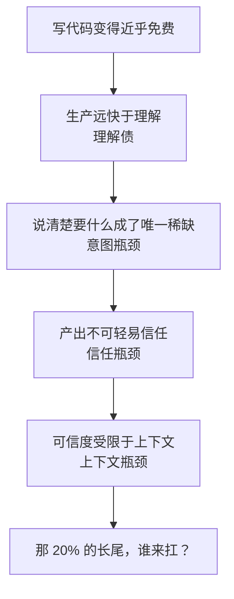

# 软件的成本大头，从来不在写代码

周五下午四点，一个入职刚三个月的新人，把一个 PR 甩进了群里。四千行代码，测试全绿，CI 一路放行，红点一个没有。你点开想扫一眼就批，滚到第八百行，手停住了：这些代码跑得起来，可全组没有一个人真读懂过它。你批，还是不批?

这个下午，正在全世界的工程团队里一遍遍重演。它背后压着一个几乎没人问出口的问题：AI 把写代码变快了这么多，它真的把"做软件"这件事变便宜了吗?

我的答案是，几乎没有。

## 软件的成本大头，从来不在写代码

大多数人对软件的直觉是一条等式：软件工程 ≈ 写代码，写得越快越省钱。这条等式是后面所有误会的根，而它是错的。

写代码只是把一个想清楚的结构落成实现，它从来不是最难、最贵的那一环。真正贵的是三件事：系统要跑很多年，今天图省事埋下的隐患，几年后连本带利爆出来，这是技术债；几十个人同时改一个系统，你的改动不能撞坏别人的依赖，这是协作和接口；需求随时在变，系统得能改而不塌，这是可演进性。写代码，不过是你在这三重约束下顺手留下的产物；钱花在别处。

四十年前 Fred Brooks 在《没有银弹》里把这件事分成两半。一半叫本质复杂度：想清楚这个系统该是什么样，有哪些模块、边界在哪、状态怎么流转，这是在脑子里构造那个复杂结构。另一半叫偶然复杂度：把这个结构翻译成代码。他给了一个到今天还成立的判断：软件史上几乎所有效率大跃进，都来自把偶然复杂度这类翻译工作变轻松；可除非它占了总工作量的九成以上，否则就算把它压到零，整体也快不了一个数量级[[No Silver Bullet]](https://worrydream.com/refs/Brooks_1986_-_No_Silver_Bullet.pdf)。

换句话说，你雇一个团队做系统，大头从来不是敲代码的工时，是想清楚要什么、把它设计对、验证它没错的成本。把敲代码的速度翻十倍，总成本降不了几个点，因为它本来就是最便宜的一环。记住这个坐标系，后面一切都挂在上面。

## AI 恰好只擅长最不值钱的那部分

AI 极强的地方，是照着一个想清楚的结构把代码写出来：查语法、拼样板、写接口、搭脚手架。用 Brooks 的划分看，这些全是偶然复杂度，AI 把它的成本压到接近零。可这恰恰是权重最低的一半。于是一个看着矛盾、其实必然的结果出现了：AI 让写代码快了很多是真的，软件工程总成本没怎么降也是真的。它省下的，正是最不值钱的那笔钱。

这不是空谈。一篇扫了 67 个来源的系统综述给这现象起了名字，叫"生产力-可靠性悖论"：在边界清楚的小任务上，个人效率确实涨了 20% 到 56%；可最严谨的随机对照实验里，资深工程师在成熟老项目上反而慢了 19%；而一份万人级遥测更值得注意，合并的代码量涨了 98%，评审时间跟着涨了 91%，可组织真正上线交付的东西是平的[[The Productivity-Reliability Paradox]](https://arxiv.org/pdf/2605.01160)。产出翻倍，评审翻倍，人人都忙，上线的东西没变多。省下的生产时间一分不剩，全被"确认这堆代码是对的"收走了。

我把这笔被重新收走的钱叫**验收税**:AI 在生产端省下的每一分钟，都会在下游读懂它、信任它、安全塞进系统这一端，被原样甚至加倍地收回去。

同一个 AI，为什么有人用了提速、有人反而更慢?那篇综述给了三个变量：任务越具体、越接近刷过一万遍的标准活，AI 越快；代码库越老、历史包袱越重，AI 越拖后腿；人越资深、系统越复杂，AI 能帮的越少，因为资深工程师的活本就长在 AI 碰不到的本质复杂度上。三个变量拨到新项目、小任务、新手，AI 提速；拨到老项目、硬骨头、老手，AI 反而添乱。快的是最不卡脖子的那环，卡脖子的那环一寸没动。

## 成本没消失，只是从写代码搬到了验证

这也是我认为软件总成本没有明显下降的原因：成本从写代码转移到了理解、验证和集成。生产代码越便宜，下游需要处理的内容越多。有篇专讲评审瓶颈的文章把这点说得更直接：AI 降低了生产代码的成本，却抬高了信任代码的成本[[AI Code Generation Is Shifting the Bottleneck to Review]](https://www.theflock.com/en/content/blog-and-ebook/ai-code-generation-review-bottleneck)。

下游因此暴露出四个问题，它们不是并排的，是一个触发下一个的链条。

第一个是**理解债**。过去有条铁律：写代码的人至少懂这段代码，整个软件工程体系都默认建在这条铁律上。AI 头一回把"生成"和"理解"分开了，你手里多了一大批能跑、却没人真读懂的代码。Google 的 Addy Osmani 给它起了个精准的名字，理解债：系统里存在的代码量，和被人真正读懂的代码量，这两者之间越拉越大的缝[[Comprehension Debt]](https://addyosmani.com/blog/comprehension-debt/)。它比技术债更隐蔽，技术债会用编译变慢、一碰就报错提醒你，理解债只给你代码干净、测试全绿的假象，然后在最糟的时刻连本带利找上门。底下还有一层速度差：代码贵的年代，老手读得比新手写得快，所以 code review 兜得住；AI 把这关系拧反了，新人用 AI 生成代码的速度，超过了老手批判性审查它的速度，那道兜底的闸门就被冲垮了。

理解跟不上生产，触发第二个问题，**意图**。写代码不要钱了，价值链上还稀缺的就只剩一件：精确说清你到底要什么。这两年"规格驱动开发"突然火起来，Kiro、spec-kit、Tessl 都往这个方向走[[Understanding Spec-Driven Development]](https://martinfowler.com/articles/exploring-gen-ai/sdd-3-tools.html)，底层就是这个原因。从前需求写得糊，靠人凭经验补；现在 AI 也补，但补的方向全看你说得多清楚。说清需求这件从没被当回事的事，成了核心手艺。这里藏着一个圈套，后面回来拆。

意图说清了也不等于能信，撞上第三个问题，**信任**。人写的代码，信任建在"这人靠谱、有 review"上；AI 递给你的，可能是个错得很讲道理、一眼看不穿的东西。于是你得有一整套机制，好在不完全信任它的前提下依然敢用：强制测试、静态检查、沙箱隔离、圈死它能改的范围。验证网织得越密，你才越敢让 AI 跑得越快。

我们能在多大程度上信任 AI 的结果，还受最后一个、也是最难的问题限制：**上下文**。这一点需要单独展开，因为它正是剩余 20% 工作难以完成的原因。

## AI 啃不下那 20%，卡在上下文不在智能

几乎所有人都以为 AI 解不了那 20% 是因为它还不够聪明，等模型再大一号就行。这是最大的一个误判。那 20% 难，不难在智能不够，难在上下文不够。

AI 会的东西全来自它见过的东西。全世界解过一万遍的问题它极强，那是好啃的 80%；可像这种超大工程里的那 20%、甚至 1%，恰恰是这套系统独有、压根没进过任何训练数据的部分。有篇文章把这 20% 摆了出来，清一色是运维现实：防止两个并发请求把状态写坏的幂等键、避免重试变雪崩的退避加抖动、绕开长表锁的数据库迁移、限流器、熔断器，还有能让你半夜快速定位故障的结构化日志[[The 80% Problem]](https://www.jonathanbeard.io/blog/2026/06/27/the-80-percent-problem.html)。这些问题的答案不在互联网上，不在任何语料里，它在这套系统自己的运行时里，在几个老工程师的脑子里。

顺着推，有个结论躲不掉：那 20% 不会因为模型变强而缩小，只会因为你把系统的上下文工程化得更好而缩小，靠好文档、清晰边界、可观测性。模型越聪明，那 20% 一寸不会少；系统越透明，那 20% 才会一点点缩。而后者是彻头彻尾的、人的工程活。

## 让 AI 敢放开用，靠的是边界和验证

讲到这儿容易让人犯难：麻烦这么多，AI 到底还能不能用?能。解法是先把边界和验证做扎实，再让它放开用。你越舍得在这上面下功夫，越敢让它高速产出。

说白了就三件事。一是圈定范围：用类型、接口契约、模块边界、权限，给 AI 划出一个就算它出错也不至于闯大祸的空间，那些不敢全信、却生产飞快的代码才敢放它跑。二是把验证做厚：测试、CI、可观测性、金丝雀发布，让你随时知道系统状态。这里有条铁律，验证有多便宜，你就敢让 AI 跑多快。三是把隐性知识显性化：把那些藏在老工程师脑子里、没写下来的系统知识，变成人和 AI 都查得到的文档和资产，这正是上一节说的、啃下那 20% 的唯一路子。

真正值得注意的是回头一看：圈定边界、做厚验证、沉淀知识，哪一样不是"人写代码"的年代就该做、却总被省掉的事?从前不写测试、边界糊一糊，靠几个聪明人硬扛也能活；现在生产速度上去了，人没变多，这笔账再也扛不住。所以 AI 没有发明任何新的软件工程原则，它做的是把那些"知道该做、却一直没做"的老规矩，从可选项逼成了必选项。

## 三个高估 AI 的流行说法

有三个很响的说法，方向不能说错，但都高估了 AI，以为那道动不了的本质复杂度已经被解决。

第一个，"Spec 驱动开发是银弹"。方向没错，前面也推到了意图这个瓶颈。但这里藏着上面留的那个圈套：如果一份规格精确到能消除所有歧义、能让 AI 稳定产出正确系统，那这份规格本身已经是一种编程语言了，写它的难度不会比写代码低。Brooks 四十年前就把这条退路堵死了，本质复杂度不在于表达，而在于构思那个复杂结构本身[[No Silver Bullet]](https://worrydream.com/refs/Brooks_1986_-_No_Silver_Bullet.pdf)。Spec 只是给本质复杂度换了个地方装，没消灭它。

第二个，"AI 会取代软件工程师"。这个说法高估了 AI。AI 让经典软件工程原则的重要性更加明显。那篇悖论论文最后开的药方，说白了就是把架构规则、接口契约、系统不变量写成紧凑、持久的文档，塞进每一次 AI 调用里；论文讲得很直白，规格的作用不只是约束，更是对项目上下文的一种压缩，用来补偿 AI 有限的记忆[[The Productivity-Reliability Paradox]](https://arxiv.org/pdf/2605.01160)。这不就是"好文档 + 清晰边界"这些老话吗。AI 唯一的新贡献，是把违约成本从"以后慢慢烂"改成了"当场出事"。

第三个，"那 20% 会随模型变强而缩小"。我赌它不会，理由上面说透了：那是上下文稀缺，不是智能稀缺。答案不在语料里，在系统的运行时里，在几个老人的脑子里，模型再聪明也变不出它没见过的东西。

## AI 没写出新原则，经典理论反而在升值

把这一圈绕回软件工程的经典坐标系，反而看得更透。

《人月神话·没有银弹》是这场风波的总纲。AI 是史上最强的偶然复杂度消除器，把翻译成代码这件事压到近零；而结果——效率涨了、却没有数量级的飞跃——恰好反过来证明 Brooks 是对的，因为本质复杂度一动没动。你最初那个朴素问题的答案，四十年前就写在这本书里。连带着 Brooks 那句"概念完整性是系统设计里最重要的考量"分量也翻倍：当几十个人各带一个 AI 高速产出，每个 AI 都按自己那点局部上下文补全，系统最容易丢的恰恰是一致的抽象、统一的风格，守住它成了"系统判断者"这个角色的头号职责。

读书的方向也跟着变：系统设计的书在升值，语法手册在贬值。那 20% 的长尾，幂等、退避抖动、熔断、避开长表锁的迁移，几乎全是《数据密集型应用系统设计》《Release It!》这类书的核心，"熔断器"这个词就出自后者[[The 80% Problem]](https://www.jonathanbeard.io/blog/2026/06/27/the-80-percent-problem.html)。AI 会背这些概念，但不会替你判断这个具体场景到底该不该上熔断、阈值该设多少。

还有一个躲不掉的代价：技能会断代。Anthropic 一个 52 人的随机对照实验发现，用 AI 的组完成时间和对照组差不多，可后续的理解测验低了 17 分，掉得最狠的是调试能力；关键结论是，被动委派("反正给我跑通就行")对技能的伤害，远大于主动提问式地使唤 AI[[Comprehension Debt]](https://addyosmani.com/blog/comprehension-debt/)。那 20% 的脏活从来不是有趣的部分，却是塑造人的部分，因为它逼你接触底层，而判断力恰恰是从这种接触里长出来的。如果下一代工程师再也不用趟那 20% 的浑水，等系统半夜出事，还能诊断它的人从哪里来?

价值上移，人也跟着分层。值钱的工程师大致三拨：一拨强在把模糊需求想清楚、翻成精确规格，值钱在"想明白要什么"；一拨强在判断，读得懂 AI 的产出、一眼看出哪儿不对、预判它哪天会炸，这拨人是啃那 20% 的主力，也最贵；还有一拨强在把系统知识、边界、可观测性建成人和 AI 都能取用的基础设施。至于纯粹的编码手速和语法熟练度，这条曾经的护城河基本被填平了。

## 不做该做的事，代价从慢慢烂变成当场出事

如果这一整篇只留一句话：AI 没有写出新的软件工程，它只是把写代码变便宜了，顺手把整个瓶颈从生产推到了验收、理解，和那些没写下来却决定系统生死的知识上。该做的事一直没变，变的只是不做的代价，从"慢慢烂"变成了"当场出事"。

过去主要由工程师编写代码，交给机器执行；现在 AI 参与实现，工程师还要理解和审查这些代码。会使用 AI 快速产出的人越来越多；能判断这些代码是否该写、应该放在哪里、剩下那 1% 的工作由谁承担的人，仍然稀缺，也会越来越有价值。

回到周五下午那个 PR。四千行绿灯代码摆在你面前，你真正要签下的从来不是"这代码能不能跑"，而是"出了事，谁读得懂它"。这个名字，你填得上吗?
