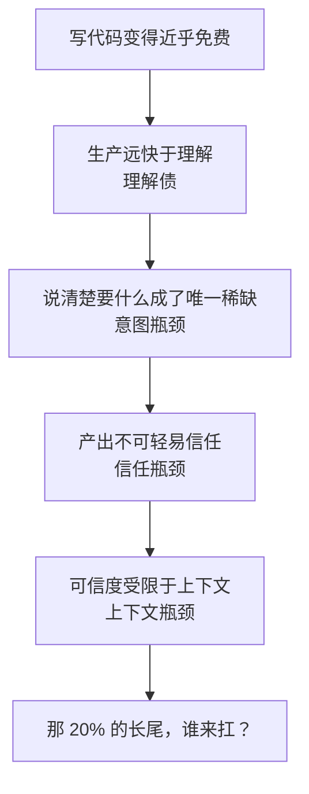

# 软件的成本大头，从来不在写代码

周五下午四点，刚入职三个月的新人往群里甩了个 PR：四千行代码，单测全绿，CI 一路放行。你点开想扫一眼就批，翻到第八百行手停住了。代码跑得通，可全组没有一个人真读懂过它。批，还是不批？

这一幕正在各地工程团队里天天重演，背后压着一个很现实的问题：AI 把写代码变便宜了这么多，做软件这件事真的跟着变便宜了吗？

我的答案是：几乎没有。

## 写代码从来不是最贵的一环

很多人对做软件有个直觉：写得越快，成本越低。这条等式把后面很多事都看歪了。

写代码只是把想清楚的结构翻译成语法，软件工程里真正花大钱的在别处：

- **长期维护账：**系统要跑好多年，图省事埋下的隐患几年后连本带利爆出来，这就是技术债。
- **多人协作与接口：**几十号人同时改一个大系统，你的改动不能撞坏别人的依赖。
- **需求演进：**业务随时在变，系统得改得动又不至于散架。

四十年前 Fred Brooks 在《没有银弹》里把复杂度拆成两半：**本质复杂度**是想清楚系统边界、模块关系和状态流转；**偶然复杂度**是把想法敲成代码。他下过一个判断，除非敲代码这类翻译工作占了九成以上工时，否则哪怕把敲代码压缩到零，做软件整体也快不了一个数量级[［No Silver Bullet］](https://worrydream.com/refs/Brooks_1986_-_No_Silver_Bullet.pdf)。

雇一个团队做系统，花大钱的是想清楚要什么、把结构设计对、再验证它没改坏东西，而不是打字速度。

## AI 恰好省掉了最不值钱的那段工时

AI 最拿手的是查语法、拼样板、写接口和搭脚手架。对照 Brooks 的切分，它几乎把偶然复杂度压到了零；可这部分本来就只占软件成本的小头。于是就出现了一个看起来矛盾的结果：代码生成确实快了，做软件的总成本却没怎么降。

一份汇总 67 项研究的综述把这个现象叫做「生产力—可靠性悖论」：在边界清楚的小任务上，个人效率能涨 20% 到 56%；可严谨随机对照实验里，资深工程师在成熟老项目上反而慢了 19%。

同一份综述里的万人级遥测更直观：合并代码量涨了 98%，评审时间跟着涨了 91%，可最终上线交付的功能数几乎持平[［The Productivity-Reliability Paradox］](https://arxiv.org/pdf/2605.01160)。

我管这笔账叫**验收税**：写代码省下的每一分钟，都会在下游读懂它、验证它、安全塞进系统时，被一分不少甚至翻倍收回去。

那篇综述还指出 AI 提不提效主要看三个条件：

- **任务熟不熟：**边界清晰、类似写法网上出现过一万遍的标准活，AI 提速明显。
- **老代码有多重：**历史包袱越重的项目，AI 越容易添乱拖慢节奏。
- **人手头干啥活：**资深工程师大半时间卡在本质复杂度上，AI 能替的很少。

## 成本没消失，只是搬到了验证环节

总成本下不来，是因为瓶颈从「生产代码」搬到了「理解、验证和集成」。写代码越便宜，下游要确认的事就越多。有篇研究评审瓶颈的文章讲得更直白：AI 压低了生成代码的成本，却抬高了信任代码的成本[［AI Code Generation Is Shifting the Bottleneck to Review］](https://www.theflock.com/en/content/blog-and-ebook/ai-code-generation-review-bottleneck)。

顺着往下看，下游一连冒出四个环环相扣的问题：

第一环是**理解债**。过去软件工程默认「谁写的代码谁懂」，现在生成和理解第一次分家了。Google 的 Addy Osmani 把系统中「存在的代码量」和「被人真懂的代码量」越拉越大的缺口叫理解债[［Comprehension Debt］](https://addyosmani.com/blog/comprehension-debt/)。

技术债好歹会用编译变慢、报错提醒你；理解债平时只给你「测试全绿」的假象，出事才连本带利找上来。更麻烦的是以前老手读代码比新手写得快，review 兜得住；现在新人靠 AI 生代码远快过老手审代码，闸门直接冲垮。

第二环是**意图说不清**。写代码不值钱以后，整条链上最稀缺的变成精确表达到底要什么。这两年「规格驱动开发」（Kiro、spec-kit、Tessl）冒头[［Understanding Spec-Driven Development］](https://martinfowler.com/articles/exploring-gen-ai/sdd-3-tools.html)，就是因为需求写糊了 AI 也跟着瞎补，说清意图成了硬手艺。

第三环是**不敢信**。人写的代码靠同事靠谱和 review 兜底；AI 吐出来的可能错得非常像模像样、一眼看不穿。你必须架起强单测、静态检查、沙箱和权限隔离，敢不敢放它跑，全看验证网织得密不密。

第四环，也是最硬的一环，是**上下文**。

## 啃不动那 20%，卡在上下文不在智力

很多人以为 AI 啃不动复杂项目，只是模型还不够聪明。可真正卡住的往往是那套系统独有、互联网语料里根本没有的上下文。

世界通用写法 AI 刷过上万遍，那是好啃的 80%；可大工程里真正决定生死的 20% 甚至 1%，全是具体的线上运维现实：幂等键、退避加抖动、避开长表锁的数据库迁移、限流器、熔断器和结构化日志[［The 80% Problem］](https://www.jonathanbeard.io/blog/2026/06/27/the-80-percent-problem.html)。

这些答案不在任何公开语料里，全在这套系统自己的运行时和几个老工程师脑子里。

所以那 20% 很难只靠等模型变聪明自己缩小，主要得靠人把系统文档、接口边界和可观测性做好。

## 想放手让 AI 跑，先补三道地基

想把 AI 真正用起来，重点在先把护栏和验证立稳：

- **圈死修改边界：**用类型系统、接口契约、模块权限划出安全区，出错也不至于把大局带翻。
- **把验证做便宜、做厚：**测试、CI、可观测性和灰度全跟上。验证跑得越快越省心，就越敢放手让 AI 生成。
- **把隐性知识写出来：**把老工程师脑子里没落纸面的约束、坑点和系统运行规则变成文档和规范，人能查，AI 也能直接读。

回头一看，圈边界、补测试、写文档，哪条不是人手写代码时就该做、只是一直偷懒省掉的老规矩？AI 只是把「不按规矩慢慢烂」变成了「速度一快当场出事」。

## 三个高估 AI 的常见说法

- **「规格驱动开发就是银弹」：**如果一份规格精确到能消除所有歧义、让 AI 百分百写对，那这份规格本身就已经是一种编程语言了。Brooks 早把这条退路封死过：难点不在怎么写出来，而在把复杂系统想清楚[［No Silver Bullet］](https://worrydream.com/refs/Brooks_1986_-_No_Silver_Bullet.pdf)。
- **「AI 会取代软件工程师」：**恰恰相反，AI 把架构纪律逼得更值钱了。前面那篇悖论综述开出的药方，就是把架构规则、契约和不变量压进紧凑文档里每次喂给模型[［The Productivity-Reliability Paradox］](https://arxiv.org/pdf/2605.01160)。说的还是好文档加硬边界那一套。
- **「剩下的 20% 会随模型变强自己消失」：**那是上下文稀缺，不是模型智商不足。答案没进过训练语料，模型再聪明也凭空变不出来。

## 老原则反而更值钱

退回软件工程经典坐标系看，AI 是史上最强的「偶然复杂度消除器」，但本质复杂度一寸没动，恰好反过来印证了四十年前《没有银弹》的判断。

几十个人各带 AI 飞快吐代码时，最容易塌掉的就是 Brooks 说的「概念完整性」。各写各的局部实现，系统很快四分五裂，守住整体抽象统一成了把关人的头号工作。

连读书风向也在跟着变：语法手册贬值，《数据密集型应用系统设计》《Release It!》这类讲系统设计与熔断退避的书反而更值钱了[［The 80% Problem］](https://www.jonathanbeard.io/blog/2026/06/27/the-80-percent-problem.html)。

还有一个躲不开的隐忧：工程手感断代。Anthropic 一项 52 人的对照实验发现，用 AI 写代码的组交差速度差不多，但事后理解测验低了 17 分，掉得最狠的是调试能力，而且把活全甩给 AI 的组退化最明显[［Comprehension Debt］](https://addyosmani.com/blog/comprehension-debt/)。

过去逼人啃那 20% 脏活的过程，恰恰长出了工程判断力。要是新人全靠 AI 绕过这一步，几年后半夜系统炸了，谁来定方向？

以后能留住高价值的工程师，大致分三类：

- **想得清楚要什么的：**能把一团模糊需求拆成没有歧义的精确规格。
- **看得出哪里不对的：**读得懂 AI 产出，一眼点破隐患，能扛住线上那 20% 长尾。
- **搭得出底座和防线的：**能把系统边界、监控和隐性知识做成可被人和 AI 共用的基础设施。

至于单纯敲代码快和背语法熟，这条曾经的护城河基本算平了。

## 不做老规矩，只是更快出事

AI 没有发明新的软件工程。它把敲代码压到近乎免费，顺手把整条链路的压力全都推到了理解、验收和没写进代码里的隐性知识上。

回到周五下午那个四千行全绿的 PR。批之前真正要签下的字，从来不是「它现在能不能跑」，而是「半夜出事时，有没有人读得懂它」。这个名字，谁签得上去？
