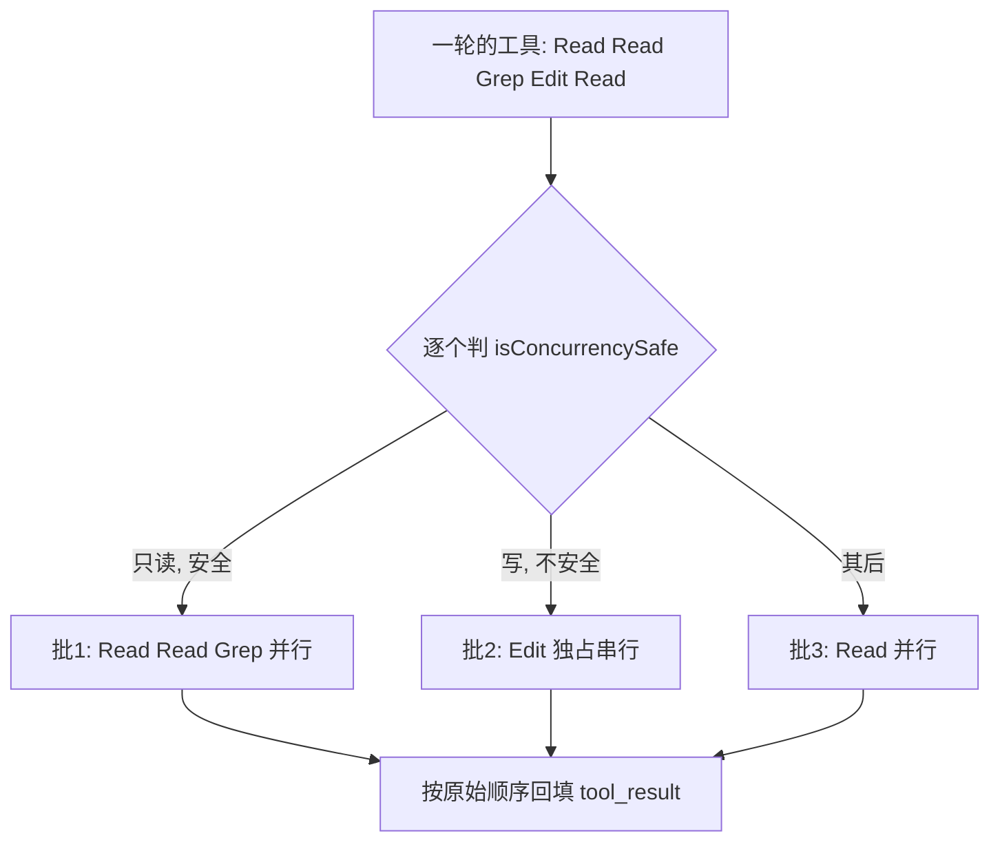

<callout emoji="💡">
**读法说明：**只讲道理像空谈，只抄源码像流水账。下面九条统一用真实源码做法推出设计取舍，把那段实现抽掉依然成立的套话，一律不写。
</callout>

# 收获一：能靠模型自己拐弯的逻辑，别硬写进代码

**源码做法：**反编译出来的 Agent 主循环就是一个函数 `nO`，里面只有一个 `while`：调模型、有工具请求就执行、塞回结果、再调模型，直到模型不再调工具为止[［Agent design lessons］](https://jannesklaas.github.io/ai/2025/07/20/claude-code-agent-design.html)。没有外层状态机，没有 DAG 调度器，也没有单独的规划层。

**能拿走的经验：**每次想给 Agent 加流程图或硬编码分支前，先问一句：模型再聪明一档后这段代码是不是全废了？如果是，尽量让主循环薄着留给模型发挥。

---

# 收获二：为了出事能定位，放弃花哨的多 Agent 网状架构

**源码做法：**全程只护一条扁平的 `messages` 数组，所有对话和工具进出顺序排队。哪怕派生子 Agent 去翻几十个文件，跑完也只把最后一条消息作为工具结果回填进主列表，过程留在子上下文里[［Subagents docs］](https://platform.claude.com/docs/en/agent-sdk/subagents)。

**能拿走的经验：**多智能体一旦连成网状调用，出 bug 极难复现；扁平日志虽然看着朴素，出问题时从头到尾顺一遍消息序列就能定位。

---

# 收获三：技术选型优先挑失败点少的笨办法

**源码做法：**Claude Code 找代码不上向量 RAG 索引，而是直接调 `grep` 和 `glob` 搜文件名与文本，找到后再按需读文件[［decoding-claude-code］](https://minusx.ai/blog/decoding-claude-code/)。

**能拿走的经验：**向量检索多出了切片、向量化和重排三处黑盒故障点，漏检了很难查为什么漏。确定性高、零状态依赖的朴素办法在工程上反而更好维护。

---

# 收获四：并发的难点不在发请求，在分批、保序与错误隔离

**源码做法：**同一轮里模型发出多个工具调用，源码没有直接用 `Promise.all` 一把发出去，而是做了三件事[［ch07-concurrency］](https://github.com/alejandrobalderas/claude-code-from-source/blob/main/book/ch07-concurrency.md)：

- 把只读的 Read 和 Grep 合并并行，写工具（如 Edit）单独串行独占。
- 结果严格按模型发出的原顺序回填，碰到没完的串行工具就先停等。
- 用三级 `AbortController` 控制错误范围：只有 Bash 出错才连带取消同批兄弟，读操作挂掉互不影响。

**能拿走的经验：**并发批处理前先按副作用分组，写后必读的依赖顺序决不能打乱：

---

# 收获五：省钱是设计出来的，不是最后靠换模型省出来的

**源码做法：**这里有两处实打实的架构省钱设计：

- 超过一半的重要辅助调用（读大文件、解析网页、压缩历史、生成会话标签，乃至 Bash 执行前安全预检）默认下沉给便宜小模型 Haiku[［decoding-claude-code］](https://minusx.ai/blog/decoding-claude-code/)。
- 压缩上下文命中缓存时，不直接改本地消息打废前缀，而是发送 `cache_edits` 通知服务端按 ID 外科式删旧结果，尽量保住 prompt 缓存[［Compaction Engine］](https://barazany.dev/blog/claude-codes-compaction-engine)。

**能拿走的经验：**做 Agent 的预算控制必须在架构设计期定好：按任务难度切分大小模型，改写历史时时刻算清会不会顺带打废提示词缓存。

---

# 收获六：长任务上下文按成本分层清理，别等到快爆才全部重总结

**源码做法：**压缩拆成两档[［Karan Prasad］](https://karanprasad.com/blog/how-claude-code-actually-works-reverse-engineering-512k-lines)：

- **微压缩：**每次发请求前直接把过早的工具输出清掉，只保留最近 5 条，其余换成 `[Old tool result content cleared]` 占位，不调模型也不改对话原文。
- **完整压缩：**等剩余容量真逼近 `autoCompactThreshold = 有效窗口 - 13000` 时再启动，让 LLM 按九段固定结构做一次全局摘要。

**能拿走的经验：**高频零成本清理过时工具输出，低频才动有损且花钱的模型摘要，比等到满窗一口气总结稳得多。

---

# 收获七：想限制某项能力，直接别放进工具列表

**源码做法：**早期的 Claude Code 不允许子 Agent 再派生子 Agent，它没有写递归计数器拦着，而是压根不给子 Agent 配 `Task` 或 `Agent` 工具，连搜索都搜不到[［Subagents docs］](https://platform.claude.com/docs/en/agent-sdk/subagents)。

后来 v2.1.172 决定放开限制，也只是把工具重新塞回可选集合。

**能拿走的经验：**给 Agent 划权限，最干净的做法是在工具可见性上做减法；模型看不见工具，提示词注入也无从借道调用。

---

# 收获八：放开命令行执行，安全上要叠多层网

**源码做法：**跑 Bash 命令前叠了三道卡子[［An Evening with Claude Code］](https://blog.xpnsec.com/An-Evening-with-Claude-Code/)，而没有花精力写完整 shell AST 解析器：

- **正则白名单：**例如 `git status` 规则明确排除 ``$ ` | & ;`` 等注入字符。
- **逐参数安全表：**通过 `safeCommandsAndArgs` 对 `sed`、`xargs` 逐参数核对。
- **小模型语义兜底：**把命令送给 Haiku 跑 `policy_spec` 语义排查，发现风险返回 `command_injection_detected` 并转回人工确认[［Claude Code Internals］](https://kirshatrov.com/posts/claude-code-internals)。

**能拿走的经验：**动真格跑本机命令不能赌单点防线。确定性规则挡明面危险，小模型抓语义伪装，再留最后一道人工确认收口。

---

# 收获九：Prompt 当工程资产管理，不靠碰运气调词

**源码做法：**反编译出的系统提示里有四个固定做法[［claude-code-reverse］](https://github.com/Yuyz0112/claude-code-reverse)：

- 工具描述里直接写死禁令和替代项（要求 Bash 避免用 `find` 和 `grep`，改走专门搜索工具）。
- 高危红线用大写绝对词钉死（如 `IMPORTANT: DO NOT ADD ***ANY*** COMMENTS unless asked` 和 `NEVER commit changes`）。
- 借助非用户输入的旁路通道 `<system-reminder>` 做运行时状态提醒（例如待办为空时提示使用 TodoWrite）。
- 一启动就注入工作目录、Git 状态和日期等 `<env>` 现场信息。

**能拿走的经验：**把工具使用边界、行为红线、动态提醒和环境上下文按结构拆开放，prompt 才能像代码一样迭代复盘。

---

# 一页速览：九条收获对照表

| 带走的经验 | 源码里对应的做法 |
|-|-|
| 能交给模型的逻辑别写进死代码 | 主循环 `nO` 就是单个 `while`，不套状态机和外部编排层 |
| 可调试性优先级高于花哨编排 | 只维系一条扁平 `messages` 列表，子 Agent 只返回最终结果 |
| 选型尽量少引看不见的失败环节 | 用 `grep` 和 `glob` 搜源码，不用容易黑盒出错的向量 RAG |
| 并发关键在分批、保序与错误隔离 | 按副作用拆组、按原始顺序回填，只有 Bash 失败连带取消同批兄弟 |
| 把成本控制做进架构设计 | 半数辅助任务切给 Haiku，历史编辑靠 `cache_edits` 护住缓存 |
| 上下文按损耗分档清理 | 微压缩高频清旧输出，快满窗再按九段结构触发全量摘要 |
| 用工具可见性限制能力 | 不直接把工具配给子 Agent，比执行层拦截更彻底 |
| 命令安全靠多层叠加 | 正则加逐参数白名单打头阵，小模型语义检测兜底 |
| 把 Prompt 拆成结构化工程组件 | 工具约束写进工具描述，动态提示走旁路通道，启动直注现场 |
